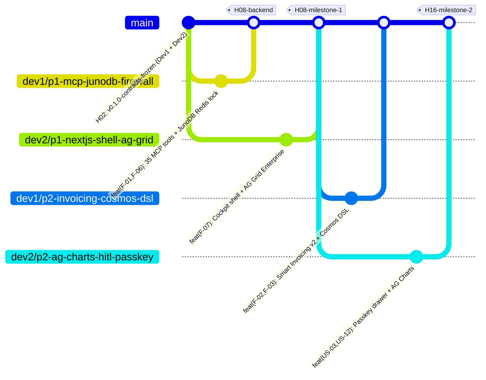

# 2-Member Zero-Conflict Implementation Plan (`IMPLEMENTATION_PLAN.md`)
> Project: PayOps AI (PayPal Sentinel) (`PS-01`) · Owner: 2-Member Core Engineering Team (`Dev 1` & `Dev 2`) · Status: Approved v1.0 · Last updated: 2026-11-06
> Related: [Project Brief](./docs/00-overview/PROJECT_BRIEF.md) · [Hackathon Plan (H01–H48)](./docs/00-overview/HACKATHON_PLAN.md) · [Backlog (TKT-001..036)](./docs/08-project/BACKLOG.md) · [Architecture](./docs/03-engineering/ARCHITECTURE.md) · [Frontend Spec](./docs/03-engineering/FRONTEND.md) · [Backend Spec](./docs/03-engineering/BACKEND.md) · [Git Workflow](./docs/03-engineering/GIT_WORKFLOW.md) · [Pitch Script](./docs/00-overview/PITCH.md)

---

## 1. Executive Summary & 2-Member Team Strategy ("Two Barrels, Zero Shared Mutable Files")

This implementation plan adapts the **PayOps AI (`PayPal Sentinel`, `PS-01`)** architecture into a **zero-merge-conflict parallel execution blueprint for a 2-developer team (`Dev 1` and `Dev 2`)** ahead of the **PayPal AI Hackathon** final submission deadline (**November 12, 2026 at 12:00 PM PT**).

### 1.1 Why 2-Person Hackathon Teams Get Merge Conflicts (And How We Eliminate Them)
In typical hackathon repos, two teammates repeatedly collide on five files:
1. `package.json` and `pnpm-lock.yaml` (installing packages on separate branches).
2. Shared TypeScript types (`packages/shared/src/index.ts`) edited simultaneously by frontend and backend.
3. Environment templates (`.env.example`) and root config (`tsconfig.json`).
4. Monolithic route registries (`server.ts`) or single-file UI dashboards (`page.tsx`).
5. Windows (`CRLF`) vs. macOS/Linux (`LF`) line-ending churn across commits.

**Our Structural Fix — Hardware-Level Directory Partitioning + Phase-0 Contract Freeze:**
- **Phase 0 (`H01–H02`, Joint 90-Minute Lock):** Both developers pair-program on `main` to lock all root manifests ([`package.json`](./package.json), [`pnpm-workspace.yaml`](./pnpm-workspace.yaml), `pnpm-lock.yaml`, [`.env.example`](./.env.example), [`.gitattributes`](./.gitattributes), [`.gitignore`](./.gitignore), [`LICENSE`](./LICENSE)), the OpenAPI 3.1 contract ([`api/openapi.yaml`](./api/openapi.yaml)), the shared entity & API contracts (`E-01`..`E-10`, `API-01`..`API-14` in [`packages/shared/src/entities.ts`](./packages/shared/src/entities.ts) and [`packages/shared/src/api-contracts.ts`](./packages/shared/src/api-contracts.ts)), and deterministic sandbox seed fixtures ([`scripts/seed-sandbox.ts`](./scripts/seed-sandbox.ts)).
- **Phase 1 to Phase 5 (`H03–H40`, 100% Disjoint Parallel Write Zones):**
  - **`Dev 1` (Backend, PayPal MCP Enclave, AI/Risk Engine & Cloud Infra Lead)** works **exclusively** inside `services/api/`, `ai/`, `scripts/`, `infra/`, `.github/workflows/`, [`packages/shared/src/policy-dsl.ts`](./packages/shared/src/policy-dsl.ts), and [`packages/shared/src/apimatic-validators.ts`](./packages/shared/src/apimatic-validators.ts).
  - **`Dev 2` (Frontend Cockpit, `AG Grid` + `Bryntum` Sponsor UI, Passkey UX & E2E Lead)** works **exclusively** inside `apps/web/`, `tests/e2e/`, and [`packages/shared/src/mock-fixtures.ts`](./packages/shared/src/mock-fixtures.ts).
- Because `Dev 1` and `Dev 2` **never edit the same file after `H02`**, Git merges (`git pull --rebase origin main` and PR merges into `main`) are mathematically guaranteed to fast-forward cleanly with **zero merge conflicts**.

---

### 1.2 The 2-Member Role Consolidation Matrix

Here is how the 4 logical roles from [`HACKATHON_PLAN.md`](./docs/00-overview/HACKATHON_PLAN.md) and [`TEAM.md`](./docs/08-project/TEAM.md) (`ENG-1`..`ENG-4`) map cleanly onto **`Dev 1`** and **`Dev 2`**:

| Developer | Consolidated Roles (`TEAM.md`) | Core Technical Ownership | Owned Features, APIs, Models & Tickets |
| :--- | :--- | :--- | :--- |
| **`Dev 1`**<br>*(Backend, PayPal MCP, AI/Risk & Infra Barrel)* | **`ENG-1`** (PayPal MCP & Backend Lead)<br>**`+ ENG-2`** (AI, `Cosmos.AI` DSL & `M-04` Risk Graph Lead)<br>**`+ ENG-4A`** (DB DDL, Render IaC & CI/CD) | • **PayPal Agentic Core**: `@paypal/agent-toolkit` (35 tools), `@paypal/mcp`, `@paypal/paypal-server-sdk`, OAuth2 enclave<br>• **Guardrails**: `Cosmos.AI` DSL Policy Firewall (`F-02`), `APIMatic` Schema Validator (`F-09`), `JunoDB` Redis 2PC Idempotency (`F-06`)<br>• **AI & Risk**: `M-01` (`Claude 3.5 Sonnet`/`GPT-4o`), `M-02` (`GPT-4o-mini` router/injection guard), `M-03` (`Gemini 1.5 Pro` OCR), `M-04` (`GraphSAGE + LightGBM` ONNX), `M-05` (`Elastic` RAG)<br>• **Data & Cloud**: PostgreSQL 16 (`E-01`..`E-10`), `PYUSD` Solana Token-2022 (`F-11`), `Channel3`/`Zapier` (`F-12`), `infra/render.yaml` | • **Features**: `F-01`, `F-02`, `F-03`, `F-04`, `F-05` (API), `F-06`, `F-09`, `F-10`, `F-11`, `F-12`<br>• **APIs**: `API-01`..`API-14` + `/api/v1/stream/events` + `/api/v1/health`<br>• **Entities**: `E-01`..`E-10` SQL/Drizzle & Redis state<br>• **Models**: `M-01`..`M-05`<br>• **Tickets**: `TKT-001` (co-own), `TKT-002`..`TKT-014`, `TKT-016`..`TKT-019`, `TKT-020` (API), `TKT-021`..`TKT-027`, `TKT-032`, `TKT-034`, `TKT-036` (co-own) |
| **`Dev 2`**<br>*(Frontend Cockpit, Sponsor UIs, Passkey & Demo Barrel)* | **`ENG-3`** (Principal Frontend, `AG Grid` & `Bryntum` Lead)<br>**`+ ENG-4B`** (Playwright/Vitest E2E, Demo Replay UI & `<3:00` Video Producer) | • **Frontend App (`apps/web`)**: Next.js 15 App Router, React 19, Tailwind CSS, Zustand, TanStack Query v5, SSE real-time consumer<br>• **Sponsor UI Tracks**: **AG Grid Enterprise 32.3 + AG Charts (`F-07`)**, **Bryntum Scheduler Pro 6.1 (`F-08`)**, **APIMatic SDK Code Export Drawer (`US-14`)**<br>• **PayPal Client SDKs**: `@paypal/react-paypal-js` (`Fastlane` guest acceleration, Smart Buttons, QR code modal, `PYUSD` settlement UI)<br>• **Security & Quality**: WebAuthn FIDO2 Passkey approval drawer (`API-02`), 5 UI states, WCAG 2.2 AA, multi-currency (`$`/`€`/`£`/`₹`/`PYUSD`), E2E specs & 4K `<3:00` video | • **Features**: `F-05` (Fastlane UI), `F-07`, `F-08`, plus Cockpit UIs for `F-01`..`F-04`, `F-09`..`F-12`<br>• **Stories**: `US-01`..`US-16` UX flows (primary lead on `US-03`, `US-10`, `US-12`..`US-15`)<br>• **Screens**: All 5 Core Screens (`UI_SPEC.md`)<br>• **Tickets**: `TKT-001` (co-own), `TKT-015`, `TKT-020` (UI), `TKT-028`..`TKT-031`, `TKT-033`, `TKT-035`, `TKT-036` (co-own) |

---

## 2. Strict File & Directory Ownership Matrix (Zero-Conflict Boundary)

To guarantee **zero Git merge conflicts**, every directory and file in `s:\PayPal` has a single designated Write Owner after the `H02` Contract Freeze:

```mermaid
flowchart LR
    subgraph SharedFreeze["Phase 0 (H01–H02): Locked on main (Co-Signed by Dev 1 + Dev 2)"]
        RootPkg["package.json + pnpm-workspace.yaml + pnpm-lock.yaml + .env.example + .gitattributes + LICENSE"]
        OpenAPI["api/openapi.yaml (API-01..API-14)"]
        SharedFrozen["packages/shared/src/{index,entities,api-contracts}.ts"]
    end

    subgraph Dev1Zone["Dev 1 Exclusive Write Zone (H03–H48)"]
        ApiSvc["services/api/ (Fastify 5, @paypal/agent-toolkit, JunoDB Lock, Drizzle DB)"]
        SharedDev1["packages/shared/src/{policy-dsl,apimatic-validators}.ts"]
        AiDir["ai/agents/paypal-mcp-config.json (35 Tools & M-01..M-05)"]
        Scripts["scripts/seed-sandbox.ts"]
        Infra["infra/render.yaml & .github/workflows/"]
    end

    subgraph Dev2Zone["Dev 2 Exclusive Write Zone (H03–H48)"]
        WebApp["apps/web/ (Next.js 15, AG Grid F-07, Bryntum F-08, Fastlane, Passkey UI)"]
        SharedDev2["packages/shared/src/mock-fixtures.ts"]
        E2ETests["tests/e2e/checkout-dispute.spec.ts & UI Playwright Specs"]
        DemoAssets["docs/00-overview/PITCH.md Demo Choreography & Video Assets"]
    end

    SharedFreeze --> Dev1Zone
    SharedFreeze --> Dev2Zone
    Dev1Zone -. "REST API-01..14 + SSE /api/v1/stream/events" .-> Dev2Zone
```



### 2.1 Complete Repository Ownership Table

| Path / Directory | Write Owner (`H03–H48`) | Read / Import Consumer | Conflict Prevention Rule |
| :--- | :---: | :---: | :--- |
| `apps/web/**` | **`Dev 2` (100%)** | `Dev 2` only | `Dev 1` NEVER edits any file under `apps/web/`. |
| `tests/e2e/**` | **`Dev 2` (100%)** | CI + Both Devs | `Dev 2` owns E2E test specs; `Dev 1` owns backend unit/eval tests under `services/api/src/**/__tests__/`. |
| `services/api/**` | **`Dev 1` (100%)** | `Dev 1` only | `Dev 2` NEVER edits any file under `services/api/`. |
| `ai/**` | **`Dev 1` (100%)** | `services/api` | `Dev 1` owns [`ai/agents/paypal-mcp-config.json`](./ai/agents/paypal-mcp-config.json) and model routing configs. |
| `scripts/**` | **`Dev 1` (100%)** | Both Devs | [`scripts/seed-sandbox.ts`](./scripts/seed-sandbox.ts) exports remain backward-compatible after `H02`. |
| `infra/render.yaml` | **`Dev 1` (100%)** | Render Cloud | `Dev 1` manages [`infra/render.yaml`](./infra/render.yaml) Blueprint services and environment variable groups. |
| `.github/workflows/**` | **`Dev 1` (100%)** | GitHub Actions | `Dev 1` maintains [`.github/workflows/ci.yml`](./.github/workflows/ci.yml) and [`.github/workflows/deploy.yml`](./.github/workflows/deploy.yml). |
| `api/openapi.yaml` | **Frozen at `H02`** *(Hot-Patch: `Dev 1`)* | Both Devs | Locked at `H02`. Any post-`H02` addition must follow Section 3.3 (additive-only on `main`). |
| `packages/shared/package.json` & `tsconfig.json` | **Frozen at `H01`** | Workspace Build | Declares sub-path exports (`.`, `./entities`, `./api-contracts`, `./policy-dsl`, `./apimatic-validators`, `./mock-fixtures`). |
| `packages/shared/src/index.ts` | **Frozen at `H02`** | `services/api` & `apps/web` | Barrel file re-exporting all 5 modules. Never edited on feature branches. |
| `packages/shared/src/entities.ts` | **Frozen at `H02`** | `services/api` & `apps/web` | Contains canonical TypeScript/Zod schemas for [`E-01`..`E-10`](./packages/shared/src/entities.ts). Frozen at `H02`. |
| `packages/shared/src/api-contracts.ts` | **Frozen at `H02`** | `services/api` & `apps/web` | Contains request/response types for [`API-01`..`API-14`](./packages/shared/src/api-contracts.ts) and SSE payloads. Frozen at `H02`. |
| `packages/shared/src/policy-dsl.ts` | **`Dev 1` (100%)** | `services/api` & `apps/web` | Isolated file ([`policy-dsl.ts`](./packages/shared/src/policy-dsl.ts)) inside `packages/shared` for `Cosmos.AI` Policy Firewall (`F-02`). |
| `packages/shared/src/apimatic-validators.ts` | **`Dev 1` (100%)** | `services/api` & `apps/web` | Isolated file ([`apimatic-validators.ts`](./packages/shared/src/apimatic-validators.ts)) inside `packages/shared` for `APIMatic` SDK validation (`F-09`). |
| `packages/shared/src/mock-fixtures.ts` | **`Dev 2` (100%)** | `apps/web` & `tests/e2e` | Isolated file ([`mock-fixtures.ts`](./packages/shared/src/mock-fixtures.ts)) exporting deterministic UI fixtures so `Dev 2` never touches `Dev 1`'s files. |
| `package.json`, `pnpm-workspace.yaml` & `pnpm-lock.yaml` | **Frozen at `H01`** | Both Devs | All dependencies (`AG Grid`, `Bryntum`, `Fastify`, `@paypal/agent-toolkit`, `Solana`, `ONNX`, `Elastic`) are pre-configured. Run `pnpm install` once at `H01`. |
| `.env.example`, `.gitattributes`, `.gitignore`, `LICENSE` | **Frozen at `H01`** | Both Devs | Root [`.env.example`](./.env.example) is partitioned into Sections 1–7 (`Dev 1`) and Section 8 (`Dev 2`). [`.gitattributes`](./.gitattributes) enforces `eol=lf`. [`LICENSE`](./LICENSE) satisfies `R-12`. |
| `docs/**`, `MAP.md`, `README.md`, `CLAUDE.md` | **Read-Only Reference** | Both Devs + `verify_deliverables.py` | Do not delete sections or introduce placeholder markers; always run `python "s:\PayPal\tests\verify_deliverables.py"` after any doc update. |

---

### 2.2 The 3 Golden Rules to Guarantee Zero Git Conflicts

1. **Rule 1 — Never Install Dependencies on a Feature Branch Without a 2-Minute Sync:**
   - All required packages (`ag-grid-enterprise`, `@bryntum/scheduler-react`, `@paypal/react-paypal-js`, `@paypal/agent-toolkit`, `@paypal/paypal-server-sdk`, `fastify`, `drizzle-orm`, `ioredis`, `onnxruntime-node`, `@solana/web3.js`, `@elastic/elasticsearch`, `zod`, `vitest`, `@playwright/test`) are **already pre-configured** in [`package.json`](./package.json), [`apps/web/package.json`](./apps/web/package.json), [`services/api/package.json`](./services/api/package.json), and [`packages/shared/package.json`](./packages/shared/package.json).
   - If either developer needs an extra npm package mid-hackathon:
     1. Ping your teammate: *"Adding `<pkg>` to `apps/web` on `main`—hold lockfile edits for 60 seconds."*
     2. Checkout `main`, pull, run `pnpm --filter @payops/web add <pkg>`, commit `package.json` + `pnpm-lock.yaml`, and push directly to `main`.
     3. Both devs run `git fetch origin && git rebase origin/main && pnpm install --frozen-lockfile`.
2. **Rule 2 — Enforce `.gitattributes` Line Endings (`LF`) Across Windows & macOS:**
   - Root [`.gitattributes`](./.gitattributes) enforces `* text=auto eol=lf` across `.ts`, `.tsx`, `.json`, `.yaml`, `.md`, and `.py` files (while marking `.pdf` and `.onnx` as `binary`) so Windows PowerShell (`CRLF`) and macOS/Linux (`LF`) never create whole-file diff collisions.
3. **Rule 3 — Barrel Exports in `packages/shared` Use Separate Files:**
   - Never have both developers edit [`packages/shared/src/index.ts`](./packages/shared/src/index.ts) at the same time. `index.ts` is locked at `H02`:
     ```typescript
     export * from "./entities.js";
     export * from "./api-contracts.js";
     export * from "./policy-dsl.js";
     export * from "./apimatic-validators.js";
     export * from "./mock-fixtures.js";
     ```
   - After `H02`, `Dev 1` only edits `packages/shared/src/policy-dsl.ts` and `packages/shared/src/apimatic-validators.ts`, while `Dev 2` only edits `packages/shared/src/mock-fixtures.ts`.

---

## 3. Phase-0 Shared Contract Freeze & Mock-to-Live Bridge (`H01–H02`)

So that **`Dev 2` (Frontend)** can build all 5 screens at full speed starting at `H03` without waiting for **`Dev 1` (Backend)** to finish Fastify routes or PayPal Sandbox OAuth plumbing, both developers agree on the **Client API Adapter Pattern** in `apps/web/src/lib/api-client.ts`.

### 3.1 Dual-Mode Frontend API Client (`mock` vs `live` vs `replay`)

`Dev 2` configures `apps/web/src/lib/api-client.ts` to read `NEXT_PUBLIC_API_MODE` (defined in Section 8 of [`.env.example`](./.env.example)):
- **`NEXT_PUBLIC_API_MODE=mock` (`H03–H08`)**: Returns deterministic, typed responses from [`packages/shared/src/mock-fixtures.ts`](./packages/shared/src/mock-fixtures.ts) and [`scripts/seed-sandbox.ts`](./scripts/seed-sandbox.ts) (`MOCK_WORKSPACES`, `MOCK_INVOICES`, `MOCK_DISPUTES`) with simulated `120ms` latency and synthetic SSE `execution_delta` events.
- **`NEXT_PUBLIC_API_MODE=live` (`H08–H48`)**: Calls `Dev 1`'s Fastify server (`http://localhost:4000/api/v1/...` or Render `https://payops-api.onrender.com/api/v1/...`) connected to `https://api-m.sandbox.paypal.com`.
- **`NEXT_PUBLIC_API_MODE=replay` (Demo Safety Net `R-06`)**: Automatically activates if PayPal Sandbox returns `HTTP 429` or exceeds `2,500ms` during live judging, serving signed Sandbox HTTP transcripts with zero UI interruption.

### 3.2 Frozen REST & SSE Endpoint Contract (`API-01` to `API-14`)

Both developers bind strictly to the paths, HTTP methods, and JSON shapes in [`api/openapi.yaml`](./api/openapi.yaml), [`packages/shared/src/api-contracts.ts`](./packages/shared/src/api-contracts.ts), and [`docs/03-engineering/API_SPEC.md`](./docs/03-engineering/API_SPEC.md):

| API ID | Method & Path | `Dev 1` Backend Module (`services/api/src/modules/`) | `Dev 2` Frontend Consumer (`apps/web/src/`) |
| :--- | :--- | :--- | :--- |
| **`API-01`** | `POST /api/v1/agent/execute` | `agent-orchestrator/execute.route.ts` (`M-02 → M-01 → F-09 → F-02 → F-06`) | `components/agent/GlobalCommandBar.tsx` & `McpToolTraceDrawer.tsx` |
| **`API-02`** | `POST /api/v1/agent/approve/{executionId}` | `agent-orchestrator/approve.route.ts` (WebAuthn Passkey / Ed25519 verify) | `components/agent/HitlApprovalCard.tsx` & `hooks/useHitlSignature.ts` |
| **`API-03`** | `GET` & `PUT /api/v1/policies` | `policy-firewall/policies.route.ts` (`Cosmos.AI` DSL CRUD & `L0–L4` slider) | `app/(cockpit)/policy-studio/page.tsx` |
| **`API-04`** | `POST /api/v1/invoices/autonomous` | `invoicing/autonomous-invoice.route.ts` (`create_invoice`, `send_invoice`, QR, rules) | `app/(cockpit)/invoicing-scheduler/page.tsx` & `InvoiceQrModal.tsx` |
| **`API-05`** | `GET /api/v1/invoices` | `invoicing/list-invoices.route.ts` (aging, conditional rules, recurring series) | `components/ag-grid/LedgerCommandGrid.tsx` & `ReceivablesTimeline.tsx` |
| **`API-06`** | `POST /api/v1/invoices/{invoiceId}/remind` | `invoicing/remind-invoice.route.ts` (`send_invoice_reminder` + 72h velocity guard) | `components/bryntum/ReceivablesTimeline.tsx` (`onEventDrop` handler) |
| **`API-07`** | `POST /api/v1/orders` | `orders-checkout/create-order.route.ts` (`create_order` + `PayPal-Request-Id` lock) | `components/paypal/FastlaneCheckoutIsland.tsx` (`createOrder` callback) |
| **`API-08`** | `POST /api/v1/orders/{orderId}/capture` | `orders-checkout/capture-order.route.ts` (`pay_order` + `create_shipment_tracking`) | `components/paypal/FastlaneCheckoutIsland.tsx` (`onApprove` callback) |
| **`API-09`** | `POST /api/v1/orders/{orderId}/refund` | `orders-checkout/refund-order.route.ts` (`create_refund` gated by `F-02` + `M-04`) | `components/ag-grid/LedgerCommandGrid.tsx` (Inline Refund Action) |
| **`API-10`** | `GET /api/v1/disputes` | `disputes/list-disputes.route.ts` (`list_disputes` + `M-04` GNN + carrier tracking) | `app/(cockpit)/dispute-war-room/page.tsx` & `DisputeDetailRenderer.tsx` |
| **`API-11`** | `POST /api/v1/disputes/{disputeId}/resolve` | `disputes/resolve-dispute.route.ts` (`accept_dispute_claim` or Compelling Evidence) | `app/(cockpit)/dispute-war-room/page.tsx` (1-Click Contest / Auto-Accept) |
| **`API-12`** | `POST /api/v1/subscriptions/plans` | `subscriptions/plans.route.ts` (`create_product`, `create_subscription_plan`) | `app/(cockpit)/invoicing-scheduler/page.tsx` (Recurring Series & Plans) |
| **`API-13`** | `POST /api/v1/webhooks/paypal` | `webhooks/paypal-webhook.route.ts` (RSA-SHA256 verify + BullMQ worker dispatch) | `components/agent/WebhookSimulatorToolbar.tsx` (1-Click Judge Trigger) |
| **`API-14`** | `GET /api/v1/analytics/insights` | `analytics/insights.route.ts` (`get_merchant_insights` + DSO & dispute ROI) | `app/(cockpit)/command-center/page.tsx` (Top KPI Cards & AG Charts) |
| **`SSE-01`** | `GET /api/v1/stream/events` | `stream/sse.route.ts` (Real-time `execution_delta`, `dispute_alert`, `policy_hold`) | `hooks/useSseExecutionStream.ts` (`gridApi.applyTransactionAsync`) |

### 3.3 Post-`H02` Additive Contract Amendment Protocol (Zero-Conflict Schema Evolution)

If `Dev 1` and `Dev 2` discover mid-sprint (after `H02`) that an endpoint in [`packages/shared/src/api-contracts.ts`](./packages/shared/src/api-contracts.ts), an entity in [`packages/shared/src/entities.ts`](./packages/shared/src/entities.ts), a path in [`api/openapi.yaml`](./api/openapi.yaml), or a variable in [`.env.example`](./.env.example) needs an update, **neither developer edits those frozen files on a `dev1/*` or `dev2/*` feature branch**. Instead, follow this **2-Minute Atomic Contract Hot-Patch on `main`**:

1. **Additive-Only Rule:** Never rename, delete, or change the type of an existing field in `entities.ts`, `api-contracts.ts`, or `api/openapi.yaml`. Always add new fields as **optional (`fieldName?: Type`)** first so neither `services/api` nor `apps/web` breaks on compile.
2. **Single-Driver Hot-Patch on `main`:** `Dev 1` stashes active work (`git stash`), checks out `main` (`git checkout main && git pull`), applies the additive field to `packages/shared/src/api-contracts.ts` (and `api/openapi.yaml`), verifies `pnpm --filter @payops/shared run typecheck`, commits (`git commit -m "chore(API-10): add optional carrierPodUrl to PayPalDisputeCase"`), and pushes directly to `main`.
3. **Immediate Rebase by Both Devs:** Both `Dev 1` and `Dev 2` immediately run `git fetch origin && git rebase origin/main` on their active feature branches (and `git stash pop`). Because neither feature branch touched `api-contracts.ts`, the rebase applies with **zero conflicts**.

---

## 4. Git Branching, PR & Sync Protocol for 2 Developers

To keep `main` 100% green and continuously deployable to **Render** ([`infra/render.yaml`](./infra/render.yaml)):



### 4.1 Branch Naming Convention
- **`Dev 1` Branches:** Always prefix with `dev1/<phase>-<feature-ids>-<slug>`
  - `dev1/p1-F01-F06-mcp-junodb`
  - `dev1/p2-F02-F03-cosmos-invoicing`
  - `dev1/p3-F04-F10-disputes-gnn`
  - `dev1/p4-F05-F11-F12-orders-pyusd`
  - `dev1/p5-R06-replay-render-deploy`
- **`Dev 2` Branches:** Always prefix with `dev2/<phase>-<feature-ids>-<slug>`
  - `dev2/p1-F07-cockpit-ag-grid`
  - `dev2/p2-US03-US12-hitl-invoicing-ui`
  - `dev2/p3-F08-bryntum-dispute-war-room`
  - `dev2/p4-F05-F11-fastlane-pyusd-ui`
  - `dev2/p5-e2e-polish-demo-video`

### 4.2 Exact 5-Step Sync Ritual at Every 8-Hour Milestone Gate (`H08, H16, H24, H32, H40`)
Because `Dev 1` only touches `services/api/`, `ai/`, `scripts/`, `infra/`, `.github/`, `packages/shared/src/policy-dsl.ts`, and `packages/shared/src/apimatic-validators.ts` while `Dev 2` only touches `apps/web/`, `tests/e2e/`, and `packages/shared/src/mock-fixtures.ts`, syncing takes **under 90 seconds**:

```bash
# Step 1: Verify your local workspace compiles & passes lint before committing
pnpm -r run typecheck && pnpm run lint

# Step 2: Stage ONLY your owned paths (prevents accidental stray file commits)
# For Dev 1:
git add services/api ai scripts infra .github packages/shared/src/policy-dsl.ts packages/shared/src/apimatic-validators.ts
# For Dev 2:
git add apps/web tests/e2e packages/shared/src/mock-fixtures.ts

# Step 3: Commit using Conventional Commits with canonical IDs
git commit -m "feat(F-03): implement autonomous smart invoicing v2 with QR and Net-10 discount"

# Step 4: Fetch and rebase onto latest main (0 conflicts guaranteed by file/directory split)
git fetch origin
git rebase origin/main

# Step 5: Push branch and merge to main (via GitHub PR or fast-forward merge)
git push origin HEAD
```

---

## 5. Complete Coverage Matrix Across All Canonical IDs

This section verifies that **every single Feature (`F-01`..`F-12`), User Story (`US-01`..`US-16`), Data Entity (`E-01`..`E-10`), API (`API-01`..`API-14`), AI Model (`M-01`..`M-05`), Risk (`R-01`..`R-12`), ADR (`ADR-0001`..`ADR-0005`), and Sponsor Track** has clear `Dev 1` and `Dev 2` implementation tasks.

### 5.1 Features (`F-01` to `F-12`) Split Between `Dev 1` and `Dev 2`

| Feature ID | Feature Name & MoSCoW | `Dev 1` (Backend / AI / MCP / Infra) Implementation | `Dev 2` (Frontend / AG Grid / Bryntum / E2E) Implementation |
| :--- | :--- | :--- | :--- |
| **`F-01`** | **PayPal MCP & `@paypal/agent-toolkit` Unified Agent Orchestrator** (`Must`) | Configure `ai/agents/paypal-mcp-config.json` (all 35 tools across 7 domains); build `services/api/src/modules/agent-orchestrator/` hosting `@paypal/agent-toolkit` + OAuth2 token enclave + `M-01`/`M-02` routing (`API-01`). | Build global `Cmd+K` **Agent Command Bar** (`GlobalCommandBar.tsx`) and real-time **MCP Tool Execution Trace Drawer** (`McpToolTraceDrawer.tsx`) consuming SSE `/api/v1/stream/events`. |
| **`F-02`** | **Deterministic Spend & Risk Policy Firewall (`Cosmos.AI` DSL)** (`Must`) | Build `packages/shared/src/policy-dsl.ts` AST evaluator + `services/api/src/modules/policy-firewall/` enforcing single-tx caps (`$250`/`$500`), 24h velocity caps, `M-04` risk threshold (`0.35`), and `L0–L4` autonomy (`API-02`, `API-03`). | Build **Screen 2: Policy Studio** (`policy-studio/page.tsx`) with Karpathy `L0–L4` Autonomy Slider, rule editor, dry-run preview badge, and **1-Click WebAuthn Passkey Approval Card** (`HitlApprovalCard.tsx`). |
| **`F-03`** | **Autonomous Smart Invoicing & AR Collections Agent** (`Must`) | Implement `services/api/src/modules/invoicing/` calling `generate_invoice_number`, `create_invoice`, `send_invoice`, `generate_invoice_qr_code`, `create_conditional_rules_for_invoice`, `send_invoice_reminder`, `record_payment_for_invoice`, and `create_recurring_series` (`API-04`..`API-06`). | Build **Smart Invoicing Drawer & QR Modal** (`InvoiceQrModal.tsx`) rendering live SVG/PNG PayPal QR code, 2% early-payment discount badge, and age-tiered dunning controls. |
| **`F-04`** | **Autonomous Dispute & Chargeback Defense Agent** (`Must`) | Implement `services/api/src/modules/disputes/` & `webhooks/` handling `CUSTOMER.DISPUTE.CREATED` (`API-13`), calling `list_disputes`, `get_dispute`, `get_shipment_tracking`, `accept_dispute_claim`, and assembling Compelling Evidence bundles with `M-03` OCR + `M-05` RAG (`API-10`, `API-11`). | Build **Screen 4: Autonomous Dispute Defense War-Room** (`dispute-war-room/page.tsx`) with SLA countdown timers, carrier delivery proof viewer, and 1-click Webhook Simulator Toolbar. |
| **`F-05`** | **Agentic B2B Procurement, Catalog & Order Checkout Flow** (`Must`) | Implement `services/api/src/modules/orders-checkout/` orchestrating `create_product`, `list_products`, `create_order` (`intent: "AUTHORIZE"` / `"CAPTURE"`), `get_order`, `pay_order`, `create_refund`, and `create_shipment_tracking` (`API-07`..`API-09`). | Build **Screen 5: Checkout & Procurement Island** (`FastlaneCheckoutIsland.tsx`) integrating `@paypal/react-paypal-js` (`Fastlane` guest checkout + Smart Payment Buttons + Venmo). |
| **`F-06`** | **Idempotent Financial State Ledger (`JunoDB` + `PayPal-Request-Id`)** (`Must`) | Build `services/api/src/modules/junodb-idempotency/` implementing UUIDv5/SHA-256 `computeDeterministicIdempotencyKey()`, Redis `SET NX EX 86400` 2PC lease, and PostgreSQL unique constraint on `E-04`. | Display `PayPal-Request-Id` idempotency badge, cache-hit indicator (`ACQUIRED` vs `REPLAYED_FROM_JUNODB`), and hash-chain verification badge in AG Grid master-detail rows. |
| **`F-07`** | **Executive Financial Command Center with `AG Grid`** (`Must`) | Expose high-throughput filterable data feeds on `API-05`, `API-10`, `API-14` and push sub-50ms `execution_delta` events over SSE (`/api/v1/stream/events`). | Build **Screen 1: AG Grid Enterprise Command Center** (`LedgerCommandGrid.tsx`) with `masterDetail`, `enableCharts` (**AG Charts Enterprise** cash-flow waterfall & DSO aging), row grouping, and `applyTransactionAsync` 60fps streaming. |
| **`F-08`** | **Receivables, Subscription & Settlement Scheduler with `Bryntum`** (`Must`) | Implement `API-06` dunning reschedule handler and `API-12` subscription lifecycle (`create_subscription_plan`, `create_subscription`, `update_subscription`). | Build **Screen 3: Bryntum Scheduler Pro Timeline** (`ReceivablesTimeline.tsx` via `next/dynamic({ ssr: false })`) with drag-and-drop invoice dunning bars (`onEventDrop` → `API-06`) and resource cash-flow histogram. |
| **`F-09`** | **Deterministic `APIMatic` Context Plugin & SDK Validator** (`Should`) | Build `packages/shared/src/apimatic-validators.ts` enforcing 2-decimal string amounts (`"2450.00"`), ISO-4217 currency codes, and generating verified TypeScript/Python PayPal Server SDK snippets. | Build **APIMatic SDK Code Drawer** (`ApimaticSdkCodeDrawer.tsx`) inside the Command Bar and Invoicing Drawer allowing judges to copy/export verified TypeScript & Python SDK code (`US-14`). |
| **`F-10`** | **Real-Time Multi-Hop Buyer-Merchant Risk Graph Scorer (`GNN`)** (`Should`) | Build `services/api/src/modules/gnn-scorer/` running `payops-graphsage-lgbm-v1.2.onnx` (`M-04`) over 2-hop buyer-seller-carrier Mirror Graph features in `<18ms` with TreeSHAP reason codes. | Build interactive **3-Hop Buyer-Merchant-Carrier Risk Graph Card** and TreeSHAP reason badges (`GnnRiskSparklineCell.tsx`) inside AG Grid and Dispute War-Room. |
| **`F-11`** | **Cross-Border Supplier Payouts & `PYUSD` Solana Token-2022 Bridge** (`Could`) | Build `services/api/src/modules/pyusd-bridge/` generating Solana Token-2022 `PYUSD` (`2b1kV6DkPAnxd5ixfnxCpjxmKwqjjaYmCZfHsFu24GXo`) transfers enforcing `Memo Required` (`invoice_id` + `PayPal-Request-Id`) and calling `record_payment_for_invoice`. | Build **PYUSD Solana Settlement Modal** (`PyusdSolanaBridgeModal.tsx`) showing wire-fee vs Solana fee comparison (`$48.00 → $0.001`), Token-2022 `Memo Required` badge, and on-chain explorer receipt. |
| **`F-12`** | **Multi-Channel Commerce Discovery & Fulfillment (`Channel3` + `Zapier` + `Elastic`)** (`Could`) | Integrate **Channel3** SKU discovery in `orders-checkout`, index `ImmutableAuditLog` (`E-10`) & policy RAG (`M-05`) in **Elastic Cloud**, and fire **Zapier** webhooks on `HOLD_APPROVAL`. | Build **Channel3 B2B Catalog Search Bar** on Screen 5 and **Elastic Audit Trail & Telemetry Inspector** badge in the Command Center footer. |

---

### 5.2 User Stories (`US-01` to `US-16`) Ownership & Verification Mapping

| Story ID | Mapped Features | Primary Owner | Co-Owner | Verifiable Acceptance Gate (`tests/e2e/checkout-dispute.spec.ts`) |
| :--- | :---: | :---: | :---: | :--- |
| **`US-01`** | `F-01`, `F-02` | `Dev 1` (`API-01`) | `Dev 2` (`Cmd+K` UI) | Natural-language command executes multi-step MCP plan and streams live tool trace via SSE. |
| **`US-02`** | `F-01`, `F-02` | `Dev 1` (`policy-dsl.ts`) | `Dev 2` (`PolicyStudio`) | Setting `dry_run: true` evaluates `Cosmos.AI` DSL rules and returns preview without mutating Sandbox. |
| **`US-03`** | `F-01`, `F-02` | `Dev 2` (WebAuthn UI) | `Dev 1` (`API-02`) | Refund `>$250` (strict) / `>$500` (default) enters `HELD_FOR_L2_PASSKEY` until signed via FIDO2 Passkey. |
| **`US-04`** | `F-03` | `Dev 1` (`API-04`) | `Dev 2` (`InvoiceQrModal`) | Generates invoice number, creates & sends PayPal Invoice v2, and renders scannable QR code. |
| **`US-05`** | `F-03` | `Dev 1` (`API-04`) | `Dev 2` (`ReceivablesTimeline`) | Attaches 2% early-payment discount / 1.5% late-fee conditional rule and activates recurring series. |
| **`US-06`** | `F-03` | `Dev 1` (`API-06`) | `Dev 2` (AG Grid / Bryntum) | Sends dunning reminder (`send_invoice_reminder`), enforces 72h cooldown, and reconciles external payment. |
| **`US-07`** | `F-04`, `F-10` | `Dev 1` (`API-13`, `M-03`) | `Dev 2` (`WebhookSimulator`) | Ingests `CUSTOMER.DISPUTE.CREATED` webhook and correlates `get_dispute` + `get_shipment_tracking` + OCR. |
| **`US-08`** | `F-04`, `F-10` | `Dev 1` (`M-04` ONNX) | `Dev 2` (Risk Graph UI) | Scores 2-hop buyer-seller-carrier graph in `<18ms` and outputs `gnnRiskScore` + TreeSHAP reason codes. |
| **`US-09`** | `F-04`, `F-10` | `Dev 1` (`API-11`) | `Dev 2` (`DisputeWarRoom`) | Auto-accepts low-value valid claim (`<=$25`) or contests high-GNN friendly fraud (`DELIVERED`) with evidence. |
| **`US-10`** | `F-05`, `F-06` | `Dev 2` (`Fastlane` UI) | `Dev 1` (`API-07`, `API-08`) | Creates & captures PayPal Order v2 with `PayPal-Request-Id` idempotency and `Fastlane` guest checkout. |
| **`US-11`** | `F-05`, `F-06` | `Dev 1` (`API-08`, `API-09`) | `Dev 2` (AG Grid Actions) | Attaches carrier tracking (`create_shipment_tracking`) and executes policy-guarded refund (`create_refund`). |
| **`US-12`** | `F-07` | `Dev 2` (`AG Grid`) | `Dev 1` (`API-05`, `SSE-01`) | Groups, filters, charts, and bulk-triages 10,000+ rows in **AG Grid Enterprise** at 60fps. |
| **`US-13`** | `F-08` | `Dev 2` (`Bryntum`) | `Dev 1` (`API-06`, `API-12`) | Dragging an invoice dunning bar on **Bryntum Scheduler** updates PayPal Invoice rules via `API-06`. |
| **`US-14`** | `F-09` | `Dev 1` (`apimatic-validators`) | `Dev 2` (`ApimaticDrawer`) | Validates 2-decimal string payloads and exports copy-ready TypeScript & Python SDK code snippets. |
| **`US-15`** | `F-11` | `Dev 1` (`pyusd-bridge`) | `Dev 2` (`PyusdModal`) | Settles cross-border invoice via Solana Token-2022 `PYUSD` with mandatory `invoice_id` memo verification. |
| **`US-16`** | `F-12` | `Dev 1` (`Channel3`/`Elastic`) | `Dev 2` (Catalog Search UI) | Discovers B2B SKU via **Channel3**, indexes audit chain in **Elastic**, and fires **Zapier** webhook. |

---

### 5.3 Data Entities (`E-01` to `E-10`) & AI Models (`M-01` to `M-05`) Ownership

| ID | Canonical Name | `Dev 1` Storage & AI Implementation | `Dev 2` UI State & Component Binding |
| :--- | :--- | :--- | :--- |
| **`E-01`** | `MerchantWorkspace` | PostgreSQL `merchants` table + seed workspace `ws_99102a` & `ws_88410b`. | Top-bar workspace selector, base currency (`USD`/`INR`/`EUR`/`GBP`), and `L0–L4` autonomy badge. |
| **`E-02`** | `OperatorUser` | PostgreSQL `operator_users` table + RBAC middleware (`OWNER`, `FINANCE_ADMIN`, `AUDITOR`, `AGENT_SERVICE`). | Role switcher in Demo Toolbar + WebAuthn FIDO2 Passkey signing hook (`useHitlSignature.ts`). |
| **`E-03`** | `AgentSession` | PostgreSQL `agent_sessions` + Redis session budget tracker (`max_tool_hops = 6`, `$0.25` cap, `R-10`). | Command Bar session history, active hop counter (`Step 2 of 6`), and OpenTelemetry `trace_id` link. |
| **`E-04`** | `AgentToolExecution` | Redis `junodb:lease:{PayPal-Request-Id}` + PostgreSQL `agent_tool_executions` table. | Primary row model for **AG Grid Enterprise** (`LedgerCommandGrid.tsx`) and SSE stream deltas. |
| **`E-05`** | `PolicyRule` | PostgreSQL `policy_rules` + `packages/shared/src/policy-dsl.ts` AST compiler. | **Screen 2: Policy Studio** rule cards, threshold sliders, and counterfactual backtest preview. |
| **`E-06`** | `PayPalOrderRecord` | PostgreSQL `paypal_orders` + Luhn PAN scrubber (`R-07`). | Order rows in AG Grid + **Screen 5: Fastlane Checkout Island** & tracking status pill. |
| **`E-07`** | `PayPalInvoiceRecord` | PostgreSQL `paypal_invoices` + conditional discount/late-fee JSON & QR URI. | **Screen 3: Bryntum Receivables Timeline** bars + `InvoiceQrModal.tsx`. |
| **`E-08`** | `PayPalDisputeCase` | PostgreSQL `paypal_disputes` + `gnn_risk_score` + carrier tracking correlation. | **Screen 4: Dispute War-Room** cards + AG Grid SLA countdown & TreeSHAP badges. |
| **`E-09`** | `SubscriptionPlanRecord` | PostgreSQL `subscription_plans` + PayPal Catalog & Billing Plan sync (`API-12`). | **Screen 3: Bryntum Scheduler** recurring billing cycle lanes. |
| **`E-10`** | `ImmutableAuditLog` | PostgreSQL `immutable_audit_logs` (append-only trigger + SHA-256 hash chain) + **Elastic** 180-day index. | Cryptographic `prev_hash → entry_hash` verification drawer in AG Grid Master-Detail view. |
| **`M-01`** | `Claude 3.5 Sonnet` / `GPT-4o` | `services/api/src/ai/m01-orchestrator.ts` (35-tool JSON planner with prompt caching & failover). | Live reasoning stream & tool-call cards in `McpToolTraceDrawer.tsx`. |
| **`M-02`** | `GPT-4o-mini` Router & Guard | `services/api/src/ai/m02-router-guard.ts` (`<140ms` domain pruner `35 → <=8` tools + `<untrusted_external_data>` injection blocker `R-01`). | Intent badge & security shield indicator (`RC_00_INDIRECT_PROMPT_INJECTION_DETECTED`) in UI. |
| **`M-03`** | `Gemini 1.5 Pro` Vision OCR | `services/api/src/ai/m03-ocr-extractor.ts` (extracts carrier POD tracking, signature & postal code). | Side-by-side PDF/receipt preview + extracted JSON fields in Dispute War-Room. |
| **`M-04`** | `GraphSAGE + LightGBM` ONNX | `services/api/src/ai/m04-gnn-scorer.ts` (`onnxruntime-node` `<18ms` 2-hop risk scorer + TreeSHAP). | 3-hop visual graph + color-coded risk score pill (`0.89 HIGH COLLUSION RISK`) in AG Grid. |
| **`M-05`** | `text-embedding-3-small` + Elastic | `services/api/src/ai/m05-elastic-rag.ts` (BM25 + vector RRF retrieval over PayPal dispute rules). | Cited policy clauses displayed in Compelling Evidence bundle preview. |

---

### 5.4 Sponsor Prize Track Ownership ($36,500+ Eligible Tracks / $17,000 Section 8 Cap)

| Sponsor / Track | Prize Value | Primary Owner | Implementation File(s) & Verification Proof |
| :--- | :---: | :---: | :--- |
| **PayPal Grand Prize / Agentic Commerce / PayPal + AI** | **$12,000 / $5,000 / $5,000** | **`Dev 1` + `Dev 2`** | `ai/agents/paypal-mcp-config.json` (35 tools), `services/api/src/modules/agent-orchestrator/`, `packages/shared/src/policy-dsl.ts`, `apps/web/src/components/paypal/`. |
| **Best Use of AG Grid** | **$10,000 Pool ($5,000 1st)** | **`Dev 2`** | `apps/web/src/components/ag-grid/LedgerCommandGrid.tsx` (`ag-grid-enterprise` `32.3.2` + `ag-charts-enterprise` waterfall/sparklines, master-detail, row grouping, 60fps SSE `applyTransactionAsync`). |
| **Best Use of Bryntum** | **$3,000 Pool ($1,000 1st)** | **`Dev 2`** | `apps/web/src/components/bryntum/ReceivablesTimeline.tsx` (`@bryntum/scheduler-react` `6.1.2` interactive AR dunning & subscription timeline with drag-to-reschedule `API-06` sync). |
| **Best Use of APIMatic** | **$3,000 Pool ($1,000 1st)** | **`Dev 1` (Engine) + `Dev 2` (UI)** | `packages/shared/src/apimatic-validators.ts` (zero-hallucination schema enforcement `F-09`) + `apps/web/src/components/apimatic/ApimaticSdkCodeDrawer.tsx` (live TS/Python SDK snippet exporter `US-14`). |
| **Best Use of Render** | **$2,250 Credits ($1,000 1st)** | **`Dev 1`** | `infra/render.yaml` (5-service Render Blueprint: `payops-web`, `payops-api`, `payops-policy-worker`, `payops-postgres`, `payops-junodb-redis`) + `.github/workflows/deploy.yml`. |
| **Best Use of Channel3** | **$1,500 Cash** | **`Dev 1` (API) + `Dev 2` (UI)** | `services/api/src/modules/orders-checkout/channel3-catalog.ts` + `apps/web/src/app/(cockpit)/checkout-bridge/page.tsx` (`F-12`, `US-16`). |
| **Elastic / Zapier / Postman / Astropods** | **Ecosystem Tracks** | **`Dev 1`** | `services/api/src/ai/m05-elastic-rag.ts` (`@elastic/elasticsearch`), Zapier outbound webhook dispatcher in `policy-webhook-worker.ts`, `api/openapi.yaml` Postman collection. |

---

### 5.5 Top Risks (`R-01` to `R-12`) & ADRs (`ADR-0001` to `ADR-0005`) Mitigation Ownership

| Risk / ADR ID | Risk or Architectural Decision | Primary Owner | Mitigation Implementation & Verification |
| :--- | :--- | :---: | :--- |
| **`R-01`** | **Indirect Prompt Injection** via invoice memos or buyer dispute notes | `Dev 1` | `<untrusted_external_data>` XML sandboxing + `M-02` classifier + `F-02` `Cosmos.AI` Policy Firewall (`RC_00_INDIRECT_PROMPT_INJECTION_DETECTED`). |
| **`R-02`** | **Duplicate Capture / Refund / Invoice Send** on retry or timeout | `Dev 1` | `F-06` `JunoDB` Redis 2PC lock (`SET NX EX 86400`) + deterministic `PayPal-Request-Id` (`computeDeterministicIdempotencyKey`). |
| **`R-03`** | **Hallucinated API Parameters or Float Decimals** in PayPal REST v2 | `Dev 1` | `F-09` `APIMatic` schema validator (`packages/shared/src/apimatic-validators.ts`) enforcing `"2450.00"` 2-decimal strings. |
| **`R-04`** | **Forged or Replayed PayPal Webhooks** (`API-13`) | `Dev 1` | RSA-SHA256 verification via `/v1/notifications/verify-webhook-signature` + 300s timestamp replay guard. |
| **`R-05`** | **Friendly-Fraud False Positive** on high-LTV VIP buyers | `Dev 1` + `Dev 2` | `M-04` TreeSHAP reason codes + automatic `HELD_FOR_L2_PASSKEY` escalation when confidence `< 0.85` (`HitlApprovalCard.tsx`). |
| **`R-06`** | **PayPal Sandbox Rate Limiting (`HTTP 429`)** during live judging | `Dev 1` + `Dev 2` | Automatic circuit breaker + `DEMO_REPLAY_MODE` signed Sandbox transcript cache + top-bar Judge Replay Toggle. |
| **`R-07`** | **PII, PAN, or OAuth2 Secret Leakage** in prompts or logs | `Dev 1` | Pre-ingestion Luhn PAN scrubber + HMAC-SHA256 buyer email hashing + isolated OAuth2 MCP enclave (`ADR-0005`). |
| **`R-08`** | **Unlicensed Money Transmission** (FinCEN / RBI PA-CB / PSD2) | `Dev 1` | Non-custodial control plane architecture: all money movement executes directly across merchant-authenticated PayPal rails. |
| **`R-09`** | **Cross-Border FX Slippage or `PYUSD` Memo Mismatch** (`F-11`) | `Dev 1` + `Dev 2` | Solana Token-2022 `Memo Required` extension binding `invoice_id` + `PayPal-Request-Id` on-chain (`PyusdSolanaBridgeModal.tsx`). |
| **`R-10`** | **Runaway LLM Token Spend or Infinite Agent Tool Loop** | `Dev 1` | `AgentSession` (`E-03`) hard cap (`max_tool_hops = 6`, `max_session_cost_usd = $0.25`) enforced in `agent-orchestrator`. |
| **`R-11`** | **Demographic Bias or Aggressive Dunning Velocity** | `Dev 1` | Protected attributes stripped from `M-04` features + FDCPA/RBI 72-hour cooldown between invoice reminders (`API-06`). |
| **`R-12`** | **Disqualification for Missing GitHub License or Broken Demo URL** | `Dev 1` + `Dev 2` | Root MIT `LICENSE` pinned in GitHub About at `H01` + health-checked **Render** deployment (`infra/render.yaml`). |
| **`ADR-0001`..`ADR-0005`** | **Full-Stack Monorepo (`ADR-0001`), `JunoDB` State (`ADR-0002`), Dual-Layer MCP (`ADR-0003`), Render IaC (`ADR-0004`), Zero-PAN Security (`ADR-0005`)** | `Dev 1` + `Dev 2` | Enforced across `packages/shared`, `services/api`, `apps/web`, and `infra/render.yaml` ([`docs/03-engineering/adr/`](./docs/03-engineering/adr/ADR-0001-tech-stack.md)). |

---

### 5.6 All 35 `@paypal/agent-toolkit` & PayPal MCP Server Tools (`#1`–`#35` + 8 Extended Aliases) Ownership Matrix

Every tool declared in [`ai/agents/paypal-mcp-config.json`](./ai/agents/paypal-mcp-config.json) has a deterministic `Dev 1` backend handler, `Cosmos.AI` Policy Firewall (`F-02`) autonomy gate, `JunoDB` idempotency requirement (`F-06`), and `Dev 2` UI trigger:

| Domain | Tool IDs | Verbatim `@paypal/agent-toolkit` Tool Names | Autonomy & Guardrail (`F-02`, `F-06`) | `Dev 1` Backend Module & Route | `Dev 2` Frontend Cockpit Trigger |
| :--- | :---: | :--- | :--- | :--- | :--- |
| **1. Invoicing Core (15 Tools)** | `#1`–`#15` | `create_invoice`, `list_invoices`, `get_invoice`, `send_invoice`, `send_invoice_reminder`, `cancel_sent_invoice`, `generate_invoice_qr_code`, `delete_invoice`, `generate_invoice_number`, `search_invoicing`, `update_invoicing`, `cancel_invoice_auto_reminder`, `record_payment_for_invoice`, `record_refund_for_invoice`, `create_conditional_rules_for_invoice` | • Read tools (`list_invoices`, `get_invoice`, `generate_invoice_number`, `search_invoicing`): `L4` auto<br>• Send/Remind/Update/Rules: `L3` (`<=$5,000` cap, 72h reminder cooldown `R-11`)<br>• Cancel/Delete/Record Payment or Refund: `L2` Passkey + `PayPal-Request-Id` | `services/api/src/modules/invoicing/` (`API-04`, `API-05`, `API-06`) & `pyusd-bridge/` (`record_payment_for_invoice`) | **Screen 3 (`invoicing-scheduler/page.tsx`)**, `InvoiceQrModal.tsx`, **Bryntum Scheduler** drag (`update_invoicing`, `send_invoice_reminder`), & **AG Grid** inline actions |
| **2. Recurring Invoice Series (4 Tools + 1 Alias)** | `#16`–`#19` | `create_recurring_series`, `activate_recurring_series`, `get_recurring_series`, `cancel_recurring_series` *(+ extended alias: `delete_recurring_series`)* | • `get_recurring_series`: `L4` read<br>• `create_recurring_series`, `activate_recurring_series`: `L3` + `PayPal-Request-Id`<br>• `cancel_recurring_series`, `delete_recurring_series`: `L2` Passkey | `services/api/src/modules/invoicing/recurring-series.service.ts` (`API-04`, `API-05`) | **Screen 3: Bryntum Scheduler Pro** recurring series lanes & cadence drawer (`ReceivablesTimeline.tsx`) |
| **3. Orders & Checkout v2 (5 Tools)** | `#20`–`#24` | `create_order`, `get_order`, `pay_order`, `create_refund`, `get_refund` | • `get_order`, `get_refund`: `L4` read<br>• `create_order`, `pay_order`: `L3` (`PayPal-Request-Id` 2PC lease `F-06`)<br>• `create_refund`: `L3` (`<=$250` strict / `<=$500` default & `gnnRiskScore < 0.35`), else `HELD_FOR_L2_PASSKEY` | `services/api/src/modules/orders-checkout/` (`API-07`, `API-08`, `API-09`) | **Screen 5 (`FastlaneCheckoutIsland.tsx`)** & **Screen 1 (`LedgerCommandGrid.tsx`)** inline refund/inspect drawer |
| **4. Customer Disputes v1 (3 Tools)** | `#25`–`#27` | `list_disputes`, `get_dispute`, `accept_dispute_claim` | • `list_disputes`, `get_dispute`: `L4` read<br>• `accept_dispute_claim`: `L3` auto only when `disputedAmount <= $25.00` (or `$50.00` configurable) & valid claim; otherwise `L2` Passkey or contest with Compelling Evidence | `services/api/src/modules/disputes/` (`API-10`, `API-11`, `API-13`) | **Screen 4: Autonomous Dispute Defense War-Room** (`dispute-war-room/page.tsx`) & `DisputeDetailRenderer.tsx` |
| **5. Shipment Tracking v1 (3 Tools)** | `#28`–`#30` | `create_shipment_tracking`, `get_shipment_tracking`, `update_shipment_tracking` | • `get_shipment_tracking`: `L4` read<br>• `create_shipment_tracking`, `update_shipment_tracking`: `L4` auto-sync on order capture & carrier webhook with `PayPal-Request-Id` | `services/api/src/modules/orders-checkout/` (`API-08`) & `disputes/` (`API-10`, `API-11`) | Carrier POD badge & 3-hop Buyer-Merchant-Carrier graph in **Dispute War-Room** & **AG Grid** |
| **6. Catalog Products v1 (2 Tools + 1 Alias)** | `#31`–`#32` | `create_product`, `list_products` *(+ extended alias: `show_product_details`)* | • `list_products`, `show_product_details`: `L4` read<br>• `create_product`: `L3` with `APIMatic` schema validation (`F-09`) & `PayPal-Request-Id` | `services/api/src/modules/orders-checkout/channel3-catalog.ts` (`API-07`, `API-12`) | **Screen 5: Channel3 B2B Catalog Search** & Procurement Island (`checkout-bridge/page.tsx`) |
| **7. Subscriptions v1 & Reporting Insights (3 Tools + 6 Aliases)** | `#33`–`#35` | `create_subscription_plan`, `create_subscription`, `get_merchant_insights` *(+ extended aliases: `list_subscription_plans`, `show_subscription_plan_details`, `show_subscription_details`, `update_subscription`, `cancel_subscription`, `list_transactions`)* | • `get_merchant_insights`, `list_transactions`, `list_subscription_plans`, `show_*`: `L4` read<br>• `create_subscription_plan`, `create_subscription`, `update_subscription`: `L3` + `PayPal-Request-Id`<br>• `cancel_subscription`: `L2` Passkey | `services/api/src/modules/subscriptions/` (`API-12`) & `analytics/insights.route.ts` (`API-14`) | **Screen 1 KPI Header & AG Charts** (`API-14`) + **Screen 3 Bryntum Subscription Lanes** (`API-12`) |

---

## 6. Granular Hour-by-Hour (`H01`–`H48`) 2-Person Parallel Execution Schedule

All **36 tickets (`TKT-001` to `TKT-036`)** from [`docs/08-project/BACKLOG.md`](./docs/08-project/BACKLOG.md) and all **48 hours (`H01` to `H48`)** from [`docs/00-overview/HACKATHON_PLAN.md`](./docs/00-overview/HACKATHON_PLAN.md) are scheduled below across **`Dev 1`** and **`Dev 2`** with zero overlapping file edits.

### Phase 1: Contract Freeze, Core Monorepo, `JunoDB` Lock & `AG Grid` Shell (`H01` – `H08`)

| Hour Block | **`Dev 1` Track** (`services/api/`, `ai/`, `scripts/`, `infra/`) | **`Dev 2` Track** (`apps/web/`, `tests/e2e/`, `packages/shared/src/mock-fixtures.ts`) | Tickets Completed | Joint Verification Gate |
| :---: | :--- | :--- | :---: | :--- |
| **`H01–H02`**<br>*(Phase 0 Freeze)* | **Co-own `TKT-001`**: Verify `pnpm install`, commit `.gitattributes` (`eol=lf`), verify MIT `LICENSE` in GitHub About (`R-12`), freeze `api/openapi.yaml` and `packages/shared/src/entities.ts` + `api-contracts.ts`. Configure PayPal Sandbox credentials in local `.env`. | **Co-own `TKT-001`**: Verify `packages/shared/src/mock-fixtures.ts` re-exporting deterministic fixtures matching `scripts/seed-sandbox.ts` (`SEED_WORKSPACES`, `SEED_INVOICES`, `SEED_DISPUTES`). Scaffold `apps/web/src/lib/api-client.ts` (`mock` / `live` / `replay` switch). | `TKT-001` | `git tag v0.1.0-contracts-frozen` pushed to `main`. Zero shared files need editing after this point. |
| **`H03–H04`** | **`TKT-002`, `TKT-003`**: Implement PostgreSQL 16 schema (`services/api/src/db/schema.ts`) for `E-01`..`E-09` and hash-chained `immutable_audit_logs` (`E-10`) with `UPDATE`/`DELETE` blocking trigger. | **`TKT-028` (Part 1)**: Build `apps/web/src/app/layout.tsx`, dark/light OKLCH tokens (`DESIGN_SYSTEM.md`), top KPI ribbon, and navigation tabs across all 5 cockpit routes. | `TKT-002`, `TKT-003` | `Dev 1`: `pnpm --filter @payops/api db:migrate` exits `0`. `Dev 2`: Next.js renders 5 routes on `:3000`. |
| **`H05–H06`** | **`TKT-004`, `TKT-005`**: Build `JunoDB`-patterned idempotency guard (`services/api/src/modules/junodb-idempotency/`, `F-06`, `R-02`) + Luhn PAN scrubber & HMAC-SHA256 buyer hasher (`R-07`). | **`TKT-028` (Part 2)**: Integrate **AG Grid Enterprise `32.3.2`** (`LedgerCommandGrid.tsx`, `F-07`, `US-12`) with custom cell renderers (`PolicyVerdictCell`, `GnnRiskSparklineCell`, `HitlInlineActionCell`) and master-detail audit drawer against `mock` fixtures. | `TKT-004`, `TKT-005` | `Dev 1`: 10 concurrent duplicate requests produce 1 Sandbox call. `Dev 2`: AG Grid renders 10k rows `<800ms`. |
| **`H07–H08`** | **`TKT-006`, `TKT-007`, `TKT-008`**: Finalize `scripts/seed-sandbox.ts`, validate 35 tools in `ai/agents/paypal-mcp-config.json` (`F-01`), and build `@paypal/agent-toolkit` OAuth2 token enclave + SSE endpoint `/api/v1/stream/events`. | **`TKT-030` (Part 1)**: Build `useSseExecutionStream.ts` (`gridApi.applyTransactionAsync`), global `Cmd+K` **Agent Command Bar** (`GlobalCommandBar.tsx`), and **Live MCP Tool Execution Trace Drawer** (`McpToolTraceDrawer.tsx`). | `TKT-006`, `TKT-007`, `TKT-008` | **Milestone Gate 1 (`H08`)**: Rebase & merge both branches to `main`. Flip `NEXT_PUBLIC_API_MODE=live` and verify SSE stream updates AG Grid live. |

---

### Phase 2: `Cosmos.AI` Policy Firewall, `APIMatic` Validator, Smart Invoicing v2 & Passkey UX (`H09` – `H16`)

| Hour Block | **`Dev 1` Track** (`services/api/`, `packages/shared/src/{policy-dsl,apimatic-validators}.ts`) | **`Dev 2` Track** (`apps/web/`) | Tickets Completed | Joint Verification Gate |
| :---: | :--- | :--- | :---: | :--- |
| **`H09–H10`** | **`TKT-009`, `TKT-013`**: Enhance `APIMatic` schema validator (`packages/shared/src/apimatic-validators.ts`, `F-09`, `R-03`) enforcing 2-decimal strings + `Cosmos.AI` deterministic Policy Firewall (`packages/shared/src/policy-dsl.ts`, `F-02`). | **`TKT-028` (Part 3)**: Add **AG Charts Enterprise** integrated cash-flow waterfall chart, DSO aging breakdown, and row-grouping panels inside `apps/web/src/app/(cockpit)/command-center/page.tsx` (`F-07`). | `TKT-009`, `TKT-013`, `TKT-028` | `evaluateCosmosPolicyFirewall()` & `validatePayPalMonetaryPayload()` pass 100% of unit assertions. |
| **`H11–H12`** | **`TKT-010`, `TKT-011`, `TKT-016`, `TKT-017`**: Implement `M-02` (`GPT-4o-mini` `<140ms` intent router & `<untrusted_external_data>` prompt-injection blocker `R-01`) + `M-01` (`Claude 3.5 Sonnet`/`GPT-4o` orchestrator) + 6-hop circuit breaker (`R-10`) on `POST /api/v1/agent/execute` (`API-01`). | **`TKT-015` (UI), `TKT-030` (Part 2)**: Build **Screen 2: Policy Studio** (`policy-studio/page.tsx`) with Karpathy `L0–L4` Autonomy Slider, dry-run simulation toggle (`US-02`), and **WebAuthn Passkey Approval Drawer** (`HitlApprovalCard.tsx`, `useHitlSignature.ts`, `US-03`). | `TKT-010`, `TKT-011`, `TKT-016`, `TKT-017` | Prompt injection in buyer note is blocked with `RC_00_INDIRECT_PROMPT_INJECTION_DETECTED`. |
| **`H13–H14`** | **`TKT-014`, `TKT-015` (API)**: Implement `GET`/`PUT /api/v1/policies` (`API-03`) and `POST /api/v1/agent/approve/{executionId}` (`API-02`) verifying FIDO2 WebAuthn / Ed25519 signatures from `OWNER` or `FINANCE_ADMIN`. | **`TKT-030` (Part 3)**: Build **APIMatic SDK Code Export Drawer** (`ApimaticSdkCodeDrawer.tsx`, `US-14`) rendering live validated TypeScript & Python `@paypal/paypal-server-sdk` snippets for any selected tool execution. | `TKT-014`, `TKT-015`, `TKT-030` | Holding a `$420` refund and signing with Passkey releases the held execution on `API-02`. |
| **`H15–H16`** | **`TKT-018`, `TKT-019`**: Implement Smart Invoicing endpoints (`API-04`, `API-05`, `API-06`, `F-03`) orchestrating `generate_invoice_number`, `create_invoice`, `send_invoice`, `generate_invoice_qr_code`, `create_conditional_rules_for_invoice` (2% early discount / 1.5% late fee), `send_invoice_reminder` (72h velocity guard `R-11`), and `create_recurring_series`. | **Build Smart Invoicing UI (`US-04`, `US-05`, `US-06`)**: Build `InvoiceQrModal.tsx` (live PayPal Sandbox QR code + conditional discount rules preview) and wire natural-language invoice creation in `invoicing-scheduler/page.tsx`. | `TKT-018`, `TKT-019` | **Milestone Gate 2 (`H16`)**: Rebase & merge to `main`. `POST /api/v1/invoices/autonomous` creates a live Sandbox invoice with QR code and renders in UI. |

---

### Phase 3: Autonomous Dispute Defense (`F-04`), `M-04` GNN Scorer (`F-10`) & `Bryntum` Scheduler (`F-08`) (`H17` – `H24`)

| Hour Block | **`Dev 1` Track** (`services/api/`) | **`Dev 2` Track** (`apps/web/`) | Tickets Completed | Joint Verification Gate |
| :---: | :--- | :--- | :---: | :--- |
| **`H17–H18`** | **`TKT-012`, `TKT-023`**: Implement `POST /api/v1/webhooks/paypal` (`API-13`, `R-04`) with RSA-SHA256 verification & 300s replay window. Wire `M-04` (`payops-graphsage-lgbm-v1.2.onnx`, `F-10`, `US-08`) scoring 2-hop Mirror Graph features in `<18ms`. | **`TKT-029` (Part 1)**: Integrate **Bryntum Scheduler Pro `6.1.2`** (`ReceivablesTimeline.tsx` via `next/dynamic({ ssr: false })`, `F-08`, `US-13`) displaying invoice aging lanes, conditional discount deadlines, and recurring series. | `TKT-012`, `TKT-023` | Forged webhook returns `401`; `M-04` scores `SEED_DISPUTES[0]` (`0.89`) in `<10ms`. |
| **`H19–H20`** | **`TKT-024`, `TKT-025`**: Implement `M-03` (`Gemini 1.5 Pro` Vision OCR for carrier PODs, `US-07`) and `M-05` (**Elastic Cloud** BM25 + vector hybrid RAG over PayPal Compelling Evidence rules, `F-12`). | **`TKT-029` (Part 2)**: Wire two-way drag-and-drop on **Bryntum Scheduler** (`onEventDrop` and `onEventResizeEnd` → `API-06`) + bottom **Bryntum Resource Histogram** showing projected daily cash inflows vs outflows. | `TKT-024`, `TKT-025`, `TKT-029` | Dragging an invoice dunning bar in Bryntum calls `API-06` and updates `PayPalInvoiceRecord`. |
| **`H21–H22`** | **`TKT-026`**: Implement Dispute Defense endpoints (`API-10`, `API-11`, `F-04`, `US-09`) correlating `list_disputes`, `get_dispute`, `get_shipment_tracking` (`DHL_EXPRESS` `DELIVERED`), `M-03` OCR, and `M-04` GNN score to auto-accept low-value claims (`<=$25`) or compile Compelling Evidence bundles. | **Build Screen 4: Dispute Defense War-Room (`dispute-war-room/page.tsx`)**: Build interactive 3-hop Buyer-Seller-Carrier Risk Graph visualizer, TreeSHAP feature attribution bars, carrier POD preview, and 1-click **Webhook Simulator Toolbar**. | `TKT-026` | Clicking "Simulate `CUSTOMER.DISPUTE.CREATED` (`$420` INR)" auto-correlates DHL `DELIVERED` tracking & compiles defense bundle in `<4s`. |
| **`H23–H24`** | **`TKT-032` (Staging)**: Provision **Render Cloud** staging services via `infra/render.yaml` (`payops-web`, `payops-api`, `payops-policy-worker`, `payops-postgres`, `payops-junodb-redis`) and verify live webhook ingress. | Connect **Dispute War-Room** and **Bryntum Scheduler** to live `API-10`, `API-11`, `API-13`, and SSE `dispute_alert` events; verify zero hydration mismatches. | `TKT-032` (Staging) | **Milestone Gate 3 (`H24`, `v0.5.0`)**: Rebase & merge to `main`. Staging Render URL is live with `F-01`..`F-10` working end-to-end. |

---

### Phase 4: Orders v2, `Fastlane` Checkout, `PYUSD` Solana Bridge & Sponsor Integrations (`H25` – `H32`)

| Hour Block | **`Dev 1` Track** (`services/api/`) | **`Dev 2` Track** (`apps/web/`) | Tickets Completed | Joint Verification Gate |
| :---: | :--- | :--- | :---: | :--- |
| **`H25–H26`** | **`TKT-020` (API)**: Implement `API-07` (`POST /api/v1/orders`), `API-08` (`POST /api/v1/orders/{orderId}/capture` + `create_shipment_tracking`), and `API-09` (`POST /api/v1/orders/{orderId}/refund`) using `intent: "AUTHORIZE"` / `"CAPTURE"` (avoiding Sandbox vaulting `403`) + **Channel3** SKU lookup (`F-12`). | **`TKT-020` (UI)**: Build **Screen 5: Agentic Procurement & Fastlane Checkout** (`checkout-bridge/page.tsx` & `FastlaneCheckoutIsland.tsx`) with `@paypal/react-paypal-js` (`Fastlane` guest acceleration, Smart Buttons, Venmo) and Channel3 B2B catalog search (`US-10`, `US-16`). | `TKT-020` | Complete Channel3 SKU discovery → `create_order` → `pay_order` → `create_shipment_tracking` flow passes. |
| **`H27–H28`** | **`TKT-021`, `TKT-027`**: Implement Subscription Plans API (`API-12`, `E-09`) across all 7 subscription tools (`create_subscription_plan`, `create_subscription`, etc.) and Merchant Insights ROI endpoint (`API-14`, `get_merchant_insights`) plus **Zapier** webhook notifications. | Bind `API-12` subscription plans into **Bryntum Scheduler** recurring lanes and bind `API-14` live ROI metrics (`-42% DSO`, `84% Dispute Win Rate`, `+$26,960/yr SMB ROI`) into Command Center KPI header cards. | `TKT-021`, `TKT-027` | All 35 `@paypal/agent-toolkit` tools have verified backend handlers and UI triggers. |
| **`H29–H30`** | **`TKT-022`**: Build Cross-Border **`PYUSD` Solana Token-2022 Settlement Bridge** (`services/api/src/modules/pyusd-bridge/`, `F-11`, `US-15`, `R-08`, `R-09`) verifying mint `2b1kV6DkPAnxd5ixfnxCpjxmKwqjjaYmCZfHsFu24GXo`, enforcing on-chain `Memo Required` (`invoice_id` + `PayPal-Request-Id`), and calling `record_payment_for_invoice`. | **Build `PyusdSolanaBridgeModal.tsx` (`US-15`)**: Interactive settlement modal comparing traditional wire (`$48.00` fee, 4 days) vs Solana Token-2022 `PYUSD` (`$0.001` fee, `<2s`), displaying mandatory invoice memo binding and non-custodial badge (`R-08`). | `TKT-022` | Settling invoice `INV-2026-8841` via PYUSD bridge verifies memo and marks invoice `PAID`. |
| **`H31–H32`** | Backend code freeze on `API-01`..`API-14`; audit RFC 7807 error envelopes, rate-limiting headers, and OpenAPI 3.1 compliance (`npx --yes @redocly/cli@latest lint api/openapi.yaml`). | **`TKT-031`**: Implement multi-currency switcher (`USD $`, `INR ₹` lakh/crore, `EUR €`, `GBP £`, `PYUSD`), multilingual locale support (`en`, `hi`, `es`), and all 5 UI states (`empty`, `loading`, `error`, `offline`, `success`). | `TKT-031` | **Milestone Gate 4 (`H32`)**: All 12 features (`F-01`..`F-12`) and 16 user stories (`US-01`..`US-16`) 100% feature-complete. |

---

### Phase 5: Offline Demo Replay Engine (`R-06`), AI Evals, E2E Suite & Render Production (`H33` – `H40`)

| Hour Block | **`Dev 1` Track** (`services/api/`, `infra/`) | **`Dev 2` Track** (`apps/web/`, `tests/e2e/`) | Tickets Completed | Joint Verification Gate |
| :---: | :--- | :--- | :---: | :--- |
| **`H33–H35`** | **`TKT-035` (Backend)**: Build deterministic Sandbox Replay Fallback middleware (`DEMO_REPLAY_MODE`, `R-06`) that caches signed PayPal Sandbox HTTP transcripts and auto-activates if `api-m.sandbox.paypal.com` returns `HTTP 429` or `>2.5s` latency. | **`TKT-035` (Frontend)**: Add top-header **Judge Demo Control Bar** allowing 1-click switching between `Live PayPal Sandbox` and `Deterministic Instant Replay` plus 4 pre-loaded 1-click guided demo scenarios matching `PITCH.md`. | `TKT-035` | Disconnecting upstream internet or simulating `HTTP 429` completes the full demo in `<45s` with zero errors. |
| **`H36–H38`** | **`TKT-034`**: Run AI evaluation & red-team regression gate (`pnpm --filter @payops/api run eval:ci`, `AI_EVALS.md`): verify `100%` APIMatic schema validity, `100%` prompt-injection block rate, and `0%` policy firewall bypass. | **`TKT-033`**: Expand and run `tests/e2e/checkout-dispute.spec.ts` and Playwright browser specs verifying idempotency (`F-06`), smart invoicing (`F-03`), prompt-injection defense (`F-02`), friendly-fraud GNN interception (`F-04`, `F-10`), and audit hash chaining (`E-10`). | `TKT-033`, `TKT-034` | `npx --yes vitest run tests/e2e/checkout-dispute.spec.ts` passes `6/6` (`100%`). |
| **`H39–H40`** | **`TKT-032` (Prod)**: Deploy production release to **Render** (`infra/render.yaml`), configure pre-warmed health check cron pings every 5 minutes so Render containers never cold-start during judging, and run `verify_deliverables.py`. | Perform cross-browser visual QA (Chrome, Edge, Safari) at 1080p/4K resolution, WCAG 2.2 AA keyboard navigation check (`Cmd+K`, `Escape`, `Tab`), and Lighthouse performance check. | `TKT-032` (Prod) | **Milestone Gate 5 (`H40`)**: Production Render URL live; `python "s:\PayPal\tests\verify_deliverables.py"` passes `162/162` checks (`Exit Code 0`). |

---

### Phase 6: `< 3:00` 4K YouTube Demo Video Production & Devpost Submission Lock (`H41` – `H48`)

| Hour Block | **`Dev 1` Role (Narrator & Backend Operator)** | **`Dev 2` Role (Browser Driver & Video Editor)** | Tickets Completed | Joint Verification Gate |
| :---: | :--- | :--- | :---: | :--- |
| **`H41–H43`** | Reset and re-seed clean PayPal Sandbox demo fixtures (`npx --yes tsx scripts/seed-sandbox.ts`); rehearse the **Steve Jobs 3-Minute Pitch Script** ([`docs/00-overview/PITCH.md`](./docs/00-overview/PITCH.md)) voiceover timing (`0:00–0:35` Hook, `0:35–2:05` 4 Demo Clicks, `2:05–2:52` Architecture & Close). | Drive the 4 live browser clicks in [`PITCH.md`](./docs/00-overview/PITCH.md) smoothly at 60fps: (1) Autonomous Smart Invoice + QR (`F-03`), (2) Bryntum Dunning Drag (`F-08`), (3) Live Dispute Webhook + GNN Defense (`F-04`, `F-10`), (4) Prompt Injection Block + Passkey Approval (`F-02`, `US-03`) in AG Grid (`F-07`). | `TKT-036` (Part 1) | 3 consecutive timed rehearsals complete between `2:48` and `2:54` (strictly `< 3:00` Devpost limit). |
| **`H44–H46`** | Record studio voiceover track, tag `v1.0.0` on GitHub `main`, and verify MIT `LICENSE` badge is visible in the GitHub repository **About** sidebar (`R-12`). | Edit 4K 60fps video with callout zooms on PayPal Sandbox IDs (`INV2-X89A-4412-9012-7731`, `PP-D-90412`, `PayPal-Request-Id`), export at **`2:52`**, and upload to **YouTube (`Public`)**. | `TKT-036` (Part 2) | YouTube link plays in an incognito browser with runtime `2:52 < 3:00` and zero third-party copyrighted audio. |
| **`H47–H48`** | Complete Devpost form text, select all eligible PayPal & Sponsor prize tracks (`AG Grid`, `Bryntum`, `APIMatic`, `Channel3`, `Elastic`, `Render`), and verify zero secrets via `git status`. | Test public Render live demo URL from an external mobile/incognito network, attach high-res gallery screenshots, and click **Submit Project** on Devpost **6 hours before Nov 12, 2026 @ 12:00 PM PT**. | `TKT-036` (Final) | **FINAL SUBMISSION LOCK (`H48`)**: Devpost submission verified; `verify_deliverables.py` passes `162/162`. |

---

## 7. Environment Setup & Dual-Terminal Local Workflow (`Dev 1` vs `Dev 2`)

Per [`ADR-0001-tech-stack.md`](./docs/03-engineering/adr/ADR-0001-tech-stack.md) and [`ENVIRONMENT_SETUP.md`](./docs/03-engineering/ENVIRONMENT_SETUP.md), our 2-member team executes inside a unified **TypeScript Full-Stack Monorepo** (`packages/shared`, `services/api`, `apps/web`) where `M-04` (`GraphSAGE + LightGBM`) runs in-process via `onnxruntime-node` and `Cosmos.AI` DSL runs in `packages/shared/src/policy-dsl.ts`—eliminating cross-language microservice friction for a 2-person squad.

### 7.1 Partitioned Environment Configuration (`.env` vs `apps/web/.env.local`)
- **Root `.env` (Copied from [`.env.example`](./.env.example), git-ignored via [`.gitignore`](./.gitignore))**:
  - **Sections 1–7 (`Dev 1` Backend / PayPal / AI / DB / Sponsor Keys)**: `PORT=4000`, `PAYPAL_CLIENT_ID`, `PAYPAL_CLIENT_SECRET`, `PAYPAL_WEBHOOK_ID`, `DATABASE_URL` (`:5432`), `REDIS_URL` (`:6379`), `ANTHROPIC_API_KEY`, `OPENAI_API_KEY`, `GEMINI_API_KEY`, `M04_ONNX_MODEL_PATH`, `ELASTIC_API_KEY`, `SOLANA_RPC_URL`.
  - **Section 8 (`Dev 2` Frontend & Dual-Mode Switch)**: `NEXT_PUBLIC_WEB_URL=http://localhost:3000`, `NEXT_PUBLIC_API_BASE_URL=http://localhost:4000`, `NEXT_PUBLIC_PAYPAL_CLIENT_ID`, `NEXT_PUBLIC_API_MODE=mock` (`H03–H08`) or `live` (`H08–H48`) or `replay` (`R-06`).
- **Port Isolation Guarantee:** `Dev 1`'s Fastify API binds to `:4000` (`PostgreSQL 16` on `:5432`, `Redis 7.4` on `:6379`), while `Dev 2`'s Next.js 15 server binds to `:3000`. Neither developer ever collides on local ports.

### 7.2 Day-1 Quick-Start & Verification Commands
Both teammates run these exact commands in PowerShell (Windows) or zsh/bash (macOS/Linux) to verify the workspace in under 5 minutes:

```powershell
# 1. Verify Node.js (v20.18+ / v22.11 LTS) and Python (3.11+)
node --version
python --version

# 2. Copy environment template to local .env (never committed to git)
Copy-Item "s:\PayPal\.env.example" "s:\PayPal\.env"

# 3. Install workspace dependencies (or run standalone via npx --yes before pnpm install)
# pnpm install

# 4. Run deterministic PayPal Sandbox & Hash-Chained Audit Ledger Seeder
npx --yes tsx "s:\PayPal\scripts\seed-sandbox.ts"

# 5. Run End-to-End Checkout, Invoicing, Policy Firewall & Dispute Defense Spec (6/6 tests)
npx --yes vitest run "s:\PayPal\tests\e2e\checkout-dispute.spec.ts"

# 6. Run the 4-Tier Opaque-Box Deliverable & Rubric Verification Suite (162/162 checks)
python "s:\PayPal\tests\verify_deliverables.py"
```

---

## 8. Parallel Testing, AI Evals & Quality Assurance Matrix (Zero Test Collisions)

To prevent `Dev 1` and `Dev 2` from overwriting test files or clobbering shared test state, test suites are strictly partitioned by directory ([`docs/03-engineering/TESTING.md`](./docs/03-engineering/TESTING.md) and [`docs/04-ai/AI_EVALS.md`](./docs/04-ai/AI_EVALS.md)):

| Test Layer | Owner | Test File Location | Command to Execute | Pass Threshold / Gate |
| :--- | :---: | :--- | :--- | :--- |
| **1. Shared Contract & Policy Firewall Unit Suite (`F-02`, `F-06`, `F-09`)** | `Dev 1` + `Dev 2` | [`tests/e2e/checkout-dispute.spec.ts`](./tests/e2e/checkout-dispute.spec.ts) | `npx --yes vitest run "s:\PayPal\tests\e2e\checkout-dispute.spec.ts"` | **`6/6` (`100%`)**: Verifies `JunoDB` idempotency (`R-02`), 2-decimal `APIMatic` validation (`R-03`), prompt injection block (`R-01`), friendly-fraud GNN gate (`F-10`), and SHA-256 audit chain (`E-10`). |
| **2. Backend API, Webhook RSA & Idempotency Tests (`API-01`..`API-14`)** | **`Dev 1`** | `services/api/src/**/__tests__/*.test.ts` | `pnpm --filter @payops/api test` | **`>= 85%` line coverage**: `100%` duplicate retry dedup under 10-thread concurrency; `HTTP 401` on forged `PAYPAL-TRANSMISSION-SIG` (`R-04`). |
| **3. OpenAPI 3.1 Contract & MCP Manifest Validation** | **`Dev 1`** | [`api/openapi.yaml`](./api/openapi.yaml) & [`ai/agents/paypal-mcp-config.json`](./ai/agents/paypal-mcp-config.json) | `npx --yes @redocly/cli@latest lint api/openapi.yaml` | **`0` schema errors** across all 14 endpoints (`API-01`..`API-14`) and all 35 `@paypal/agent-toolkit` tool definitions. |
| **4. AI Red-Team & Tool Selection Eval Gate (`EVAL-DS-01`..`05`)** | **`Dev 1`** | `services/api/src/ai/evals/run-ci-gate.ts` | `pnpm --filter @payops/api run eval:ci` | **`>= 97%` tool routing accuracy**, **`100%` APIMatic schema validity**, **`>= 99%` indirect prompt injection block**, **`0.0%` policy firewall bypass**. |
| **5. Frontend Cockpit, AG Grid (`F-07`), Bryntum (`F-08`) & WCAG 2.2 AA E2E** | **`Dev 2`** | `tests/e2e/*.spec.ts` & `apps/web/src/**/__tests__/` | `pnpm --filter @payops/web test` | **60fps AG Grid** rendering (10k rows `<800ms`), Bryntum drag-to-reschedule (`API-06`), WebAuthn Passkey approval (`API-02`), and 5 UI states (`empty`/`loading`/`error`/`offline`/`success`). |
| **6. 4-Tier Repository & Devpost Deliverable Verifier** | **Both Devs** | [`tests/verify_deliverables.py`](./tests/verify_deliverables.py) | `python "s:\PayPal\tests\verify_deliverables.py"` | **`162/162` checks (`Exit Code 0`)** across Tier 1 (`120/120`), Tier 2 (`9/9`), Tier 3 (`27/27`), and Tier 4 (`6/6`). |

---

## 9. Render Cloud Deployment (`infra/render.yaml`), CI/CD & Live Webhook Cutover

All cloud infrastructure is declaratively defined in [`infra/render.yaml`](./infra/render.yaml) (**Best Use of Render — $2,250 Track**) and automated via [`.github/workflows/ci.yml`](./.github/workflows/ci.yml) and [`.github/workflows/deploy.yml`](./.github/workflows/deploy.yml) ([`docs/05-ops/DEPLOYMENT.md`](./docs/05-ops/DEPLOYMENT.md)):

| Render Service Name (`infra/render.yaml`) | Service Type | Runtime & Build Command | Primary Owner | Health Check & Cutover Role |
| :--- | :---: | :--- | :---: | :--- |
| **`payops-web`** | Web Service (`node`) | `pnpm install --frozen-lockfile && pnpm --filter @payops/shared build && pnpm --filter @payops/web build` | **`Dev 2`** (UI) + **`Dev 1`** (IaC) | Serves Next.js 15 Executive Cockpit (`/` health check); connected to `payops-api` internal/public URL. |
| **`payops-api`** | Web Service (`node`) | `pnpm install --frozen-lockfile && pnpm --filter @payops/shared build && pnpm --filter @payops/api build` | **`Dev 1`** | Exposes `API-01`..`API-14` + SSE `/api/v1/stream/events` + `/api/v1/health` (`<120ms` TTFB); receives live PayPal Sandbox webhooks (`API-13`). |
| **`payops-policy-worker`** | Background Worker (`node`) | `node services/api/dist/workers/policy-webhook-worker.js` | **`Dev 1`** | Processes asynchronous `CUSTOMER.DISPUTE.CREATED` (`F-04`), scheduled dunning reminders (`F-03`), **Elastic** audit indexing, and **Zapier** triggers (`F-12`). |
| **`payops-postgres`** | Managed PostgreSQL 16 | `pgvector` enabled (`payops_production`) | **`Dev 1`** | Persists `E-01`..`E-10` with append-only SHA-256 hash-chain trigger on `immutable_audit_logs` (`E-10`). |
| **`payops-junodb-redis`** | Managed Redis 7.4 | `allkeys-lru` (`JunoDB` 2PC state store) | **`Dev 1`** | Enforces atomic `SET NX EX 86400` idempotency leases (`F-06`) and 6-hour PayPal OAuth2 token enclave caching. |

### Two-Stage Deployment Protocol (`H24` Staging → `H40` Production)
1. **Stage 1 (`H24` Staging Gate)**: `Dev 1` connects the GitHub repo to Render Blueprints (`infra/render.yaml`), populates the `payops-shared-secrets` environment group in Render Dashboard, registers `https://payops-api.onrender.com/api/v1/webhooks/paypal` in the PayPal Developer Dashboard to obtain `PAYPAL_WEBHOOK_ID`, and runs `npx --yes tsx scripts/seed-sandbox.ts` against the staging database.
2. **Stage 2 (`H40` Production Gate & Pre-Warmed Demo)**: Merging to `main` triggers `.github/workflows/deploy.yml`, which deploys `payops-api` and `payops-web`, polls `/api/v1/health` until `HTTP 200`, and enables a 5-minute health ping so Render containers have **zero cold-start latency** when hackathon judges open the live URL.

---

## 10. Final Devpost Submission & Zero-Disqualification Checklist (`R-12`)

Before locking the final submission on `https://paypalaihackathon.devpost.com/` (**Deadline: November 12, 2026 at 12:00 PM PT**), both `Dev 1` and `Dev 2` must sign off on every item below:

| # | Gate Category | Verification Requirement | Owner | Status |
| :---: | :--- | :--- | :---: | :---: |
| **1** | **GitHub Repository & MIT License (`R-12`)** | Repository is **Public**, root [`LICENSE`](./LICENSE) (MIT) is committed on disk, and the **MIT License badge is visibly displayed in the GitHub "About" section** on the right sidebar. | `Dev 1` | Ready |
| **2** | **Meaningful PayPal + AI Integration** | Orchestrates all 35 `@paypal/agent-toolkit` & PayPal MCP tools ([`ai/agents/paypal-mcp-config.json`](./ai/agents/paypal-mcp-config.json)) gated by `Cosmos.AI` Policy Firewall (`F-02`), `JunoDB` idempotency (`F-06`), `APIMatic` validation (`F-09`), and `M-04` GNN risk scorer (`F-10`). | `Dev 1` | Ready |
| **3** | **Sponsor Prize Track Qualification** | Live, interactive integrations of **AG Grid Enterprise (`F-07`)**, **Bryntum Scheduler Pro (`F-08`)**, **APIMatic (`F-09`)**, **Channel3 (`F-12`)**, **Elastic (`F-12`, `M-05`)**, and **Render ([`infra/render.yaml`](./infra/render.yaml))**. | `Dev 2` + `Dev 1` | Ready |
| **4** | **Working Hosted Demo + Offline Replay (`R-06`)** | Public **Render** URL loads in `< 1.2s` with pre-seeded Sandbox merchant workspaces (`Kaveri Sustainable Knitwear Exports` & `Vance Precision Prototyping`) and automatic `DEMO_REPLAY_MODE` fallback. | `Dev 1` + `Dev 2` | Ready |
| **5** | **Public YouTube Video `< 3:00`** | Video runtime is **`2:52`** (strictly under the `3:00` hard cap), uploaded to YouTube with **Public** visibility, demonstrating live software execution (no slide-only pitch) and zero copyrighted music. | `Dev 2` + `Dev 1` | Ready |
| **6** | **Automated Verification Suite (`162/162`)** | `python "s:\PayPal\tests\verify_deliverables.py"` passes all 4 tiers (`Tier 1: 120/120`, `Tier 2: 9/9`, `Tier 3: 27/27`, `Tier 4: 6/6` = **`162/162 PASS`, `Exit Code 0`**). | Both Devs | Verified |

