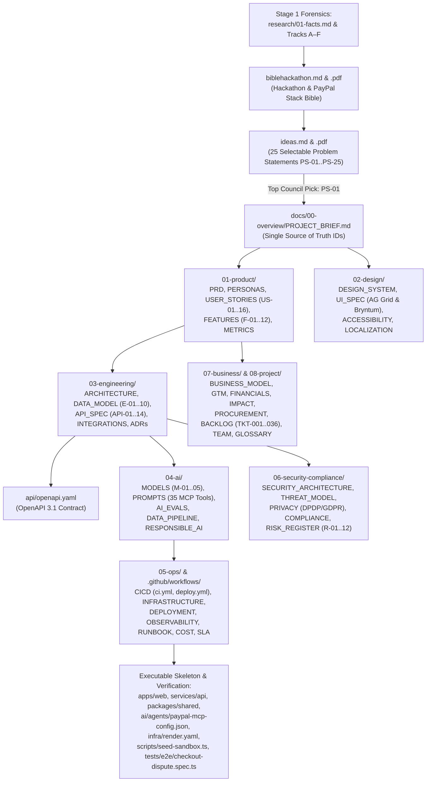

# Master Project Navigation Map (`MAP.md`)
> Project: PayOps AI (PayPal Sentinel) · Owner: Principal Architect & War-Room Council · Status: Approved v1.0 · Last updated: 2026-11-05
> Related: [README](./README.md) · [2-Member Implementation Plan](./IMPLEMENTATION_PLAN.md) · [CLAUDE.md](./CLAUDE.md) · [Hackathon Bible](./biblehackathon.md) · [Ranked Ideas (`PS-01`..`PS-25`)](./ideas.md) · [Project Brief](./docs/00-overview/PROJECT_BRIEF.md)

## 1. Complete Annotated Repository Directory Tree (`s:\PayPal`)

Every file in `s:\PayPal` is listed below with its one-line purpose:

```text
s:\PayPal\
├── PROJECT.md                                      # Master project architecture, feature inventory & canonical interface contracts
├── IMPLEMENTATION_PLAN.md                          # 2-Member Zero-Merge-Conflict Parallel Implementation Plan (H01–H48, F-01..F-12, TKT-001..036)
├── MAP.md                                          # Master navigation index, lookup table, dependency graph & 4 reading paths
├── README.md                                       # Executive front door, MIT license, quick start & feature summary (F-01..F-12)
├── CLAUDE.md                                       # AI coding agent instructions, commands, 10-line architecture & security rules
├── CONTRIBUTING.md                                 # Developer setup, trunk-based workflow, Conventional Commits & DoD checklist
├── SECURITY.md                                     # Vulnerability disclosure policy, response SLAs & Zero-PAN security guarantees
├── CHANGELOG.md                                    # Keep a Changelog release history (Unreleased, v1.0.0, v0.1.0)
├── CODE_OF_CONDUCT.md                              # Contributor Covenant v2.1 community standards
├── LICENSE                                         # Root MIT License required by Devpost Hackathon Rule R-12
├── package.json                                    # Root workspace manifest & scripts (dev, build, lint, typecheck, test, eval:ci)
├── pnpm-workspace.yaml                             # pnpm monorepo workspace linking apps/*, services/*, and packages/*
├── .gitattributes                                  # Enforces LF line endings across Windows/macOS to prevent whole-file merge conflicts
├── .gitignore                                      # Prevents committing .env secrets, node_modules, and build artifacts (R-07)
├── .env.example                                    # Documented environment variable template grouped by service (zero real secrets)
│
├── biblehackathon.md                               # Stage 1 Deliverable: 6-Part PayPal AI Hackathon & Company Forensic Bible + Sources
├── biblehackathon.pdf                              # Stage 1 Deliverable: Styled A4 PDF edition of biblehackathon.md (via md2pdf.py)
├── ideas.md                                        # Stage 1 Deliverable: Part 0 + 5 Domains × 5 Ranked Selectable Ideas (PS-01..PS-25)
├── ideas.pdf                                       # Stage 1 Deliverable: Styled A4 PDF edition of ideas.md (via md2pdf.py)
│
├── research\                                       # Stage 1 Forensic Reconnaissance & Domain Deep-Dives
│   ├── 01-facts.md                                 # Verbatim Devpost rules, timeline, $69,750 prizes, 10 sponsors & 13 judges
│   ├── A-organisers.md                             # PayPal Inc., CEOs (Alex Chriss, Dan Schulman) & Executive Leadership profiles
│   ├── B-sponsors.md                               # Deep-dive on all 10 official ecosystem sponsors & prize-stacking hooks
│   ├── C-judges.md                                 # Psychological & technical profiles of all 13 Devpost judges + Judge Heat-Map
│   ├── D-why-now.md                                # Industry triggers, regulatory drivers & why each strategic pillar exists now
│   ├── E-competition.md                            # Competition forecast across 25,000+ registrants, prior art & Winnability Index
│   ├── F-connect-the-dots.md                       # Patrick Jane synthesis: 7+ connected dots, hidden criteria, landmines & 80% trap
│   └── domains\
│       ├── D1.md                                   # Domain 1 Deep Research: Agentic Commerce & Autonomous SMB Financial Operations
│       ├── D2.md                                   # Domain 2 Deep Research: Autonomous Dispute Defense & Friendly-Fraud Graph
│       ├── D3.md                                   # Domain 3 Deep Research: Cross-Border B2B Treasury, Invoicing & PYUSD Settlement
│       ├── D4.md                                   # Domain 4 Deep Research: Social Payments, Multi-Party Split & Fastlane Checkout
│       └── D5.md                                   # Domain 5 Deep Research: Developer Experience, APIMatic Context & Observability
│
├── war-room\                                       # Stage 1 War-Room Council Dossiers & Multi-Round Debate Transcripts
│   ├── roster-additions.md                         # 6-field dossiers for 15 PayPal Mafia members + PayPal CEOs & Engineering Leaders
│   ├── D1.md                                       # Rounds 0–5 War-Room Council debate transcript & scoring for Domain D1 (PS-01..PS-05)
│   ├── D2.md                                       # Rounds 0–5 War-Room Council debate transcript & scoring for Domain D2 (PS-06..PS-10)
│   ├── D3.md                                       # Rounds 0–5 War-Room Council debate transcript & scoring for Domain D3 (PS-11..PS-15)
│   ├── D4.md                                       # Rounds 0–5 War-Room Council debate transcript & scoring for Domain D4 (PS-21..PS-25)
│   └── D5.md                                       # Rounds 0–5 War-Room Council debate transcript & scoring for Domain D5 (PS-16..PS-20)
│
├── docs\                                           # Stage 2 Complete /bible Company-Grade Specification Suite for PS-01: PayOps AI
│   ├── 00-overview\
│   │   ├── PROJECT_BRIEF.md                        # Single Source of Truth: F-01..F-12, US-01..US-16, E-01..E-10, API-01..API-14, M-01..M-05, R-01..R-12
│   │   ├── VISION.md                               # 1/5/10-year Musk first-principles vision, mission & north-star thesis
│   │   ├── PITCH.md                                # Jobs 3-min pitch script, Karp 30s summary, demo clicks & 20+ Judge Q&As
│   │   └── HACKATHON_PLAN.md                       # Hour-by-hour H01–H48 build plan, cut list & Devpost rubric compliance checklist
│   │
│   ├── 01-product\
│   │   ├── PRD.md                                  # Product Requirements Document covering functional (F-01..F-12) & NFR specs
│   │   ├── PERSONAS.md                             # 4 data-grounded merchant & finance operator personas (Maya Lin, Arjun Mehta, Elena Rostova, Marcus Vance)
│   │   ├── USER_JOURNEYS.md                        # Current-state vs future-state Mermaid user journeys & emotional curves
│   │   ├── USER_STORIES.md                         # User stories US-01..US-16 with Gherkin Given/When/Then acceptance criteria
│   │   ├── FEATURES.md                             # MoSCoW feature matrix (F-01..F-12), dependencies & runtime feature flags
│   │   ├── ROADMAP.md                              # Hackathon MVP -> 30/60/90-day pilot -> 6-month -> 1-year product roadmap
│   │   ├── METRICS.md                              # North Star metric, AARRR funnel & structured analytics event taxonomy
│   │   └── COMPETITIVE_ANALYSIS.md                 # Global & India competitor matrix, 2x2 positioning map & Thiel monopoly moat
│   │
│   ├── 02-design\
│   │   ├── DESIGN_SYSTEM.md                        # Jony Ive + PayPal brand tokens, OKLCH palette, typography & spring motion
│   │   ├── UI_SPEC.md                              # Screen-by-screen ASCII wireframes (AG Grid, Bryntum, Passkey Drawer) & 5 UI states
│   │   ├── ACCESSIBILITY.md                        # WCAG 2.2 AA compliance, keyboard nav, screen readers & RPwD/ADA alignment
│   │   └── LOCALIZATION.md                         # Multi-currency ($/€/£/₹/PYUSD) & multilingual (English, Hindi, Spanish) formatting
│   │
│   ├── 03-engineering\
│   │   ├── ARCHITECTURE.md                         # C4 Context/Container/Component Mermaid diagrams, sequence flows & PayPal stack mapping
│   │   ├── TECH_STACK.md                           # Exact library versions, Karpathy rationale, licenses & sponsor tools table
│   │   ├── DATA_MODEL.md                           # Mermaid ER diagram & full SQL/JSON schemas for entities E-01 to E-10
│   │   ├── API_SPEC.md                             # REST/Webhook specification for endpoints API-01 to API-14 with JSON examples
│   │   ├── INTEGRATIONS.md                         # PayPal REST v2, @paypal/agent-toolkit, MCP, Fastlane, PYUSD & Sponsor integrations
│   │   ├── FRONTEND.md                             # Next.js 15 App Router, AG Grid Enterprise, Bryntum Scheduler & WebAuthn patterns
│   │   ├── BACKEND.md                              # Fastify service layout, Cosmos.AI Policy Firewall (F-02) & JunoDB idempotency (F-06)
│   │   ├── CODING_STANDARDS.md                     # TypeScript/Python style rules, ESLint config & zero-PAN/secret logging rules
│   │   ├── GIT_WORKFLOW.md                         # Trunk-based branching, Conventional Commits & semantic versioning
│   │   ├── TESTING.md                              # Test pyramid, Vitest/Playwright suite, synthetic Sandbox data & CI gates
│   │   ├── PERFORMANCE.md                          # Latency SLOs (p50/p95/p99), k6 load test plan & caching tiers
│   │   ├── ENVIRONMENT_SETUP.md                    # Step-by-step setup on Windows, macOS & Linux with troubleshooting guide
│   │   ├── MOBILE.md                               # Responsive PWA, mobile passkey approvals & PayPal/Venmo mobile wallet flows
│   │   └── adr\
│   │       ├── ADR-0000-template.md                # Standard MADR Architecture Decision Record template
│   │       ├── ADR-0001-tech-stack.md              # Decision: TypeScript Full-Stack Monorepo + @paypal/agent-toolkit + AG Grid + Bryntum
│   │       ├── ADR-0002-database-and-state.md      # Decision: PostgreSQL 16 + JunoDB/Redis Idempotent State Store + Hash-Chained Audit Log
│   │       ├── ADR-0003-ai-model-and-agent-architecture.md # Decision: Dual-Layer MCP Orchestrator (M-01..M-05) Gated by Cosmos.AI DSL Firewall
│   │       ├── ADR-0004-hosting-and-deployment.md  # Decision: Multi-Service Render Blueprint + Elastic Observability + Offline Demo Replay
│   │       └── ADR-0005-auth-and-payment-security.md # Decision: Zero-PAN PCI SAQ-A Boundary, Webhook RSA-SHA256 & WebAuthn Passkeys
│   │
│   ├── 04-ai\
│   │   ├── MODELS.md                               # Complete specifications, Model Cards & $/₹ cost/latency tables for M-01..M-05
│   │   ├── PROMPTS.md                              # Versioned system prompts, 35 @paypal/agent-toolkit tool schemas & injection defenses
│   │   ├── AI_EVALS.md                             # Golden datasets (EVAL-DS-01..05), metrics, red-team suite & CI regression gates
│   │   ├── DATA_PIPELINE.md                        # Webhook ingestion, Luhn PAN redaction, Elastic/pgvector hybrid RAG & seeding
│   │   ├── RESPONSIBLE_AI.md                       # Karpathy L0–L4 Autonomy Slider, subgroup fairness parity & NIST/EU AI Act/MeitY
│   │   └── FINE_TUNING.md                          # PyTorch Geometric GraphSAGE + LightGBM ONNX pipeline (M-04) & QLoRA router (M-02)
│   │
│   ├── 05-ops\
│   │   ├── CICD.md                                 # 6-stage CI/CD pipeline diagram, promotion matrix & inline GitHub Actions YAML
│   │   ├── INFRASTRUCTURE.md                       # Render Blueprint multi-service topology, GCP Mumbai/US/EU residency & sizing
│   │   ├── DEPLOYMENT.md                           # Step-by-step Render & Docker deployment, webhook registration & kill-switches
│   │   ├── OBSERVABILITY.md                        # Elastic APM, OpenTelemetry tracing, LLM token telemetry & 180-day CERT-In/PCI logs
│   │   ├── RUNBOOK.md                              # SEV-1..4 definitions, Top 10 failure playbooks, statutory breach reporting & Demo fallback
│   │   ├── COST.md                                 # Monthly & unit cost model at 100 / 10,000 / 1,000,000 users in $ USD and ₹ INR
│   │   └── SLA.md                                  # SMB, Mid-Market & Enterprise 99.99% availability SLAs, SLOs & credit remedies
│   │
│   ├── 06-security-compliance\
│   │   ├── SECURITY_ARCHITECTURE.md                # Zero-PAN SAQ-A, OIDC/Passkey RBAC, AES-256-GCM & OWASP Web + LLM Top 10 mitigations
│   │   ├── THREAT_MODEL.md                         # Trust-boundary Mermaid DFD, component STRIDE matrix & unauthorized spend defenses
│   │   ├── PRIVACY.md                              # Personal data inventory (E-01..E-10), India DPDP Act 2023/Rules 2025 notice & GDPR rights
│   │   ├── COMPLIANCE.md                           # FinCEN/MTL non-custodial exemption, PCI-DSS v4.0, RBI PA-CB, CERT-In & EU AI Act matrix
│   │   ├── RISK_REGISTER.md                        # Charlie Munger pre-mortem & complete mitigation register for canonical risks R-01..R-12
│   │   └── REGULATORY_SANDBOX.md                   # Multi-jurisdiction sandbox blueprint across RBI (India), FCA (UK), MAS (SG) & US
│   │
│   ├── 07-business\
│   │   ├── BUSINESS_MODEL.md                       # Lean Canvas, $/₹ SaaS + performance pricing, Botha/Chriss margin flywheel & Thiel moat
│   │   ├── GTM.md                                  # Godin beachhead, Thiel/Hoffman/Sacks viral invoice loop (K=0.576) & 10/100/10k plan
│   │   ├── FINANCIALS.md                           # CAC, LTV (76.2x LTV:CAC), 22-day payback & 3-year P&L projections in $ USD and ₹ INR
│   │   ├── IMPACT.md                               # Theory of change, +$26,960/yr SMB ROI, UN SDGs (8, 9, 10) & Mike Ross composite stories
│   │   └── PROCUREMENT.md                          # Enterprise & GeM procurement packet: CAIQ/SIG-Lite summary, subprocessors & DPA
│   │
│   └── 08-project\
│       ├── BACKLOG.md                              # 7 Epics & 36 granular GitHub Issue tickets mapped to F-01..F-12, US-01..US-16 & H01–H48
│       ├── TEAM.md                                 # 4-person "Barrels" team structure, workstream RACI matrix & 15-min decision protocol
│       └── GLOSSARY.md                             # Comprehensive glossary of PayPal, FinTech, Agentic AI/MCP & regulatory terms
│
├── api\
│   └── openapi.yaml                                # Validated OpenAPI 3.1.0 specification covering API-01..API-14 and schemas E-01..E-10
│
├── .github\
│   └── workflows\
│       ├── ci.yml                                  # Runnable GitHub Actions CI pipeline (lint, typecheck, tests, OpenAPI, Trivy, AI Evals)
│       └── deploy.yml                              # Runnable GitHub Actions CD pipeline for Render deployment, health poll & auto-rollback
│
├── apps\
│   └── web\
│       └── package.json                            # Next.js 15 + React 19 + AG Grid + Bryntum + @paypal/react-paypal-js frontend manifest
├── services\
│   └── api\
│       └── package.json                            # Fastify + @paypal/agent-toolkit + @paypal/paypal-server-sdk + ONNX backend manifest
├── packages\
│   └── shared\
│       ├── package.json                            # Shared package manifest exporting entities, api-contracts, policy-dsl, apimatic-validators, mock-fixtures
│       ├── tsconfig.json                           # Shared TypeScript compiler configuration
│       └── src\
│           ├── index.ts                            # Phase-0 frozen barrel export file
│           ├── entities.ts                         # Phase-0 frozen canonical entity interfaces (E-01..E-10)
│           ├── api-contracts.ts                    # Phase-0 frozen REST & SSE contract types (API-01..API-14 + SSE-01)
│           ├── policy-dsl.ts                       # Dev 1 owned Cosmos.AI Policy Firewall evaluator (F-02)
│           ├── apimatic-validators.ts              # Dev 1 owned APIMatic 2-decimal monetary payload validator (F-09)
│           └── mock-fixtures.ts                    # Dev 2 owned deterministic UI mock & replay fixtures
├── ai\
│   └── agents\
│       └── paypal-mcp-config.json                  # Declarative 35-tool @paypal/agent-toolkit & PayPal MCP Server configuration
├── infra\
│   └── render.yaml                                 # Render Cloud Blueprint IaC defining web, api, policy-worker, Postgres 16 & Redis/JunoDB
├── scripts\
│   └── seed-sandbox.ts                             # Deterministic PayPal Sandbox catalog, invoice, order, dispute & audit-chain seeder
└── tests\
    ├── e2e\
    │   └── checkout-dispute.spec.ts                # End-to-End Vitest/Playwright spec verifying idempotency, invoicing & dispute defense
    └── verify_deliverables.py                      # Automated Opaque-Box E2E deliverable & rubric verification suite
```

---

## 2. `"Where Do I Find…?"` Quick Lookup Table

| Question / Topic | Primary Authoritative File | Companion File(s) |
|---|---|---|
| **What are all the official PayPal AI Hackathon rules, prizes ($69,750), 10 sponsors, and 13 judges?** | [`biblehackathon.md`](./biblehackathon.md) (`Part 1 & Part 2`) | [`research/01-facts.md`](./research/01-facts.md) · [`research/C-judges.md`](./research/C-judges.md) |
| **What tools, frameworks (`JunoDB`, `Cosmos.AI`, `Raptor`, `Kraken.js`, `GNN`), and APIs does PayPal use internally?** | [`biblehackathon.md`](./biblehackathon.md) (`Part 1`) | [`docs/03-engineering/ARCHITECTURE.md`](./docs/03-engineering/ARCHITECTURE.md) |
| **How did the PayPal Mafia (`Thiel`, `Musk`, `Levchin`, `Hoffman`, `Sacks`, `Botha`, `Rabois`) and PayPal Leadership debate and rank the 25 Problem Statements (`PS-01`..`PS-25`)?** | [`ideas.md`](./ideas.md) (`Part 0 & Domains D1–D5`) | [`war-room/roster-additions.md`](./war-room/roster-additions.md) · [`war-room/D1.md`](./war-room/D1.md) |
| **Where is the Single Source of Truth for `PS-01: PayOps AI` feature, story, entity, API, model, and risk IDs?** | [`docs/00-overview/PROJECT_BRIEF.md`](./docs/00-overview/PROJECT_BRIEF.md) | [`PROJECT.md`](./PROJECT.md) (`§ Interface Contracts`) |
| **What is the 3-minute Steve Jobs pitch script and the 20+ Judge Q&A bank mapped to the 13 Devpost judges?** | [`docs/00-overview/PITCH.md`](./docs/00-overview/PITCH.md) | [`docs/00-overview/HACKATHON_PLAN.md`](./docs/00-overview/HACKATHON_PLAN.md) |
| **How are all 35 `@paypal/agent-toolkit` & PayPal MCP Server tools orchestrated and validated?** | [`docs/04-ai/PROMPTS.md`](./docs/04-ai/PROMPTS.md) | [`ai/agents/paypal-mcp-config.json`](./ai/agents/paypal-mcp-config.json) · [`docs/03-engineering/INTEGRATIONS.md`](./docs/03-engineering/INTEGRATIONS.md) |
| **How does the deterministic `Cosmos.AI` DSL Policy Firewall (`F-02`) stop prompt injections (`R-01`) and unauthorized refunds?** | [`docs/06-security-compliance/THREAT_MODEL.md`](./docs/06-security-compliance/THREAT_MODEL.md) | [`docs/04-ai/RESPONSIBLE_AI.md`](./docs/04-ai/RESPONSIBLE_AI.md) · [`docs/04-ai/AI_EVALS.md`](./docs/04-ai/AI_EVALS.md) |
| **How does `JunoDB`-patterned idempotency (`F-06`) guarantee zero double-charges or double-refunds (`R-02`)?** | [`docs/03-engineering/BACKEND.md`](./docs/03-engineering/BACKEND.md) | [`docs/03-engineering/adr/ADR-0002-database-and-state.md`](./docs/03-engineering/adr/ADR-0002-database-and-state.md) · [`scripts/seed-sandbox.ts`](./scripts/seed-sandbox.ts) |
| **Where are the database tables (`E-01`..`E-10`) and REST API contracts (`API-01`..`API-14`) defined?** | [`docs/03-engineering/DATA_MODEL.md`](./docs/03-engineering/DATA_MODEL.md) · [`docs/03-engineering/API_SPEC.md`](./docs/03-engineering/API_SPEC.md) | [`api/openapi.yaml`](./api/openapi.yaml) |
| **How are AG Grid (`F-07`) and Bryntum (`F-08`) integrated in the Executive Financial Command Center?** | [`docs/02-design/UI_SPEC.md`](./docs/02-design/UI_SPEC.md) | [`docs/03-engineering/FRONTEND.md`](./docs/03-engineering/FRONTEND.md) · [`apps/web/package.json`](./apps/web/package.json) |
| **How do we comply with PCI-DSS v4.0 SAQ-A, FinCEN MTLs, India RBI PA-CB, CERT-In 180-day logs, and DPDP Act 2023?** | [`docs/06-security-compliance/COMPLIANCE.md`](./docs/06-security-compliance/COMPLIANCE.md) · [`docs/06-security-compliance/PRIVACY.md`](./docs/06-security-compliance/PRIVACY.md) | [`docs/06-security-compliance/SECURITY_ARCHITECTURE.md`](./docs/06-security-compliance/SECURITY_ARCHITECTURE.md) · [`docs/06-security-compliance/REGULATORY_SANDBOX.md`](./docs/06-security-compliance/REGULATORY_SANDBOX.md) |
| **What are the monthly cloud & AI token costs at 100 / 10k / 1M users and the 3-year financial projections in `$` and `₹`?** | [`docs/05-ops/COST.md`](./docs/05-ops/COST.md) · [`docs/07-business/FINANCIALS.md`](./docs/07-business/FINANCIALS.md) | [`docs/07-business/BUSINESS_MODEL.md`](./docs/07-business/BUSINESS_MODEL.md) · [`docs/07-business/GTM.md`](./docs/07-business/GTM.md) |
| **How do we deploy to Render (`render.yaml`) or recover if PayPal Sandbox rate-limits (`HTTP 429`) during live judging?** | [`docs/05-ops/DEPLOYMENT.md`](./docs/05-ops/DEPLOYMENT.md) · [`docs/05-ops/RUNBOOK.md`](./docs/05-ops/RUNBOOK.md) | [`infra/render.yaml`](./infra/render.yaml) · [`.github/workflows/deploy.yml`](./.github/workflows/deploy.yml) |
| **How does a 2-member team (`Dev 1` + `Dev 2`) build `PS-01: PayOps AI` in parallel with zero Git merge conflicts?** | [`IMPLEMENTATION_PLAN.md`](./IMPLEMENTATION_PLAN.md) | [`docs/00-overview/HACKATHON_PLAN.md`](./docs/00-overview/HACKATHON_PLAN.md) · [`docs/08-project/BACKLOG.md`](./docs/08-project/BACKLOG.md) |

---

## 3. Document Dependency Graph (Mermaid)



---

## 4. Four Tailored Reading Paths

### Path 1: For a Hackathon Judge (10-Minute Executive & Technical Evaluation)
1. **[`README.md`](./README.md)** — 2-minute overview of the problem, live dispute/invoicing demo sequence, `F-01`..`F-12` feature matrix, and MIT license verification.
2. **[`docs/00-overview/PITCH.md`](./docs/00-overview/PITCH.md)** — The 3-minute Steve Jobs demo script, Karp 30-second thesis, and answers tailored directly to all 13 Devpost judges (`Jo Franchetti`, `Eddie Jaoude`, `Marco Podien`, `Karthik Ravi`, `Himraj Singh`, `Nathaniel Olson`, `Sylwia Vargas`, `Ameer Hassan`, `Mats Bryntse`, `Ignacio Valdez Bicard`, `Carly Richmond`, `Pooja Mistry`, `Shifra Williams`).
3. **[`docs/03-engineering/ARCHITECTURE.md`](./docs/03-engineering/ARCHITECTURE.md)** & **[`ai/agents/paypal-mcp-config.json`](./ai/agents/paypal-mcp-config.json)** — How we orchestrate all 35 `@paypal/agent-toolkit` & PayPal MCP tools with `Cosmos.AI` policy guardrails (`F-02`), `JunoDB` idempotency (`F-06`), and `APIMatic` validation (`F-09`).
4. **[`docs/02-design/UI_SPEC.md`](./docs/02-design/UI_SPEC.md)** — ASCII wireframes and architecture of the **AG Grid Enterprise Command Center (`F-07`)** and **Bryntum Timeline Scheduler (`F-08`)**.
5. **[`biblehackathon.md`](./biblehackathon.md)** & **[`ideas.md`](./ideas.md)** — Deep forensic research on PayPal's stack and all 25 selectable problem statements (`PS-01`..`PS-25`) if evaluating strategic breadth.

---

### Path 2: For a New Developer Joining the Team (15-Minute Onboarding)
1. **[`docs/00-overview/PROJECT_BRIEF.md`](./docs/00-overview/PROJECT_BRIEF.md)** — Learn the canonical IDs (`F-01`..`F-12`, `E-01`..`E-10`, `API-01`..`API-14`, `M-01`..`M-05`, `R-01`..`R-12`).
2. **[`docs/03-engineering/ENVIRONMENT_SETUP.md`](./docs/03-engineering/ENVIRONMENT_SETUP.md)** & **[`.env.example`](./.env.example)** — Configure Node 22.11.0 LTS, pnpm, Docker Compose, and PayPal Sandbox keys.
3. **[`docs/03-engineering/DATA_MODEL.md`](./docs/03-engineering/DATA_MODEL.md)** & **[`api/openapi.yaml`](./api/openapi.yaml)** — Understand the PostgreSQL 16 + `JunoDB`/Redis schema and the 14 REST/Webhook endpoints.
4. **[`docs/03-engineering/BACKEND.md`](./docs/03-engineering/BACKEND.md)** & **[`docs/04-ai/PROMPTS.md`](./docs/04-ai/PROMPTS.md)** — See how `M-01`..`M-05`, `@paypal/agent-toolkit`, and the `Cosmos.AI` Policy Firewall (`F-02`) interact.
5. **[`docs/08-project/BACKLOG.md`](./docs/08-project/BACKLOG.md)** & **[`docs/00-overview/HACKATHON_PLAN.md`](./docs/00-overview/HACKATHON_PLAN.md)** — Pick up your assigned `TKT-xxx` ticket in the `H01`–`H48` build schedule.

---

### Path 3: For a Product Designer & UX Engineer
1. **[`docs/01-product/PERSONAS.md`](./docs/01-product/PERSONAS.md)** & **[`docs/01-product/USER_JOURNEYS.md`](./docs/01-product/USER_JOURNEYS.md)** — Empathize with `Maya Lin` (`P-01`, wholesale & D2C founder chasing overdue invoices), `Arjun Mehta` (`P-02`, cross-border finance & ops lead), `Elena Rostova` (`P-03`, risk & dispute analyst fighting friendly-fraud claims), and `Marcus Vance` (`P-04`, principal platform & AI engineer).
2. **[`docs/02-design/DESIGN_SYSTEM.md`](./docs/02-design/DESIGN_SYSTEM.md)** — Jony Ive restraint principles, PayPal Navy/Blue/Gold semantic tokens, typography, and motion rules.
3. **[`docs/02-design/UI_SPEC.md`](./docs/02-design/UI_SPEC.md)** — Every screen layout, **AG Grid** financial table/chart patterns (`F-07`), **Bryntum** scheduler interactions (`F-08`), WebAuthn Passkey approval drawer (`API-02`), and all 5 UI states (`empty`, `loading`, `error`, `offline`, `success`).
4. **[`docs/02-design/ACCESSIBILITY.md`](./docs/02-design/ACCESSIBILITY.md)** & **[`docs/02-design/LOCALIZATION.md`](./docs/02-design/LOCALIZATION.md)** — WCAG 2.2 AA checklist and multi-currency (`$`/`€`/`£`/`₹`/`PYUSD`) formatting standards.

---

### Path 4: For an AI Coding Agent (`Claude Code / Cursor / Antigravity / Codex`)
1. **[`CLAUDE.md`](./CLAUDE.md)** — Read first: exact build/test/eval CLI commands, 10-line architecture, folder ownership, and strict security/idempotency invariants.
2. **[`docs/00-overview/PROJECT_BRIEF.md`](./docs/00-overview/PROJECT_BRIEF.md)** — Lock in all canonical IDs (`F-01`..`F-12`, `US-01`..`US-16`, `E-01`..`E-10`, `API-01`..`API-14`, `M-01`..`M-05`, `R-01`..`R-12`).
3. **[`api/openapi.yaml`](./api/openapi.yaml)** & **[`ai/agents/paypal-mcp-config.json`](./ai/agents/paypal-mcp-config.json)** — Machine-readable OpenAPI 3.1 and 35-tool PayPal MCP schemas.
4. **[`docs/03-engineering/CODING_STANDARDS.md`](./docs/03-engineering/CODING_STANDARDS.md)** & **[`docs/06-security-compliance/SECURITY_ARCHITECTURE.md`](./docs/06-security-compliance/SECURITY_ARCHITECTURE.md)** — Enforce Zero-PAN SAQ-A, deterministic `PayPal-Request-Id` headers (`F-06`), `APIMatic` 2-decimal currency strings (`F-09`), and `<untrusted_external_data>` XML prompt-injection isolation (`R-01`).
5. **[`tests/e2e/checkout-dispute.spec.ts`](./tests/e2e/checkout-dispute.spec.ts)** & **[`docs/04-ai/AI_EVALS.md`](./docs/04-ai/AI_EVALS.md)** — Run automated verification suites after every code change.
