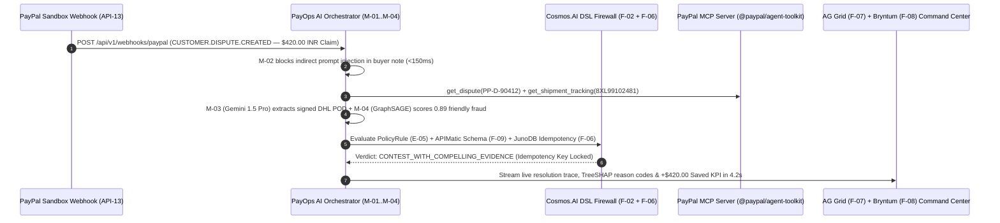

# PayOps AI (`PayPal Sentinel`)

[](https://opensource.org/licenses/MIT)
[](https://github.com/paypal/agent-toolkit)
[](https://developer.paypal.com)
[](./MAP.md)

> **One-Liner (`PS-01`, Council #1 Pick — Score `9.45/10`)**: An autonomous, policy-guarded financial operations control plane that orchestrates all **35 `@paypal/agent-toolkit` & PayPal MCP Server tools** (`Orders v2`, `Invoicing v2`, `Disputes v1`, `Shipment Tracking v1`, `Catalog v1`, `Subscriptions v1`, `Merchant Insights`) with a **`Cosmos.AI`-style deterministic DSL spend/risk firewall (`F-02`)**, **`JunoDB`-patterned idempotent execution ledger (`F-06`)**, **`GraphSAGE` friendly-fraud scorer (`M-04`, `F-10`)**, **`APIMatic` verified context plugins (`F-09`)**, and an **`AG Grid` + `Bryntum` real-time treasury & dispute command center (`F-07`, `F-08`)** deployed on **`Render`**.

---

## 1. Strategic Navigation & Hackathon Deliverables Index

This repository contains both the **Stage 1 War-Room Council & PayPal Forensics Suite** and the **Stage 2 Complete `/bible` Specification & Code Skeleton Suite**:

| Deliverable | File Path | Description |
|---|---|---|
| **Master Navigation Map** | [`MAP.md`](./MAP.md) | **Start Here**: Complete directory tree, `"Where do I find…?"` lookup table, Mermaid dependency graph, and 4 reading paths (Judge, Developer, Designer, AI Agent). |
| **2-Member Zero-Conflict Implementation Plan** | [`IMPLEMENTATION_PLAN.md`](./IMPLEMENTATION_PLAN.md) | Parallel execution blueprint for `Dev 1` (Backend/MCP/AI/Infra) & `Dev 2` (Frontend/AG Grid/Bryntum/E2E) across `H01`–`H48` with disjoint directory ownership and zero Git merge conflicts. |
| **The Hackathon & Company Bible** | [`biblehackathon.md`](./biblehackathon.md) · [`biblehackathon.pdf`](./biblehackathon.pdf) | Forensic analysis of `paypalaihackathon.devpost.com` ($69,750 prizes, 13 judges, 10 sponsors), PayPal's engineering stack (`JunoDB`, `Cosmos.AI`, `Raptor`, `Kraken.js`, `GNN`, `@paypal/agent-toolkit`), PayPal CEOs/leadership, and **PayPal Mafia** council synthesis. |
| **25 Ranked Selectable Problem Statements (`PS-01`..`PS-25`)** | [`ideas.md`](./ideas.md) · [`ideas.pdf`](./ideas.pdf) | 5 Strategic Domains $\times$ 5 Ranked Selectable Problem Statements with Rounds 0–5 multi-round debate transcripts (PayPal Mafia + PayPal Leadership + Core Council), architectures, and execution plans. |
| **Single Source of Truth Brief (`PS-01`)** | [`docs/00-overview/PROJECT_BRIEF.md`](./docs/00-overview/PROJECT_BRIEF.md) | Canonical registry of `F-01`..`F-12`, `US-01`..`US-16`, `E-01`..`E-10`, `API-01`..`API-14`, `M-01`..`M-05`, `R-01`..`R-12`, and `ADR-0000`..`ADR-0005`. |
| **Product Requirements & 48h Plan** | [`docs/01-product/PRD.md`](./docs/01-product/PRD.md) · [`docs/00-overview/HACKATHON_PLAN.md`](./docs/00-overview/HACKATHON_PLAN.md) | Full functional/non-functional requirements, Gherkin user stories, and hour-by-hour `H01`–`H48` build plan. |
| **System Architecture & OpenAPI 3.1** | [`docs/03-engineering/ARCHITECTURE.md`](./docs/03-engineering/ARCHITECTURE.md) · [`api/openapi.yaml`](./api/openapi.yaml) | C4 diagrams, sequence flows, data model (`E-01`..`E-10`), and validated OpenAPI 3.1 specification (`API-01`..`API-14`). |

---

## 2. The Problem We Solve

Small and mid-market businesses (`$100k–$25M` TPV) on PayPal bleed margin across three broken manual workflows:
1. **Friendly-Fraud Dispute Losses (`1.8%–3.2%` of revenue)**: Even when an item was delivered with a carrier signature, merchants forfeit **66% of "Item Not Received" (`INR`) and "Significantly Not As Described" (`SNAD`) disputes** because manually cross-referencing PayPal Orders v2, carrier tracking APIs, PDF waybills, and buyer history takes 45+ minutes per claim.
2. **Chronic Late B2B Invoices (`42-day average DSO`)**: 54% of B2B invoices are paid late because static invoices lack conditional early-payment discounts, instant QR checkout, and automated multi-channel dunning.
3. **Unsafe "Toy" AI Agents**: Giving a raw LLM direct access to `create_refund`, `accept_dispute_claim`, or `pay_order` without deterministic spend caps, `PayPal-Request-Id` idempotency, and prompt-injection isolation is an immediate financial security failure.

---

## 3. Live Demo Workflow & Architecture (`< 45-Second Wow Moment`)



---

## 4. Complete Feature Matrix (`F-01` to `F-12`)

| ID | Feature Name | Priority | PayPal & Sponsor Technologies Used |
|---|---|---|---|
| **`F-01`** | **PayPal MCP & `@paypal/agent-toolkit` Unified Agent Orchestrator** | Must (MVP) | All 35 tools across Invoices, Orders, Disputes, Tracking, Catalog, Subscriptions, Insights |
| **`F-02`** | **Deterministic Spend & Risk Policy Firewall (`Cosmos.AI` DSL Pattern)** | Must (MVP) | Pre-execution rule DAG, Karpathy Autonomy Slider (`L0`–`L4`), WebAuthn Passkey (`API-02`) |
| **`F-03`** | **Autonomous Smart Invoicing & AR Collections Agent** | Must (MVP) | `create_invoice`, `send_invoice`, `generate_invoice_qr_code`, `create_conditional_rules_for_invoice` |
| **`F-04`** | **Autonomous Dispute & Chargeback Defense Agent** | Must (MVP) | `list_disputes`, `get_dispute`, `accept_dispute_claim`, `get_shipment_tracking`, `M-03` OCR |
| **`F-05`** | **Agentic B2B Procurement, Catalog & Order Checkout Flow** | Must (MVP) | `create_product`, `create_order`, `pay_order`, `create_refund`, **PayPal Fastlane** |
| **`F-06`** | **Idempotent Financial State Ledger (`JunoDB` + `PayPal-Request-Id`)** | Must (MVP) | Redis 7.4 atomic `SET NX EX 86400` lock + PostgreSQL 16 unique constraint + `SHA-256` audit log |
| **`F-07`** | **Executive Financial Command Center with `AG Grid`** | Must (MVP) | **AG Grid Enterprise / AG Studio** live transaction stream, pivot charts & TreeSHAP drawer |
| **`F-08`** | **Receivables, Subscription & Settlement Scheduler with `Bryntum`** | Must (MVP) | **Bryntum Scheduler / Gantt** interactive dunning & recurring billing timeline |
| **`F-09`** | **Deterministic `APIMatic` Context Plugin & SDK Validator** | Should (MVP) | **APIMatic Context Plugins** + `@paypal/paypal-server-sdk` strict ISO-4217 schema validator |
| **`F-10`** | **Real-Time Multi-Hop Buyer-Merchant Risk Graph Scorer (`M-04`)** | Should (MVP) | `PyTorch Geometric GraphSAGE + LightGBM` ONNX Runtime (`<10ms` inference, Simility pattern) |
| **`F-11`** | **Programmable Cross-Border Supplier Payouts & `PYUSD` Bridge** | Could (v1) | **PayPal USD (`PYUSD`)** on Solana Token-2022 (`2b1kV6DkPAnxd5ixfnxCpjxmKwqjjaYmCZfHsFu24GXo`) |
| **`F-12`** | **Multi-Channel Commerce Discovery & Observability (`Elastic` + `Channel3`)** | Could (v1) | **Elasticsearch** hybrid RAG (`M-05`) + OpenTelemetry 180-day CERT-In/PCI logs + **Channel3** |

---

## 5. Quick Start (`Clone → Configure → Seed → Run`)

### Prerequisites
- **Node.js `>= 20.18.0`** & **`pnpm >= 9.12.3`**
- **PayPal Developer Sandbox Credentials** ([developer.paypal.com](https://developer.paypal.com/dashboard/applications/sandbox))

```bash
# 1. Clone the repository and install dependencies
git clone https://github.com/payops-ai/paypal-sentinel.git
cd paypal-sentinel
pnpm install

# 2. Configure environment variables from the documented template
cp .env.example .env

# 3. Seed deterministic PayPal Sandbox catalog, invoice, order, and dispute fixtures
npx tsx scripts/seed-sandbox.ts

# 4. Run the End-to-End Verification Suite (Idempotency, Policy Firewall, Dispute Defense)
npx vitest run tests/e2e/checkout-dispute.spec.ts
```

---

## 6. Project Structure Overview

See [`MAP.md`](./MAP.md) for the complete annotated file tree.

```text
s:\PayPal\
├── MAP.md                          # Master Navigation Index & Reading Paths
├── CLAUDE.md                       # AI Coding Agent Instructions & Guardrail Rules
├── biblehackathon.md / .pdf        # Stage 1: PayPal AI Hackathon & Company Forensic Bible
├── ideas.md / .pdf                 # Stage 1: 25 Ranked Selectable Problem Statements (PS-01..PS-25)
├── research/ & war-room/           # Recon Tracks A-F, Domain Deep-Dives D1-D5 & Debate Transcripts
├── docs/
│   ├── 00-overview/                # PROJECT_BRIEF, VISION, PITCH, HACKATHON_PLAN
│   ├── 01-product/                 # PRD, PERSONAS, USER_JOURNEYS, USER_STORIES, FEATURES, ROADMAP, METRICS, COMPETITIVE_ANALYSIS
│   ├── 02-design/                  # DESIGN_SYSTEM, UI_SPEC, ACCESSIBILITY, LOCALIZATION
│   ├── 03-engineering/             # ARCHITECTURE, TECH_STACK, DATA_MODEL, API_SPEC, INTEGRATIONS, ADRs (ADR-0000..0005)
│   ├── 04-ai/                      # MODELS (M-01..M-05), PROMPTS, AI_EVALS, DATA_PIPELINE, RESPONSIBLE_AI, FINE_TUNING
│   ├── 05-ops/                     # CICD, INFRASTRUCTURE, DEPLOYMENT, OBSERVABILITY, RUNBOOK, COST, SLA
│   ├── 06-security-compliance/     # SECURITY_ARCHITECTURE, THREAT_MODEL, PRIVACY, COMPLIANCE, RISK_REGISTER, REGULATORY_SANDBOX
│   ├── 07-business/                # BUSINESS_MODEL, GTM, FINANCIALS, IMPACT, PROCUREMENT
│   └── 08-project/                 # BACKLOG, TEAM, GLOSSARY
├── api/openapi.yaml                # Validated OpenAPI 3.1 Specification (API-01..API-14)
├── .github/workflows/              # Runnable CI (ci.yml) & Render CD (deploy.yml) Pipelines
└── apps/web, services/api, packages/shared, ai/agents, infra/render.yaml, scripts/, tests/e2e/
```

---

## 7. Open-Source License (`MIT License` — Devpost Rule Compliance `R-12`)

This project is open source and released under the **MIT License** (visible at the top of the repository and in the GitHub repository **About** section per official PayPal AI Hackathon rules):

```text
MIT License

Copyright (c) 2026 PayOps AI (PayPal Sentinel) Contributors

Permission is hereby granted, free of charge, to any person obtaining a copy
of this software and associated documentation files (the "Software"), to deal
in the Software without restriction, including without limitation the rights
to use, copy, modify, merge, publish, distribute, sublicense, and/or sell
copies of the Software, and to permit persons to whom the Software is
furnished to do so, subject to the following conditions:

The above copyright notice and this permission notice shall be included in all
copies or substantial portions of the Software.

THE SOFTWARE IS PROVIDED "AS IS", WITHOUT WARRANTY OF ANY KIND, EXPRESS OR
IMPLIED, INCLUDING BUT NOT LIMITED TO THE WARRANTIES OF MERCHANTABILITY,
FITNESS FOR A PARTICULAR PURPOSE AND NONINFRINGEMENT. IN NO EVENT SHALL THE
AUTHORS OR COPYRIGHT HOLDERS BE LIABLE FOR ANY CLAIM, DAMAGES OR OTHER
LIABILITY, WHETHER IN AN ACTION OF CONTRACT, TORT OR OTHERWISE, ARISING FROM,
OUT OF OR IN CONNECTION WITH THE SOFTWARE OR THE USE OR OTHER DEALINGS IN THE
SOFTWARE.
```
