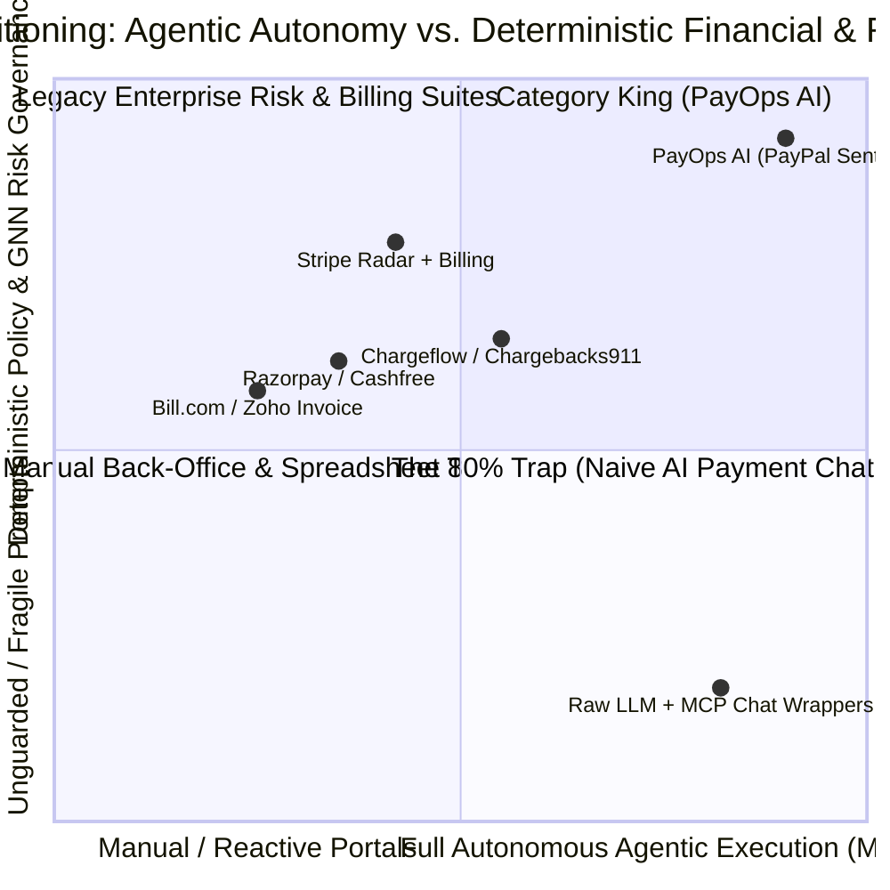

# Competitive Analysis & Structural Moat — PayOps AI (PayPal Sentinel)
> Project: PayOps AI (PayPal Sentinel) · Owner: Chief Strategy Officer · Status: Approved v1.0 · Last updated: 2026-11-05
> Related: [Project Brief](../00-overview/PROJECT_BRIEF.md) · [Vision](../00-overview/VISION.md) · [PRD](./PRD.md) · [Business Model](../07-business/BUSINESS_MODEL.md)

---

## 1. Competitive Landscape Matrix (Global & India FinTech Ecosystem)

Existing tools force merchants to choose between **legacy rule-based SaaS portals** (which lack autonomous PayPal MCP execution), **single-point chargeback vendors** (which charge 25% of gross dispute value and ignore invoicing/treasury), or **naive LLM payment wrappers** (which lack deterministic spend guardrails and idempotency):

| Competitor / Category | Geography & Funding | Core Product Focus | Pricing (`$` / `₹`) | Specific Architectural & Product Weaknesses vs. `PayOps AI` |
| :--- | :--- | :--- | :--- | :--- |
| **1. Chargeflow / Chargebacks911 / Midigator** | Global (US/EU) · `$35M–$100M+` | Post-facto chargeback representment portals | `20%–25%` of recovered dispute gross amount (or `$25–$40`/dispute) | • **Reactive only:** Does not proactively sync `create_shipment_tracking` at order capture to prevent INR disputes before they happen. • **No Invoicing or Treasury:** Siloed from B2B receivables (`F-03`), subscriptions (`F-08`), and `PYUSD` settlement (`F-11`). • **Taxing Take-Rate:** 25% fee erodes SMB net margin. |
| **2. Stripe Billing + Stripe Radar** | Global · `$95B` Valuation | Developer billing APIs and card-network fraud rules | `0.5%–0.8%` of recurring billing + `$0.05–$0.07`/tx Radar fee | • **Closed to PayPal's 430M+ Wallet Graph:** Cannot orchestrate `@paypal/agent-toolkit`, **Fastlane**, Venmo, or **PYUSD Solana Token-2022**. • **No Autonomous MCP CFO:** Requires manual dashboard rule writing rather than natural-language + `Cosmos.AI` DSL agentic orchestration (`F-01`, `F-02`). |
| **3. Bill.com (BILL) / Melio** | US SMB · Public (`NYSE: BILL`) | Accounts Payable & Receivable workflow portals | `$45–$79` / user / month + `$1.50–$40` wire/FX fees | • **Manual Form-Heavy UI:** Zero autonomous MCP tool execution; operators still manually click through approval chains and wait 3–5 days for cross-border wires instead of `1.2s` memo-bound `PYUSD` settlement (`F-11`). • **Zero Dispute Defense:** Does not handle PayPal buyer disputes (`F-04`). |
| **4. Razorpay Thirdwatch / Cashfree RiskShield / Zoho Invoice** | India & Cross-Border · `$7.5B` (Razorpay) | Domestic Indian UPI/card checkout, basic invoicing, RTO fraud scoring | `2.0%–3.0%` cross-border gateway fee + SaaS tiers (`₹1,500–₹15,000/mo`) | • **Weak US/EU Buyer Trust:** Overseas B2B buyers strongly prefer paying via trusted **PayPal Invoicing v2 / Fastlane** over unfamiliar regional gateways. • **No Multi-Hop PayPal Dispute Automation:** Lacks native `@paypal/agent-toolkit` integration across `get_dispute`, `get_shipment_tracking`, and `create_conditional_rules_for_invoice`. |
| **5. Generic Hackathon "AI Payment Chatbot" Wrappers (The 80% Trap)** | Global Hackathon Projects | Thin Next.js + OpenAI wrapper calling `create_order` or `create_invoice` | Open-source prototype | • **Critically Unsafe for Production (`R-01`..`R-03`):** Vulnerable to indirect prompt injection via invoice/dispute text, double-charging on retries (no `JunoDB` idempotency), and LLM schema hallucinations (no `APIMatic` validation). • **Toy Chat UI:** Lacks enterprise **AG Grid** (`F-07`) and **Bryntum** (`F-08`) financial workbenches. |
| **6. PayOps AI (`PayPal Sentinel`) — *Our Solution*** | **Global + US–India Corridor** | **Autonomous Agentic CFO, Smart Invoicing & GNN Dispute-Defense Control Plane** | **Starter:** Free (Sandbox) **Growth:** `$99/mo` (`₹8,200/mo`) **Scale:** `$299/mo` (`₹24,900/mo`) + `10%` net dispute recovery | **Complete Unified Stack:** All 35 `@paypal/agent-toolkit` MCP tools + `Cosmos.AI` DSL Policy Firewall + `JunoDB` idempotency + `APIMatic` SDK validation + `M-04` GNN Fraud Scorer + `AG Grid` & `Bryntum` + `PYUSD` Solana Token-2022 Bridge. |

---

## 2. Strategic Positioning Map (Mermaid `quadrantChart`)

---

## 3. Our Four-Pillar Structural Moat (Thiel · Buffett · Levchin · Botha Lens)

### 3.1 Pillar 1 — The Counterparty & Carrier Trust Graph Data Moat (Max Levchin Lens)
Every invoice sent (`F-03`), shipment tracker linked (`F-05`), and dispute defended (`F-04`) enriches our **Multi-Hop Buyer-Seller Risk Graph (`M-04`, `F-10`)**. While a single merchant only sees their own isolated disputes, `PayOps AI` learns structural corridor patterns (e.g., which carrier hub scans correlate with 99% Compelling Evidence 3.0 win rates, and which device/address clusters exhibit serial friendly fraud). New entrants starting with an empty graph cannot match our `84%+` dispute win rate or low false-positive hold rate.

### 3.2 Pillar 2 — Compiled `Cosmos.AI` DSL Policy & Audit Switching Costs (Warren Buffett Lens)
Once a CFO (`P-01`), Finance Head (`P-02`), or Risk Analyst (`P-03`) encodes their company's delegation-of-authority matrix into `PayOps AI` (`PolicyRule` `E-05`), binds their recurring billing series on **Bryntum** (`F-08`), and relies on our hash-chained `ImmutableAuditLog` (`E-10`) for SOC 2 / PCI-DSS / CERT-In audits, ripping out `PayOps AI` means reverting to manual human reviews and losing audit continuity.

### 3.3 Pillar 3 — Embedded Two-Sided Viral Distribution in Every Invoice (Peter Thiel & Reid Hoffman Lens)
Competitors like Chargeflow or Bill.com pay `$1,200–$3,500` in paid-search CAC to acquire a single SMB. `PayOps AI` embeds an interactive **Fastlane + QR Checkout + `PYUSD` Settlement** experience directly inside every outbound PayPal Invoice v2 (`F-03`). When Merchant A sends 400 monthly invoices to 180 wholesale buyers, those buyers experience 1-tap settlement and click *"Automate Your Payables & Dispute Defense with PayPal Sentinel"*—recreating PayPal's legendary two-sided viral loop at near-zero marginal CAC.

### 3.4 Pillar 4 — Deep Native Coupling with PayPal's Full 2026 Stack (Alex Chriss & Roelof Botha Lens)
Horizontal SaaS tools build lowest-common-denominator integrations (often supporting only basic payment links). `PayOps AI` is engineered from the ground up around PayPal's proprietary differentiation: all **35 `@paypal/agent-toolkit` tools**, **PayPal MCP Server**, **Invoicing v2 conditional rules**, **Fastlane**, and **PYUSD on Solana Token-2022 (`Memo Required`)**.

---

## 4. Why Incumbents & Fast-Followers Cannot Copy Fast

1. **Legacy Chargeback Vendors Have Misaligned Incentives:** Chargeflow and Chargebacks911 charge `20%–25%` of disputed revenue *after* a dispute occurs. Proactively calling `create_shipment_tracking` (`F-05`) to *prevent* "Item Not Received" disputes from ever being filed directly cannibalizes their core contingency-fee business model.
2. **Traditional ERP/Invoicing Portals Lack Real-Time Risk & Graph Infrastructure:** Accounting tools (QuickBooks, Zoho, Bill.com) are batch ledger systems; they do not run sub-20ms PyTorch Geometric GNN inference (`M-04`) or synchronous `Cosmos.AI`-style policy firewalls over live MCP tool streams.
3. **Naive AI Agent Builders Lack Financial Systems Engineering:** Building an enterprise-safe financial control plane requires solving distributed two-phase idempotency (`JunoDB` pattern `F-06`), deterministic SDK schema compilation (`APIMatic` `F-09`), cryptographic webhook verification (`R-04`), and PCI-DSS SAQ-A zero-PAN boundaries (`ADR-0005`).
