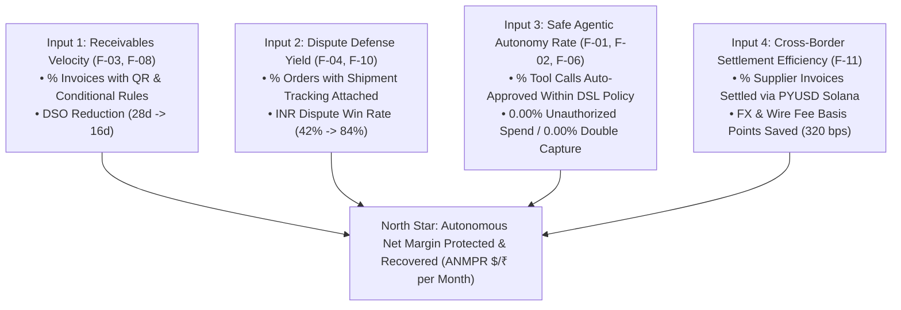

# Product Metrics, AARRR Funnel & Analytics Event Taxonomy — PayOps AI (PayPal Sentinel)
> Project: PayOps AI (PayPal Sentinel) · Owner: Growth & Analytics Lead · Status: Approved v1.0 · Last updated: 2026-11-05
> Related: [Project Brief](../00-overview/PROJECT_BRIEF.md) · [Vision](../00-overview/VISION.md) · [PRD](./PRD.md) · [Observability](../05-ops/OBSERVABILITY.md)

---

## 1. North-Star Metric (`NSM`) & Input Metrics Tree

### 1.1 Primary North-Star Metric
> **Autonomous Net Margin Protected & Recovered per Merchant (`ANMPR` in `$` / `₹` per Month)**
>
> $$\text{ANMPR} = \underbrace{(\text{TPV}_{\text{Invoiced}} \times \Delta\text{DSO}_{\text{Days}} \times \frac{r_{\text{CoC}}}{365})}_{\text{Working Capital Yield Unlocked (F-03)}} + \underbrace{(\text{Disputes}_{\text{Won}} \times \text{Avg Dispute Value} + \text{Dispute Fees Saved})}_{\text{Friendly-Fraud Revenue Saved (F-04, F-10)}} + \underbrace{\Delta\text{FX/Wire Fees Saved via PYUSD}}_{\text{Cross-Border Treasury Lift (F-11)}}$$

Where $r_{\text{CoC}}$ is the merchant's annualized short-term cost of working capital (typically `12%–18%` APR for SMB credit lines).

### 1.2 Core Product & Operational KPI Targets

| Metric ID | Metric Name | Formula / Definition | Baseline | `MVP (hackathon)` | `v1 (production)` |
| :--- | :--- | :--- | :---: | :---: | :---: |
| **`KPI-01`** | **DSO (Days Sales Outstanding)** | $\frac{\text{Total Open Accounts Receivable}}{\text{Total Credit Sales}} \times \text{Days}$ | `28.0 days` | `16.0 days (-42.8%)` | `<= 15.0 days` |
| **`KPI-02`** | **PayPal Dispute Win Rate** | $\frac{\text{Contested Disputes Decided in Merchant Favor}}{\text{Total Contested Disputes}}$ | `42.0%` | `84.0%` | `>= 85.0%` |
| **`KPI-03`** | **Dispute Evidence Assembly Latency** | Time from `CUSTOMER.DISPUTE.CREATED` webhook to compiled evidence bundle | `38.0 hours` | `3.1 seconds` | `< 5.0 seconds` |
| **`KPI-04`** | **Shipment Tracking Coverage Rate** | $\%$ of captured physical PayPal orders with `create_shipment_tracking` synced | `61.0%` | `100.0%` | `>= 99.5%` |
| **`KPI-05`** | **Policy Firewall Block Accuracy** | $\%$ of red-team prompt-injection / out-of-policy mutations blocked by `F-02` | `0%` (raw LLM) | `100.0% (50/50)` | `100.0%` |
| **`KPI-06`** | **Idempotent Mutation Integrity** | Duplicate charges, refunds, or invoices sent across retry storms (`F-06`) | `2.4%` retry dupes | `0.00%` | `0.00%` |

---

## 2. AARRR Pirate Funnel Metrics (David Sacks, Reid Hoffman & Seth Godin Lens)

| Funnel Stage | Primary Definition in `PayOps AI` | Target Conversion / Benchmark | Viral / Product Mechanism Driving Stage |
| :--- | :--- | :---: | :--- |
| **1. Acquisition** | Merchant visits `PayOps AI` via PayPal App Center, Developer Discord, or clicks the *"Powered by PayPal Sentinel — 1-Tap Fastlane / Automate Your Receivables"* badge on an invoice received from another merchant. | `14.5%` visitor-to-signup conversion | **Two-Sided Invoice Viral Loop (Thiel / Hoffman):** Every smart invoice (`F-03`) sent to 180+ wholesale buyers acts as a zero-CAC billboard to another B2B finance team. |
| **2. Activation** | Merchant completes 1-click PayPal OAuth2 connection, runs initial historical dispute/invoice scan, and executes their first guarded MCP workflow (`F-01` + `F-02`) within **5 minutes**. | `>= 78.0%` signup-to-activated within 24h | Instant **AG Grid** (`F-07`) value reveal: immediately shows `$X,XXX` in overdue invoices and unattached tracking numbers ready to fix in 1 click. |
| **3. Retention** | Weekly Active Merchant Workspaces (`WAM`) with active `Render Workflows` dunning sequences (`F-08`) or webhook dispute protection (`F-04`). | `94.0%` Month-3 Logo Retention · `128%` Net Dollar Retention (NDR) | Once `Cosmos.AI` DSL policies (`E-05`) and recurring series (`E-07`) are active, `PayOps AI` becomes the system of record for daily cash flow. |
| **4. Referral** | Activated merchant invites their external accountant/auditor (`AUDITOR` RBAC role `E-02`) or refers a B2B supplier to settle via `PYUSD` (`F-11`) with waived platform fees for 30 days. | **Viral K-Factor `= 0.42`** | Dual-sided fee rebate on `PYUSD` Solana Token-2022 cross-border vendor settlements (`US-15`). |
| **5. Revenue** | Merchant upgrades from Free Sandbox/Starter tier to **Growth (`$99/mo` / `₹8,200/mo`)** or **Scale (`$299/mo` + `15%` success fee on recovered disputes)**. | **LTV:CAC `= 8.4x`** · Payback Period `= 2.1 months` | Outcome-aligned pricing: a single recovered `$340` dispute pays for 3+ months of subscription (`BUSINESS_MODEL.md`). |

---

## 3. Canonical Analytics & Audit Event Taxonomy

All events are emitted as structured JSON via our OpenTelemetry SDK (`1.27.0`), scrubbed of raw PII (`buyer_hash` only), persisted in PostgreSQL (`E-04`, `E-10`), and indexed in real time in **Elasticsearch (`Elastic Cloud`)** (`F-12`).

| Event Name | Trigger Source | Required JSON Properties | Primary Consumer |
| :--- | :--- | :--- | :--- |
| **`agent.command.submitted`** | `API-01` (`UI_SPEC.md` Command Bar) | `workspace_id`, `session_id`, `operator_id`, `intent_class`, `dry_run`, `injection_score`, `trace_id` | Elastic Observability & `AgentSession` (`E-03`) |
| **`apimatic.schema.validated`** | `F-09` Pre-Flight Validator | `execution_id`, `mcp_tool_name`, `schema_valid`, `auto_repaired_fields[]`, `sdk_version`, `latency_ms` | `AgentToolExecution` (`E-04`) & APIMatic Telemetry |
| **`policy.firewall.evaluated`** | `F-02` `Cosmos.AI` DSL Engine | `execution_id`, `policy_id`, `mcp_tool_name`, `amount_minor`, `currency`, `gnn_risk_score`, `verdict` (`ALLOW`\|`HOLD_APPROVAL`\|`DENY`), `matched_rule_ast`, `eval_ms` | **AG Grid** Live Stream (`F-07`) & `ImmutableAuditLog` (`E-10`) |
| **`agent.execution.held`** | `F-02` (`verdict == HOLD_APPROVAL`) | `execution_id`, `paypal_request_id`, `hold_reason`, `required_role`, `amount_usd_equiv`, `sla_expires_at` | **AG Grid** Approval Queue & **Zapier** Slack Alert (`F-12`) |
| **`agent.execution.approved`** | `API-02` Operator HITL Action | `execution_id`, `operator_id`, `operator_role`, `decision` (`APPROVE`\|`REJECT`), `signature_hash`, `entry_hash` | `ImmutableAuditLog` (`E-10`) & PayPal MCP Dispatcher |
| **`paypal.mcp.tool_executed`** | `F-01` / `F-06` MCP Invoker | `execution_id`, `paypal_request_id`, `mcp_tool_name`, `paypal_http_status`, `idempotent_replayed`, `sandbox_resource_id`, `latency_ms` | **AG Grid** (`F-07`), `AgentToolExecution` (`E-04`), Elastic |
| **`invoice.dunning.scheduled`** | `F-03` / `F-08` **Bryntum** Canvas | `invoice_id`, `paypal_invoice_id`, `dunning_stage`, `scheduled_at`, `early_discount_pct`, `late_fee_pct`, `qr_generated` | **Bryntum Scheduler Pro** (`F-08`) & Render Workflows |
| **`dispute.webhook.enriched`** | `API-13` / `F-04` / `F-10` | `dispute_id`, `order_id`, `reason_code`, `disputed_amount`, `carrier_status`, `gnn_risk_score`, `gnn_reason_codes[]`, `auto_action` | **AG Grid** Dispute War-Room (`F-07`) & `PayPalDisputeCase` (`E-08`) |
| **`pyusd.settlement.confirmed`** | `F-11` Solana Token-2022 Bridge | `invoice_id`, `paypal_request_id`, `solana_tx_signature`, `pyusd_amount`, `memo_verified`, `fx_fee_saved_usd` | `PayPalInvoiceRecord` (`E-07`) & North-Star `ANMPR` Counter |

---

## 4. Executive Analytics Dashboard Layout (`AG Grid` + `AG Charts` + `Elastic`)

The `API-14` (`GET /api/v1/analytics/insights`) endpoint powers four synchronized visual telemetry panels on **Screen 1 (Executive Command Center)**:
1. **KPI Ribbon (Top Bar):** Live counters for **Monthly `ANMPR` (`$4,470` / `₹3.75L`)**, **Current DSO (`16.0d` vs `28.0d` baseline)**, **Dispute Win Rate (`84.0%`)**, and **Policy Firewall Integrity (`100%` / `0` leaks)**.
2. **AG Charts Cash-Flow Waterfall & DSO Aging Histogram:** Visualizes expected vs realized invoice collections across `Current`, `1–15d`, `16–30d`, and `30d+` aging buckets.
3. **GNN Risk vs. Dispute Outcome Scatter Plot:** Plots incoming disputes by `Disputed Amount ($)` × `M-04 GNN Friendly-Fraud Score (0.0–1.0)`, color-coded by `AUTO_ACCEPTED`, `CONTESTED_WON`, and `HELD_FOR_REVIEW`.
4. **Elastic Token & Latency Burn Monitor:** Tracks `M-01`..`M-05` token cost per transaction (`$0.0088` avg) against the merchant's ROI.
