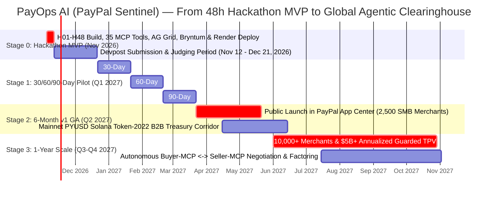

# Product & Engineering Roadmap — PayOps AI (PayPal Sentinel)
> Project: PayOps AI (PayPal Sentinel) · Owner: VP of Product & Strategy · Status: Approved v1.0 · Last updated: 2026-11-05
> Related: [Project Brief](../00-overview/PROJECT_BRIEF.md) · [Vision](../00-overview/VISION.md) · [Hackathon Plan](../00-overview/HACKATHON_PLAN.md) · [PRD](./PRD.md) · [GTM](../07-business/GTM.md)

---

## 1. Multi-Horizon Roadmap Overview (Mermaid `gantt`)

---

## 2. Detailed Milestone Breakdown

### 2.1 Stage 0 — Hackathon MVP (`H01–H48` · November 2026)
- **Objective:** Deliver a complete, production-architected, working build of **`PS-01: PayOps AI`** deployed on **Render** and connected to the **PayPal Developer Sandbox**.
- **Delivered Capabilities:**
  - All **12 canonical features (`F-01`..`F-12`)** and **14 API endpoints (`API-01`..`API-14`)**.
  - Orchestration of all **35 tools in `@paypal/agent-toolkit`** and the **PayPal MCP Server**.
  - Deterministic **`Cosmos.AI` DSL Policy Firewall (`F-02`)**, **`JunoDB`-patterned `PayPal-Request-Id` idempotency (`F-06`)**, and **`APIMatic` SDK schema validation (`F-09`)**.
  - Executive **AG Grid Enterprise Command Center (`F-07`)** and **Bryntum Scheduler Pro (`F-08`)** timeline.
  - Multi-Hop **GNN Friendly-Fraud Scorer (`F-10`, `M-04`)** + **Solana Devnet `PYUSD` Token-2022 (`F-11`)** bridge.

### 2.2 Stage 1 — 30 / 60 / 90-Day Post-Hackathon Commercialization (`Q1 2027`)

| Horizon | Milestone Focus | Concrete Engineering & Commercial Deliverables | Exit Criteria / KPI Target |
| :--- | :--- | :--- | :--- |
| **Day 30 (`Jan 2027`)** | **Design Partner Private Beta** | • Onboard **25 high-volume SMB merchants** (15 US D2C/wholesale brands like `P-01` + 10 Bengaluru SaaS/IT export agencies like `P-02`). • Deploy Shadow-Mode Policy Backtester so merchants can run `F-02` and `F-04` in read-only audit mode for 7 days before enabling live autonomous execution. | `25` active merchants · `$15M` annualized TPV monitored · `0` policy violations. |
| **Day 60 (`Feb 2027`)** | **PayPal Partner (`PPCP`) & Native Carrier Connectors** | • Transition from single-merchant OAuth2 to multi-tenant **PayPal Complete Payments (PPCP)** Partner APIs (`PayPal-Partner-Attribution-Id` & `PayPal-Auth-Assertion`). • Add native webhook listeners for **DHL Express, FedEx, UPS, USPS, and Shiprocket (India)** to auto-trigger `create_shipment_tracking` within 5 seconds of label scan. | `100` active merchants · `>98%` of shipped orders auto-tagged with tracking on PayPal. |
| **Day 90 (`Mar 2027`)** | **Compliance Attestation & ERP Sync** | • Complete **SOC 2 Type I** audit and **PCI-DSS v4.0 SAQ-A** self-assessment. • Launch native 2-way connectors for **QuickBooks Online, Xero, NetSuite, and Zoho Books (India)** alongside **Zapier** (`F-12`). | `250` paying merchants · Average DSO reduced by `>= 38%` across cohort. |

### 2.3 Stage 2 — 6-Month Milestone: `v1 (production)` General Availability (`May 2027`)
- **Scale Target:** **2,500 active SMB & mid-market merchants** processing **$1.2B (`₹10,000 Cr`)** in annualized PayPal TPV.
- **Key Launches:**
  1. **PayPal App Center Listing:** 1-click OAuth installation directly from the PayPal Merchant Dashboard.
  2. **Mainnet `PYUSD` Solana Token-2022 Treasury Corridor (`F-11`):** Production rollout of cross-border B2B vendor payouts using `PYUSD` with Zero-Knowledge **Confidential Transfers** (encrypting invoice settlement amounts on-chain while maintaining full regulatory auditability via Paxos/PayPal viewing keys) and **RBI PA-CB** compliant off-ramp partners in India.
  3. **Automated Compelling Evidence 3.0 Direct Submission:** Full production integration with PayPal's Dispute Sandbox/Live Evidence Upload API and Braintree GraphQL Dispute mutations.

### 2.4 Stage 3 — 1-Year Milestone: The Autonomous B2B Clearinghouse (`November 2027`)
- **Scale Target:** **10,000+ active businesses** processing **$5.0B+ (`₹42,000 Cr+`)** in annualized guarded TPV, generating **$14.4M ARR** (`FINANCIALS.md`).
- **Key Launches:**
  1. **Agent-to-Agent (A2A) MCP Negotiation Protocol:** When a `PayOps AI` seller agent sends an invoice (`F-03`) to a buyer who also runs an MCP-compatible procurement agent (`F-05`), the two agents autonomously negotiate dynamic early-payment discounts (e.g., `2.4% discount for instant PYUSD settlement today vs Net-30`) within each company's `Cosmos.AI` DSL policy bounds.
  2. **GNN-Underwritten Instant Invoice Factoring:** Leveraging our cross-merchant `M-04` Multi-Hop Trust Graph, pre-qualify verified PayPal invoices for instant working-capital advances in partnership with **PayPal Working Capital**.

---

## 3. Pilot Programs & Ecosystem Partnership Strategy

| Partner / Ecosystem | Partnership Track | Value to Partner | Value to `PayOps AI` |
| :--- | :--- | :--- | :--- |
| **PayPal (`PPCP` & Agentic Commerce Team)** | Official PayPal Partner & `Agent Ready` Control Plane | Drives higher merchant adoption of `Invoicing v2`, `Fastlane`, `PYUSD`, and `@paypal/agent-toolkit` while cutting PayPal support overhead on disputes. | Distribution to 35M+ PayPal merchant accounts + partner rev-share BPS. |
| **AG Grid & Bryntum** | OEM Enterprise UI Showcase Partners | Flagship FinTech AI reference customer showcasing **AG Grid Enterprise** (`F-07`) and **Bryntum Scheduler Pro** (`F-08`) in autonomous finance. | Enterprise visual polish that converts CFOs and Risk VP buyers in `< 45 seconds`. |
| **APIMatic** | Deterministic MCP SDK Co-Marketing Partner | Proves APIMatic Context Plugins eliminate LLM hallucinations in regulated financial execution (`F-09`). | Zero-maintenance SDK updates whenever PayPal releases new REST v2/v3 endpoints. |
| **Elastic & Render** | Cloud & AI Observability Startup Program | High-growth AI workload consuming **Render Workflows**, Managed Postgres/Redis, and **Elastic Cloud** vector/audit search. | Cloud credits (`$2,250+` Render Credits + Elastic startup tier) extending gross margin to `84%+`. |
