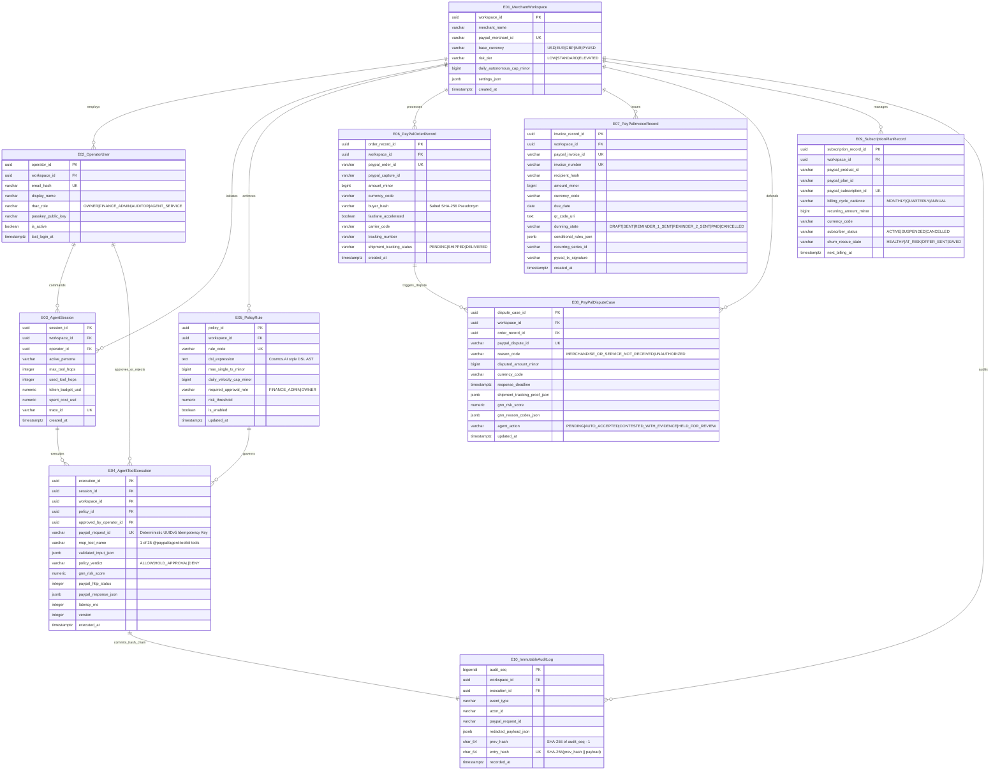

# Data Model, Entity-Relationship Diagram & SQL/JSON Schemas (`E-01` to `E-10`) — PayOps AI (PayPal Sentinel)
> Project: PayOps AI (PayPal Sentinel) · Owner: Principal Data & Ledger Architect · Status: Approved v1.0 · Last updated: 2026-11-05
> Related: [Project Brief](../00-overview/PROJECT_BRIEF.md) · [Architecture](./ARCHITECTURE.md) · [API Spec](./API_SPEC.md) · [Privacy](../06-security-compliance/PRIVACY.md) · [ADR-0002](./adr/ADR-0002-database-and-state.md)

---

## 1. Entity-Relationship Diagram (`E-01` to `E-10`, Mermaid `erDiagram`)

Every canonical entity (`E-01` through `E-10`) defined in [`PROJECT_BRIEF.md`](../00-overview/PROJECT_BRIEF.md) is modeled in **PostgreSQL 16.4** (`pgvector` `0.7.4`) with hot idempotency state mirrored in **Redis 7.4 (`JunoDB` 2PC pattern)** and compliance logs indexed in **Elasticsearch (`Elastic Cloud`)**.



---

## 2. Complete PostgreSQL 16 SQL DDL Schema (`E-01` to `E-10`)

The following production migration (`infra/migrations/0001_init_payops_schema.sql`) initializes all 10 canonical tables, constraints, composite indexes, and the cryptographic hash-chaining trigger on `ImmutableAuditLog` (`E-10`):

```sql
-- Enable required PostgreSQL 16 extensions
CREATE EXTENSION IF NOT EXISTS "uuid-ossp";
CREATE EXTENSION IF NOT EXISTS "pgcrypto";
CREATE EXTENSION IF NOT EXISTS "vector";

-- E-01: MerchantWorkspace
CREATE TABLE merchant_workspaces (
    workspace_id UUID PRIMARY KEY DEFAULT gen_random_uuid(),
    merchant_name VARCHAR(160) NOT NULL,
    paypal_merchant_id VARCHAR(64) NOT NULL UNIQUE,
    paypal_client_id_ref VARCHAR(128) NOT NULL,
    risk_tier VARCHAR(24) NOT NULL DEFAULT 'STANDARD' CHECK (risk_tier IN ('LOW', 'STANDARD', 'ELEVATED')),
    base_currency VARCHAR(8) NOT NULL DEFAULT 'USD' CHECK (base_currency IN ('USD', 'EUR', 'GBP', 'INR', 'JPY', 'PYUSD')),
    daily_autonomous_cap_minor BIGINT NOT NULL DEFAULT 500000, -- $5,000.00 default
    settings_json JSONB NOT NULL DEFAULT '{}'::jsonb,
    created_at TIMESTAMPTZ NOT NULL DEFAULT NOW(),
    updated_at TIMESTAMPTZ NOT NULL DEFAULT NOW()
);

-- E-02: OperatorUser
CREATE TABLE operator_users (
    operator_id UUID PRIMARY KEY DEFAULT gen_random_uuid(),
    workspace_id UUID NOT NULL REFERENCES merchant_workspaces(workspace_id) ON DELETE RESTRICT,
    email_hash CHAR(64) NOT NULL UNIQUE, -- Salted SHA-256
    display_name VARCHAR(120) NOT NULL,
    rbac_role VARCHAR(24) NOT NULL CHECK (rbac_role IN ('OWNER', 'FINANCE_ADMIN', 'AUDITOR', 'AGENT_SERVICE')),
    passkey_public_key TEXT NOT NULL,
    is_active BOOLEAN NOT NULL DEFAULT TRUE,
    last_login_at TIMESTAMPTZ,
    created_at TIMESTAMPTZ NOT NULL DEFAULT NOW()
);
CREATE INDEX idx_operator_users_workspace_role ON operator_users(workspace_id, rbac_role);

-- E-03: AgentSession
CREATE TABLE agent_sessions (
    session_id UUID PRIMARY KEY DEFAULT gen_random_uuid(),
    workspace_id UUID NOT NULL REFERENCES merchant_workspaces(workspace_id) ON DELETE RESTRICT,
    operator_id UUID NOT NULL REFERENCES operator_users(operator_id) ON DELETE RESTRICT,
    active_persona VARCHAR(48) NOT NULL DEFAULT 'SENTINEL_CFO',
    max_tool_hops INTEGER NOT NULL DEFAULT 6 CHECK (max_tool_hops BETWEEN 1 AND 12),
    used_tool_hops INTEGER NOT NULL DEFAULT 0 CHECK (used_tool_hops <= max_tool_hops),
    token_budget_usd NUMERIC(8, 4) NOT NULL DEFAULT 0.2500,
    spent_cost_usd NUMERIC(8, 4) NOT NULL DEFAULT 0.0000 CHECK (spent_cost_usd <= token_budget_usd),
    trace_id VARCHAR(64) NOT NULL UNIQUE,
    created_at TIMESTAMPTZ NOT NULL DEFAULT NOW()
);
CREATE INDEX idx_agent_sessions_workspace_created ON agent_sessions(workspace_id, created_at DESC);

-- E-05: PolicyRule
CREATE TABLE policy_rules (
    policy_id UUID PRIMARY KEY DEFAULT gen_random_uuid(),
    workspace_id UUID NOT NULL REFERENCES merchant_workspaces(workspace_id) ON DELETE RESTRICT,
    rule_code VARCHAR(32) NOT NULL,
    rule_name VARCHAR(140) NOT NULL,
    dsl_expression TEXT NOT NULL, -- Cosmos.AI style deterministic rule expression
    max_single_tx_minor BIGINT NOT NULL DEFAULT 50000, -- $500.00 / ₹42,000 cap
    daily_velocity_cap_minor BIGINT NOT NULL DEFAULT 500000,
    required_approval_role VARCHAR(24) NOT NULL DEFAULT 'FINANCE_ADMIN' CHECK (required_approval_role IN ('FINANCE_ADMIN', 'OWNER')),
    risk_threshold NUMERIC(4, 3) NOT NULL DEFAULT 0.700 CHECK (risk_threshold BETWEEN 0.000 AND 1.000),
    is_enabled BOOLEAN NOT NULL DEFAULT TRUE,
    updated_at TIMESTAMPTZ NOT NULL DEFAULT NOW(),
    UNIQUE (workspace_id, rule_code)
);

-- E-04: AgentToolExecution
CREATE TABLE agent_tool_executions (
    execution_id UUID PRIMARY KEY DEFAULT gen_random_uuid(),
    session_id UUID NOT NULL REFERENCES agent_sessions(session_id) ON DELETE RESTRICT,
    workspace_id UUID NOT NULL REFERENCES merchant_workspaces(workspace_id) ON DELETE RESTRICT,
    policy_id UUID NOT NULL REFERENCES policy_rules(policy_id) ON DELETE RESTRICT,
    approved_by_operator_id UUID REFERENCES operator_users(operator_id) ON DELETE RESTRICT,
    paypal_request_id VARCHAR(64) NOT NULL UNIQUE, -- Deterministic UUIDv5 Idempotency Key
    mcp_tool_name VARCHAR(64) NOT NULL,
    validated_input_json JSONB NOT NULL,
    policy_verdict VARCHAR(24) NOT NULL CHECK (policy_verdict IN ('ALLOW', 'HOLD_APPROVAL', 'DENY', 'COMPLETED', 'REJECTED')),
    injection_score NUMERIC(4, 3) NOT NULL DEFAULT 0.000,
    gnn_risk_score NUMERIC(4, 3) NOT NULL DEFAULT 0.000,
    paypal_http_status INTEGER,
    paypal_response_json JSONB,
    operator_signature TEXT,
    latency_ms INTEGER NOT NULL DEFAULT 0,
    version INTEGER NOT NULL DEFAULT 1, -- Optimistic concurrency lock
    executed_at TIMESTAMPTZ NOT NULL DEFAULT NOW()
);
CREATE INDEX idx_tool_exec_workspace_verdict ON agent_tool_executions(workspace_id, policy_verdict, executed_at DESC);

-- E-06: PayPalOrderRecord
CREATE TABLE paypal_order_records (
    order_record_id UUID PRIMARY KEY DEFAULT gen_random_uuid(),
    workspace_id UUID NOT NULL REFERENCES merchant_workspaces(workspace_id) ON DELETE RESTRICT,
    paypal_order_id VARCHAR(64) NOT NULL UNIQUE,
    paypal_capture_id VARCHAR(64),
    amount_minor BIGINT NOT NULL CHECK (amount_minor > 0),
    currency_code VARCHAR(8) NOT NULL,
    buyer_hash CHAR(64) NOT NULL, -- Salted SHA-256 pseudonymized buyer token
    fastlane_accelerated BOOLEAN NOT NULL DEFAULT FALSE,
    carrier_code VARCHAR(32),
    tracking_number VARCHAR(64),
    shipment_tracking_status VARCHAR(24) NOT NULL DEFAULT 'PENDING' CHECK (shipment_tracking_status IN ('PENDING', 'SHIPPED', 'IN_TRANSIT', 'DELIVERED', 'CANCELLED')),
    created_at TIMESTAMPTZ NOT NULL DEFAULT NOW(),
    updated_at TIMESTAMPTZ NOT NULL DEFAULT NOW()
);
CREATE INDEX idx_paypal_orders_buyer_hash ON paypal_order_records(workspace_id, buyer_hash);

-- E-07: PayPalInvoiceRecord
CREATE TABLE paypal_invoice_records (
    invoice_record_id UUID PRIMARY KEY DEFAULT gen_random_uuid(),
    workspace_id UUID NOT NULL REFERENCES merchant_workspaces(workspace_id) ON DELETE RESTRICT,
    paypal_invoice_id VARCHAR(64) NOT NULL UNIQUE,
    invoice_number VARCHAR(64) NOT NULL,
    recipient_hash CHAR(64) NOT NULL,
    amount_minor BIGINT NOT NULL CHECK (amount_minor > 0),
    currency_code VARCHAR(8) NOT NULL,
    due_date DATE NOT NULL,
    qr_code_uri TEXT,
    dunning_state VARCHAR(32) NOT NULL DEFAULT 'SENT' CHECK (dunning_state IN ('DRAFT', 'SENT', 'REMINDER_1_SENT', 'REMINDER_2_SENT', 'PAID', 'CANCELLED')),
    conditional_rules_json JSONB NOT NULL DEFAULT '{}'::jsonb,
    recurring_series_id VARCHAR(64),
    pyusd_tx_signature VARCHAR(128),
    created_at TIMESTAMPTZ NOT NULL DEFAULT NOW(),
    updated_at TIMESTAMPTZ NOT NULL DEFAULT NOW(),
    UNIQUE (workspace_id, invoice_number)
);
CREATE INDEX idx_paypal_invoices_due_state ON paypal_invoice_records(workspace_id, dunning_state, due_date);

-- E-08: PayPalDisputeCase
CREATE TABLE paypal_dispute_cases (
    dispute_case_id UUID PRIMARY KEY DEFAULT gen_random_uuid(),
    workspace_id UUID NOT NULL REFERENCES merchant_workspaces(workspace_id) ON DELETE RESTRICT,
    order_record_id UUID REFERENCES paypal_order_records(order_record_id) ON DELETE RESTRICT,
    paypal_dispute_id VARCHAR(64) NOT NULL UNIQUE,
    reason_code VARCHAR(64) NOT NULL,
    disputed_amount_minor BIGINT NOT NULL CHECK (disputed_amount_minor > 0),
    currency_code VARCHAR(8) NOT NULL,
    response_deadline TIMESTAMPTZ NOT NULL,
    shipment_tracking_proof_json JSONB NOT NULL DEFAULT '{}'::jsonb,
    gnn_risk_score NUMERIC(4, 3) NOT NULL DEFAULT 0.000,
    gnn_reason_codes_json JSONB NOT NULL DEFAULT '[]'::jsonb,
    evidence_bundle_json JSONB NOT NULL DEFAULT '{}'::jsonb,
    agent_action VARCHAR(32) NOT NULL DEFAULT 'PENDING' CHECK (agent_action IN ('PENDING', 'AUTO_ACCEPTED', 'CONTESTED_WITH_EVIDENCE', 'HELD_FOR_REVIEW', 'WON', 'LOST')),
    updated_at TIMESTAMPTZ NOT NULL DEFAULT NOW()
);
CREATE INDEX idx_paypal_disputes_deadline ON paypal_dispute_cases(workspace_id, agent_action, response_deadline ASC);

-- E-09: SubscriptionPlanRecord
CREATE TABLE subscription_plan_records (
    subscription_record_id UUID PRIMARY KEY DEFAULT gen_random_uuid(),
    workspace_id UUID NOT NULL REFERENCES merchant_workspaces(workspace_id) ON DELETE RESTRICT,
    paypal_product_id VARCHAR(64) NOT NULL,
    paypal_plan_id VARCHAR(64) NOT NULL,
    paypal_subscription_id VARCHAR(64) NOT NULL UNIQUE,
    billing_cycle_cadence VARCHAR(24) NOT NULL CHECK (billing_cycle_cadence IN ('MONTHLY', 'QUARTERLY', 'ANNUAL')),
    recurring_amount_minor BIGINT NOT NULL CHECK (recurring_amount_minor > 0),
    currency_code VARCHAR(8) NOT NULL,
    subscriber_status VARCHAR(24) NOT NULL CHECK (subscriber_status IN ('APPROVAL_PENDING', 'ACTIVE', 'SUSPENDED', 'CANCELLED', 'EXPIRED')),
    churn_rescue_state VARCHAR(24) NOT NULL DEFAULT 'HEALTHY' CHECK (churn_rescue_state IN ('HEALTHY', 'AT_RISK', 'OFFER_SENT', 'SAVED')),
    next_billing_at TIMESTAMPTZ NOT NULL,
    updated_at TIMESTAMPTZ NOT NULL DEFAULT NOW()
);

-- E-10: ImmutableAuditLog (Append-Only Hash-Chained Compliance Ledger)
CREATE TABLE immutable_audit_logs (
    audit_seq BIGSERIAL PRIMARY KEY,
    workspace_id UUID NOT NULL REFERENCES merchant_workspaces(workspace_id) ON DELETE RESTRICT,
    execution_id UUID REFERENCES agent_tool_executions(execution_id) ON DELETE RESTRICT,
    event_type VARCHAR(64) NOT NULL,
    actor_id VARCHAR(64) NOT NULL,
    paypal_request_id VARCHAR(64) NOT NULL,
    redacted_payload_json JSONB NOT NULL,
    prev_hash CHAR(64) NOT NULL,
    entry_hash CHAR(64) NOT NULL UNIQUE,
    recorded_at TIMESTAMPTZ NOT NULL DEFAULT NOW()
);
CREATE INDEX idx_audit_logs_workspace_recorded ON immutable_audit_logs(workspace_id, recorded_at DESC);

-- Prevent UPDATE or DELETE on immutable_audit_logs (Tamper-Evident Enforcement)
CREATE OR REPLACE FUNCTION prevent_audit_log_mutation()
RETURNS TRIGGER AS $$
BEGIN
    RAISE EXCEPTION 'ImmutableAuditLog (E-10) is append-only. UPDATE and DELETE are strictly prohibited.';
END;
$$ LANGUAGE plpgsql;

CREATE TRIGGER trg_immutable_audit_log_protect
BEFORE UPDATE OR DELETE ON immutable_audit_logs
FOR EACH ROW EXECUTE FUNCTION prevent_audit_log_mutation();
```

---

## 3. PII / PCI-DSS v4.0 / DPDP Classification & Retention Schedule

Per `PRIVACY.md` and `COMPLIANCE.md`, `PayOps AI` enforces strict field-level data minimization and cryptographic pseudonymization:

| Entity ID & Table | Sensitive / Regulated Fields | Classification Tier | Protection & Masking Control | Retention Period |
| :--- | :--- | :---: | :--- | :--- |
| **`E-01` `MerchantWorkspace`** | `paypal_client_id_ref` | **C3 — Credential Reference** | Stores KMS/Vault secret reference ARN only; raw `PAYPAL_CLIENT_SECRET` never stored in DB. | Active account + 90 days |
| **`E-02` `OperatorUser`** | `email_hash`, `passkey_public_key` | **C2 — Operator Identity (PII)** | Email salted & SHA-256 hashed (`email_hash`); WebAuthn public key only. | Active account + 180 days |
| **`E-03` `AgentSession`** | `trace_id`, `spent_cost_usd` | **C1 — Operational Telemetry** | Zero PII stored in session metadata. | 90 days hot · 180 days archive |
| **`E-04` `AgentToolExecution`**| `validated_input_json`, `paypal_response_json` | **C2 — Financial Execution Record** | Buyer emails/names redacted to `buyer_hash` prior to persistence; keyed by `PayPal-Request-Id`. | **7 years** (Financial ledger tax/audit statutory retention) |
| **`E-05` `PolicyRule`** | `dsl_expression` | **C1 — Internal Policy Config** | Versioned in audit log on every edit. | Life of workspace |
| **`E-06` `PayPalOrderRecord`** | `buyer_hash`, `tracking_number` | **C2 — Pseudonymized Commerce** | **Zero PAN / Zero CVV** (PCI-DSS SAQ-A); buyer identity stored strictly as salted `buyer_hash`. | **7 years** (Statutory accounting) |
| **`E-07` `PayPalInvoiceRecord`**| `recipient_hash`, `pyusd_tx_signature` | **C2 — Pseudonymized Receivables** | Recipient email hashed via `HMAC-SHA256`; PayPal Sandbox/Live holds raw billing PII. | **7 years** (Statutory accounting) |
| **`E-08` `PayPalDisputeCase`** | `shipment_tracking_proof_json`, `evidence_bundle_json` | **C2 — Dispute Evidence** | Street number masked in logs; full evidence transmitted over TLS 1.3 directly to PayPal Disputes API. | **3 years** post-dispute resolution |
| **`E-09` `SubscriptionPlanRecord`**| `paypal_subscription_id` | **C1 — Billing Metadata** | Tokenized PayPal Subscription ID (`I-XXXX`) only. | Active subscription + 3 years |
| **`E-10` `ImmutableAuditLog`** | `redacted_payload_json`, `entry_hash` | **C3 — Regulated Audit Trail** | Append-only (`trg_immutable_audit_log_protect`), SHA-256 hash-chained, replicated to **Elastic**. | **180 days hot** (CERT-In mandate) + **7 years cold WORM** (PCI-DSS v4.0 Req 10.5) |

---

## 4. Zero-Downtime Schema Migration Strategy (`Expand-and-Contract`)

All database schema changes use **Drizzle Kit (`drizzle-kit migrate`)** executed inside an automated pre-deploy phase on **Render** (`DEPLOYMENT.md`) following the strict **Expand-and-Contract** pattern:
1. **Phase 1 (Expand):** Add nullable columns, new tables, or `CREATE INDEX CONCURRENTLY` without locking active reads/writes on `agent_tool_executions` or `paypal_order_records`.
2. **Phase 2 (Dual-Write & Backfill):** Deploy application code writing to both old and new columns while a background worker backfills historical rows in batches of `1,000`.
3. **Phase 3 (Contract):** Enforce `NOT NULL` constraints via `ALTER TABLE ... ADD CONSTRAINT ... NOT VALID` followed by `VALIDATE CONSTRAINT`.
