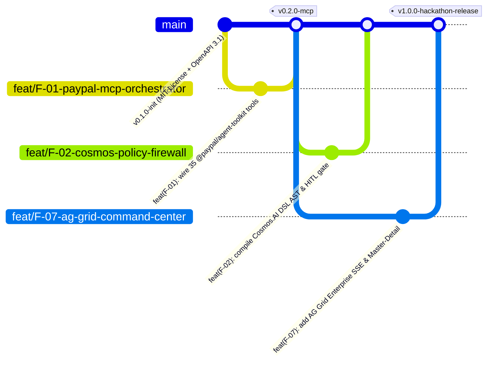

# Git Workflow, Branching Strategy & Conventional Commits — PayOps AI (PayPal Sentinel)
> Project: PayOps AI (PayPal Sentinel) · Owner: Release Engineering & DevRel Lead · Status: Approved v1.0 · Last updated: 2026-11-05
> Related: [Project Brief](../00-overview/PROJECT_BRIEF.md) · [Coding Standards](./CODING_STANDARDS.md) · [Testing](./TESTING.md) · [CI/CD](../05-ops/CICD.md)

---

## 1. Trunk-Based Development & Branching Model

To maximize velocity during the 48-hour hackathon sprint (`H01–H48`) while keeping `main` continuously deployable to **Render** (`render.yaml`), our team uses **Trunk-Based Development with Short-Lived Feature Branches**:



### 1.1 Branch Naming Convention
All branches follow the pattern `<type>/<canonical-id>-<short-kebab-slug>`:
- `feat/F-01-paypal-mcp-orchestrator`
- `feat/F-03-smart-invoicing-qr`
- `feat/F-04-dispute-defense-gnn`
- `feat/F-07-ag-grid-enterprise`
- `feat/F-08-bryntum-scheduler`
- `feat/F-11-pyusd-solana-bridge`
- `fix/R-04-webhook-signature-verify`
- `docs/M3-engineering-specifications`

---

## 2. Commit Message Convention (Conventional Commits 1.0)

Every commit message adheres strictly to **Conventional Commits 1.0** with a mandatory canonical feature (`F-xx`), entity (`E-xx`), API (`API-xx`), or risk (`R-xx`) scope so `CHANGELOG.md` can be generated deterministically:

```text
<type>(<canonical-id>): <imperative summary under 72 characters>

[Optional body explaining architectural rationale and PayPal Sandbox verification]

Refs: <US-xx>, <API-xx>, <ADR-xxxx>
```

### Allowed Commit Types
- **`feat(F-xx)`**: New product or engineering capability (`feat(F-03): add generate_invoice_qr_code and Net-10 discount rule`).
- **`fix(R-xx)`**: Security, idempotency, or bug fix (`fix(R-02): enforce Redis CAS lease on PayPal-Request-Id retry`).
- **`perf(F-xx)`**: Latency or throughput optimization (`perf(F-10): cache 3-hop Mirror Graph features for <18ms GNN scoring`).
- **`test(US-xx)`**: Unit, contract, E2E, or AI red-team evaluation tests (`test(US-03): add 50 red-team prompt injection block assertions`).
- **`docs(M3/M4)`**: Documentation, ADRs, or OpenAPI specification updates.
- **`ci` / `chore`**: GitHub Actions workflows, `render.yaml`, or dependency lockfile updates.

---

## 3. Pull Request Rules & Automated Merge Gates

1. **Maximum Branch Lifespan:** `< 4 hours` during the hackathon sprint (`< 24 hours` in post-hackathon production) to prevent merge conflicts across `apps/web` and `services/api`.
2. **Mandatory CI Status Checks Before Merge to `main` (`.github/workflows/ci.yml`):**
   - `lint-and-typecheck`: Biome, ESLint, `tsc --noEmit`, Ruff, and `mypy --strict`.
   - `secret-and-hygiene-scan`: `gitleaks` check verifying zero leaked credentials + repository compliance script (`tests/verify_deliverables.py`).
   - `unit-and-contract-tests`: Vitest + Pytest + OpenAPI 3.1 schema validation (`api/openapi.yaml`).
   - `ai-safety-eval-gate`: Runs the 50-case adversarial prompt-injection and APIMatic schema benchmark (`100.0%` required block/validity rate).
3. **Open-Source Repository Hygiene (Eddie Jaoude Standard):**
   - Root `LICENSE` (MIT License) is committed in the initial commit (`H01`) so GitHub displays the MIT license badge in the repository **About** header (`R-12`).
   - Every PR automatically deploys a preview environment on **Render** for live visual inspection before merging to `main`.

---

## 4. Semantic Versioning & Release Tagging (`SemVer 2.0.0`)

- **`v0.1.0`** (`H08` Gate): Core monorepo, PostgreSQL `E-01`..`E-10` schema, PayPal Sandbox OAuth2, and 35-tool MCP harness.
- **`v0.5.0`** (`H24` Gate): Smart Invoicing (`F-03`), `Cosmos.AI` Policy Firewall (`F-02`), Dispute Defense + GNN (`F-04`, `F-10`), **AG Grid (`F-07`)**, and **Bryntum (`F-08`)** live on Render.
- **`v1.0.0`** (`H44` Final Hackathon Submission Tag): Full `F-01`..`F-12` suite including `APIMatic` SDK code exporter (`F-09`), `PYUSD` Solana Token-2022 bridge (`F-11`), `Channel3`/`Elastic`/`Zapier` (`F-12`), deterministic Sandbox replay engine (`R-06`), and 100% passing E2E verification suite.
