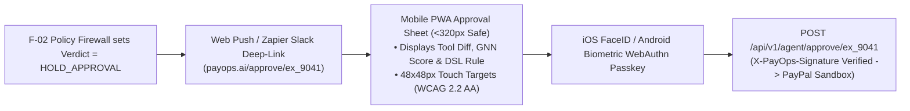

# Mobile, Responsive PWA & QR Wallet Experience Specification — PayOps AI (PayPal Sentinel)
> Project: PayOps AI (PayPal Sentinel) · Owner: Mobile & Omnichannel Experience Lead · Status: Approved v1.0 · Last updated: 2026-11-05
> Related: [Project Brief](../00-overview/PROJECT_BRIEF.md) · [Personas](../01-product/PERSONAS.md) · [UI Spec](../02-design/UI_SPEC.md) · [Frontend](./FRONTEND.md)

---

## 1. Mobile Use Cases Across Merchant Operators & Buyers

While desktop (`1920×1080`) serves as the high-density **AG Grid** and **Bryntum** command center, three critical moments of truth in `PayOps AI` happen on mobile devices (`iOS Safari` / `Android Chrome` PWA):

1. **On-the-Go Human-in-the-Loop Approval (`P-01` Maya Lin & `P-03` Elena Rostova, `US-03`):**
   When an autonomous agent action exceeds the `$500` (`₹42,000`) `Cosmos.AI` DSL policy threshold (`HOLD_APPROVAL`), the merchant receives an instant mobile push / Slack notification (`F-12`) and approves or rejects the mutation in **one FaceID / TouchID WebAuthn Passkey tap** (`API-02`).
2. **Buyer 1-Tap QR Code & Fastlane Mobile Checkout (`F-03`, `F-05`, `US-04`):**
   When a wholesale buyer scans a PayPal Invoice QR code (`generate_invoice_qr_code`) or opens an invoice link on their phone, `PayOps AI` launches a mobile-optimized **Fastlane by PayPal / Venmo / Apple Pay / Google Pay** checkout sheet that settles in `< 8 seconds`.
3. **Commute Treasury & `PYUSD` Settlement (`P-02` Arjun Mehta, `US-15`):**
   Reviewing daily cash-flow inflows (`ANMPR`) and approving cross-border `PYUSD` Solana Token-2022 supplier settlements from an Android device on 5G/4G.

---

## 2. Mobile-First Architecture & Progressive Web App (PWA) Capabilities

- **Installable PWA Manifest (`apps/web/public/manifest.json`):** Supports iOS/Android home-screen installation, standalone full-screen viewport (`display: "standalone"`), and Service Worker offline caching of the last 100 ledger records and held approvals.
- **Biometric WebAuthn Passkey Signing (`E-02` `passkey_public_key`):** Uses the browser `navigator.credentials.get()` WebAuthn API so operators can cryptographically sign `API-02` approvals using hardware Secure Enclave / Titan M2 biometrics without typing passwords on mobile keyboards.

---

## 3. Responsive Viewport Adaptations for `AG Grid` & `Bryntum` (`< 768px`)

Enterprise data grids and Gantt charts become unusable on `375px` mobile screens if rendered as horizontal scrolling tables. `PayOps AI` dynamically adapts both sponsor engines below the `md` (`768px`) breakpoint:

| Component | Desktop (`>= 1024px`) | Tablet (`768px – 1023px`) | Mobile Phone (`< 768px` / `320px` min) |
| :--- | :--- | :--- | :--- |
| **`F-07` AG Grid Command Center** | Full multi-column treegrid + side-by-side AG Charts waterfall + pinned right action column. | Auto-hides secondary metadata columns (`trace_id`, `version`); collapsible chart drawer. | Switches to **AG Grid Single-Column Card Renderer Mode**: each row renders as a stacked financial card with full-width `48px`-tall `[Approve]` / `[Reject]` touch buttons. |
| **`F-08` Bryntum Scheduler Pro** | Multi-week horizontal Gantt timeline + dependency arrows + lower resource histogram. | 7-day compact timeline zoom level with pinch-to-zoom enabled. | Switches to **Bryntum Mobile Agenda / Vertical Day List** with tap-to-open Date/Offset Popover Editor (satisfying WCAG 2.2 **2.5.7 Dragging Movements**). |
| **Global Agent Command Bar** | Floating bottom spotlight bar (`Cmd+K`). | Bottom docked bar with quick-prompt chips. | Sticky bottom sheet with **Voice-to-Intent Microphone Button** (`en-US`, `en-IN`, `hi-IN`). |

---

## 4. Mobile Deep-Linking for PayPal, Venmo & Solana `PYUSD` Wallets

- **PayPal & Venmo App Switch:** On iOS and Android, `@paypal/react-paypal-js` (`8.7.0`) automatically detects installed PayPal and Venmo native apps via Universal Links / Android App Links, enabling 1-tap biometric payment confirmation.
- **Invoice QR Code (`generate_invoice_qr_code`):** Renders as a resolution-independent inline SVG with high error correction (`Level Q`) so smartphone cameras scan it instantly from laptop screens or printed packing slips.
- **Solana Mobile Wallet Adapter (`F-11`):** Supports Phantom / Solflare / Backpack mobile deep-linking for signing Token-2022 `PYUSD` (`Memo Required`) supplier settlements on mobile.
