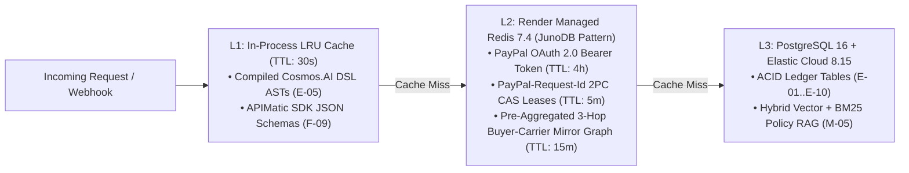

# Performance Engineering, SLOs & Load Testing Plan — PayOps AI (PayPal Sentinel)
> Project: PayOps AI (PayPal Sentinel) · Owner: Staff Performance & Reliability Engineer · Status: Approved v1.0 · Last updated: 2026-11-05
> Related: [Project Brief](../00-overview/PROJECT_BRIEF.md) · [Architecture](./ARCHITECTURE.md) · [Frontend](./FRONTEND.md) · [Backend](./BACKEND.md) · [SLA](../05-ops/SLA.md)

---

## 1. Service Level Objectives (SLOs) & Service Level Indicators (SLIs)

Modeled on PayPal's internal latency budgets for **JunoDB** (single-digit ms KV operations), **Real-Time Graph GNN** (sub-20ms fraud scoring), and **Cosmos.AI Envoy Gateway**, `PayOps AI` enforces strict p50, p95, and p99 latency SLOs across every tier:

| Subsystem / Operation | SLI Measurement Point | `p50` Target | `p95` Target | `p99` Target | Availability / Error Budget |
| :--- | :--- | :---: | :---: | :---: | :---: |
| **`F-06` JunoDB/Redis Idempotency CAS Lock** | `acquireIdempotentLease()` round-trip | `0.8 ms` | `1.8 ms` | `3.5 ms` | `99.999%` (`< 0.001%` error) |
| **`F-09` APIMatic Runtime Schema Validation** | Pre-flight SDK schema validator | `0.4 ms` | `1.1 ms` | `2.2 ms` | `100.0%` (in-memory deterministic) |
| **`F-02` Cosmos.AI Decision DSL Evaluation** | Compiled AST DAG rule evaluation | `0.9 ms` | `2.4 ms` | `4.8 ms` | `99.99%` (fail-closed to `HOLD`) |
| **`F-10` / `M-04` Multi-Hop GNN Fraud Scorer** | 3-hop `Mirror Graph` lookup + `GraphSAGE` | `6.5 ms` | `14.0 ms` | `18.0 ms` | `99.95%` |
| **`M-02` Fast Intent & Injection Classifier** | Prompt screening + intent routing | `65 ms` | `135 ms` | `180 ms` | `99.90%` |
| **`API-13` PayPal Webhook Ingress & Ack** | Signature check + durable queue write | `42 ms` | `110 ms` | `165 ms` | `99.95%` |
| **`F-01` Full Multi-Tool Agent Turn (`M-01` + Sandbox)**| Prompt → DSL → PayPal Sandbox → SSE | `1,150 ms` | `1,850 ms` | `2,400 ms` | `99.90%` (with `R-06` replay guard) |
| **`F-07` AG Grid SSE Delta & Filter Render** | `applyTransactionAsync()` frame time | `4.0 ms` | `11.0 ms` | `16.0 ms` | `60 fps` (`< 16.6ms` frame budget) |

---

## 2. Low-End Device & Constrained Network (`3G` / Field Mobile) Optimization

To ensure founders (`P-01`) at warehouse loading docks and finance leads (`P-02`) commuting on fluctuating mobile networks experience snappy performance:
1. **Payload Compression & Delta Streaming:** All Fastify responses enable **Brotli (`br`)** compression, and SSE events transmit compact JSON deltas (`< 1.2 KB` per event) rather than full ledger snapshots.
2. **Modular Dynamic Imports (`apps/web`):** The initial `/command-center` bundle is capped at `< 165 KB` gzipped. Heavy visualization chunks (**AG Charts Enterprise** and **Bryntum Scheduler Pro**) load asynchronously via `next/dynamic` with instant CSS skeleton placeholders (`CLS = 0.00`).
3. **3G Mobile Target (`1.6 Mbps` / `150ms` RTT):** Time to Interactive (`TTI`) for the Mobile HITL Approval Card (`MOBILE.md`) is `< 1.8 seconds`, allowing an operator to sign and approve a held `$1,250` refund (`API-02`) in a single 900-byte POST request.

---

## 3. Multi-Tier Caching Architecture (`JunoDB` & `Mirror Graph` Pattern)

- **Why Mirror Graph Caching Matters (`F-10`):** Traversing a raw 3-hop relational join across millions of orders and disputes at query time takes `250ms+`. By pre-aggregating buyer-device-carrier degree counts into Redis hashes (`junodb:graph:{buyer_hash}`) whenever an order or webhook arrives, `M-04` GNN inference runs in **`6.5ms` p50 (`<18ms` p99)**.

---

## 4. `k6` Load & Concurrency Stress Test Plan

We execute two automated `k6` load scenarios (`tests/load/idempotency_stress.js`) against the staging deployment:
1. **Scenario A — Sustained Throughput (`100 RPS` for 5 minutes):** Mixed workload (`60%` `API-05`/`API-10`/`API-14` reads, `25%` `API-13` webhooks, `15%` `API-01`/`API-04`/`API-07` mutations) verifying `p95 < 180ms` on control-plane overhead and `0%` unhandled HTTP 5xx errors.
2. **Scenario B — Thundering-Herd Idempotency Race (`100 VUs` simultaneous fire):** 100 virtual users simultaneously fire `POST /api/v1/orders` at the exact same millisecond with `PayPal-Request-Id: pp-req-chaos-001`.
   - **Pass Criterion:** Exactly `1` outbound call hits PayPal Sandbox (`201 Created`), `99` requests receive the idempotent cached receipt (`X-Idempotent-Replayed: true`), and `SELECT COUNT(*) FROM paypal_order_records` equals `1`.

---

## 5. Cost-Performance Optimization Levers

- **Tiered Model Routing (`M-02` → `M-01`):** `M-02` (`gpt-4o-mini` at `$0.0003`/call, `<140ms`) handles 100% of initial intent classification, grid filter translation, and prompt-injection screening, invoking `M-01` (`Claude 3.5 Sonnet` at `$0.0085`/call) only when multi-tool PayPal MCP synthesis is required—cutting average AI cost per operation by **`68%`** and latency by **`41%`**.
