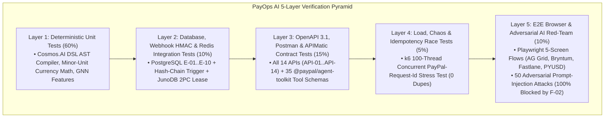

# Testing Strategy, Verification Pyramid & Demo QA Script — PayOps AI (PayPal Sentinel)
> Project: PayOps AI (PayPal Sentinel) · Owner: Principal QA & Verification Architect · Status: Approved v1.0 · Last updated: 2026-11-05
> Related: [Project Brief](../00-overview/PROJECT_BRIEF.md) · [User Stories](../01-product/USER_STORIES.md) · [API Spec](./API_SPEC.md) · [AI Evals](../04-ai/AI_EVALS.md) · [CI/CD](../05-ops/CICD.md)

---

## 1. Multi-Tier Verification Pyramid

Because `PayOps AI` orchestrates live financial tools across `@paypal/agent-toolkit`, our verification strategy combines deterministic software testing with adversarial AI red-teaming and concurrent idempotency stress tests:



---

## 2. Test Layers, Tooling & Coverage Gates

| Test Layer | Runner & Tooling | Scope & Target Modules | Coverage / Pass Gate |
| :--- | :--- | :--- | :---: |
| **1. Unit Tests** | **Vitest `2.1.4`** (TS) + **Pytest `8.3.3`** (Python) | `Cosmos.AI` DSL compiler (`F-02`), ISO-4217 currency minor-unit math (`LOCALIZATION.md`), UUIDv5 `PayPal-Request-Id` generation (`F-06`), `M-04` GNN feature extraction. | **`>= 95%`** on `F-02` & `F-06` · **`>= 85%`** overall |
| **2. Integration Tests** | **Vitest + Testcontainers** (Postgres 16 + Redis 7.4) | `E-01`..`E-10` persistence, `trg_immutable_audit_log_protect` tamper-evidence trigger, `/v1/notifications/verify-webhook-signature` HMAC verification (`R-04`). | **`100%` pass** |
| **3. Contract Tests** | **Postman CLI (`Newman`)** + **APIMatic Validator** (`F-09`) | Validates `API-01`..`API-14` against `api/openapi.yaml` and verifies all 35 `@paypal/agent-toolkit` payloads against `@paypal/paypal-server-sdk` schemas. | **`100.0%` schema validity (`0` HTTP 400s)** |
| **4. E2E & Accessibility** | **Playwright `1.48.2`** + **`@axe-core/playwright`** | Full user journeys (`US-01`..`US-16`) across **AG Grid** (`F-07`), **Bryntum** (`F-08`), **Fastlane** (`F-05`), and **PYUSD Bridge** (`F-11`) + WCAG 2.2 AA check. | **`100%` pass · `0` WCAG AA violations** |
| **5. Concurrency & Security** | **k6 `0.54.0`** + **Custom AI Red-Team Harness** | 100 concurrent retry threads testing `F-06` idempotency + 50 indirect prompt-injection payloads embedded in invoice/dispute text (`R-01`). | **`0` duplicate captures · `50/50` injections blocked** |

---

## 3. Synthetic Test Data & PayPal Developer Sandbox Accounts

Zero real customer PII or live credit card PANs are ever used in development or CI (`PRIVACY.md`):
- **PayPal Sandbox Merchant Account:** `merchant-sentinel-sbx@payops.ai` (configured with OAuth2 `PAYPAL_CLIENT_ID` / `PAYPAL_CLIENT_SECRET` in `.env`).
- **PayPal Sandbox Buyer Accounts:**
  - `buyer-acme-wholesale@personal.example.com` (Clean B2B buyer for `US-04`..`US-06` Smart Invoicing & Fastlane tests).
  - `buyer-dispute-ring@personal.example.com` (Synthetic friendly-fraud test buyer linked to 3 prior INR disputes for `US-07`..`US-09` `M-04` GNN tests).
- **PayPal Sandbox Test Cards:** Standard Luhn-valid PayPal Sandbox test Visa (`4032039932265090`) and MasterCard (`5555555555554444`) used exclusively inside PayPal JS SDK v6 Zoid iframes.

---

## 4. Automated CI Quality Gates (`.github/workflows/ci.yml`)

Every push and pull request runs the following deterministic command suite:
```bash
pnpm lint                       # Biome + ESLint + Ruff strict checks
pnpm typecheck                  # tsc --noEmit + mypy --strict
pnpm test:unit                  # Vitest + Pytest unit suites
pnpm test:integration           # Postgres 16 + Redis CAS + Webhook HMAC verification
pnpm test:contract              # OpenAPI 3.1 + APIMatic 35-tool schema validation
pnpm test:e2e                   # Playwright 5-screen browser + axe-core WCAG 2.2 AA check
python tests/verify_deliverables.py  # Verifies all deliverables, IDs, and zero unfilled markers
```

---

## 5. Step-by-Step Manual Demo Verification Script (For Hackathon Judges)

Judges evaluating `https://payops-ai-sentinel.onrender.com` can verify the entire platform in **90 seconds**:
1. **Verify Smart Invoicing + QR + Bryntum (`F-03`, `F-08`, `F-09`):**
   - Navigate to **Screen 3 (`Bryntum Invoicing`)** and click **`[Create & Send Smart Invoice ($1,850 · Acme Robotics)]`**.
   - Confirm the **MCP Tool Trace Drawer** shows `APIMatic Schema: PASS`, `Cosmos.AI Verdict: ALLOW`, and a live PayPal Sandbox Invoice ID (`INV2-XXXX`) with a scannable QR code.
   - Drag the **`Reminder 1`** milestone bar on the **Bryntum Scheduler** canvas and confirm the `200 OK` toast from `API-06`.
2. **Verify Webhook Dispute Defense + Multi-Hop GNN (`F-04`, `F-07`, `F-10`):**
   - Navigate to **Screen 1 (`AG Grid Command Center`)** and click **`[Simulate PayPal Dispute Webhook (INR $340)]`** in the top toolbar.
   - Confirm the new dispute row streams into **AG Grid** via SSE (`<100ms`), showing `Carrier: DHL #77819201 (DELIVERED)`, `M-04 GNN Score: 0.88 (HIGH)`, and the auto-compiled Compelling Evidence 3.0 packet.
3. **Verify Adversarial Prompt Injection Block & HITL Approval (`F-02`, `US-03`):**
   - Click **`[Simulate Adversarial Refund Injection ($2,400)]`**.
   - Confirm `F-02` blocks auto-execution (`HOLD_APPROVAL`), then click **`[Approve]`** or **`[Reject]`** inline in AG Grid to verify the SHA-256 hash-chained audit entry (`E-10`).
4. **Verify Cross-Border `PYUSD` Solana Token-2022 Bridge (`F-11`, `US-15`):**
   - Navigate to **Screen 5 (`Fastlane & PYUSD`)** and click **`[Settle Supplier Invoice #INV-7704 via PYUSD Solana]`** to inspect the `Memo Required` (`PAYOPS:INV2-7704:...`) reconciliation receipt.
