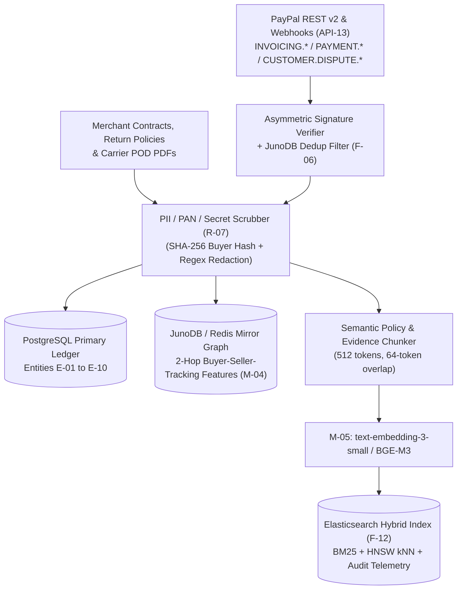

# Data Pipeline, RAG Architecture & Synthetic Sandbox Seeding (`DATA_PIPELINE.md`)
> Project: PayOps AI (PayPal Sentinel) · Owner: Data Platform & RAG Lead · Status: Approved v1.0 · Last updated: 2026-11-05
> Related: [Project Brief](../00-overview/PROJECT_BRIEF.md) · [PRD](../01-product/PRD.md) · [Architecture](../03-engineering/ARCHITECTURE.md) · [Data Model](../03-engineering/DATA_MODEL.md) · [Models](./MODELS.md)

## 1. Data Pipeline Overview

The **PayOps AI (`PayPal Sentinel`)** data pipeline ingests real-time PayPal Sandbox/Live webhook events (`API-13`), historical ledger polls via `@paypal/agent-toolkit` (`list_transactions`, `list_invoices`, `list_disputes`), merchant policy documents, and shipping carrier proofs (`M-03`), transforming them into:
1. **ACID Relational State in PostgreSQL (`E-01`..`E-10`)**
2. **Sub-10ms 2-Hop Mirror Graph Features in `JunoDB`/Redis (`F-06`, `F-10`, `M-04`)**
3. **Hybrid Lexical + Dense Vector RAG Indexes in Elasticsearch (`F-12`, `M-05`) & `pgvector`**



---

## 2. Authoritative Data Sources & Licenses

| Source ID | Data Source | URL / Access Mechanism | License / Terms | Usage in `MVP (hackathon)` vs `v1 (production)` |
|---|---|---|---|---|
| **DS-01** | **PayPal Developer Sandbox APIs & Webhooks** | `https://api-m.sandbox.paypal.com` (`@paypal/agent-toolkit` & `@paypal/paypal-server-sdk`) | PayPal Developer Agreement | **MVP**: Live Sandbox Orders v2, Invoicing v2, Disputes v1, Tracking v1, Subscriptions v1.<br>**v1**: Production `https://api-m.paypal.com` endpoints. |
| **DS-02** | **PayPal Dispute Compelling Evidence Corpus** | `https://developer.paypal.com/docs/disputes/` | Public Developer Documentation | Indexed into `M-05` RAG store to ground `M-01` dispute rebuttals (`F-04`) by exact PayPal reason code. |
| **DS-03** | **APIMatic PayPal OpenAPI & SDK Schemas** | `https://www.apimatic.io/` / `@paypal/paypal-server-sdk` | MIT / Apache-2.0 | Powers deterministic tool payload validation (`F-09`) and eliminates hallucinated REST v2 fields (`R-03`). |
| **DS-04** | **Synthetic SMB Commerce & Friendly-Fraud Graph (`seed-sandbox.ts`)** | `scripts/seed-sandbox.ts` | MIT (Internal Synthetic Generator) | Seeds 50 catalog items, 120 invoices (`E-07`), 200 orders (`E-06`), and 25 dispute cases (`E-08`) with zero real PII. |
| **DS-05** | **IEEE-CIS Fraud Detection & PayPal Graph Topology Priors** | `https://www.kaggle.com/c/ieee-fraud-detection` | Competition / Research Benchmark | Used offline to calibrate `M-04` (`GraphSAGE + LightGBM`) feature distributions and velocity thresholds (`FINE_TUNING.md`). |
| **DS-06** | **Channel3 Retail Product Catalog Feed (`F-12`)** | `https://www.channel3.com` (Sponsor API / MCP) | Sponsor Hackathon Access | Normalized product metadata for agentic B2B/SMB catalog seeding (`F-05`, `F-12`). |

---

## 3. Ingestion, PII Scrubbing & Tokenization Pipeline (`R-07`, `PRIVACY.md`)

To maintain **PCI-DSS v4.0 SAQ-A** eligibility and strict **India DPDP Act 2023 / GDPR** compliance, PayOps AI enforces a mandatory **Pre-Storage & Pre-LLM Scrubbing Stage** (`services/api/src/pipeline/pii-scrubber.ts`):

1. **Zero Primary Account Number (PAN) Ingestion**: PayPal hosts all card/bank entry via Smart Payment Buttons, Fastlane, and Hosted Fields (`ADR-0005`). If a buyer inadvertently types a 13–19 digit Luhn-valid card number or Indian Aadhaar number (12 digits) inside an invoice memo or dispute message, the regex + Luhn filter replaces it with `[REDACTED_PAYMENT_IDENTIFIER]` before database persistence or LLM context assembly.
2. **Pseudonymous Buyer Graph Hashing (`E-06`, `E-08`)**: Buyer email addresses and shipping street lines are salted and hashed (`HMAC-SHA256` with workspace KMS key) into `buyer_hash` and `address_hash` before populating the `JunoDB`/Redis Mirror Graph (`M-04`). This enables cross-transaction friendly-fraud ring detection without exposing raw PII to the graph scorer.
3. **Secret & Token Stripping**: Outbound logs and Elastic telemetry streams (`F-12`) automatically strip `Authorization`, `PAYPAL_CLIENT_SECRET`, `PayPal-Auth-Assertion`, and OAuth2 bearer tokens.

---

## 4. Hybrid RAG Architecture (`M-05` + Elasticsearch + `pgvector`)

### 4.1 Chunking & Metadata Enrichment Strategy
Merchant contracts, return policies, past winning dispute rebuttals, and PayPal Seller Protection rules are processed through a structure-aware markdown/PDF chunker:
- **Chunk Size**: `512 tokens` with `64-token` sliding window overlap.
- **Preserved Boundaries**: Markdown tables, JSON policy blocks, and legal clause numbers (`Section 4.2`) are never split mid-clause.
- **Metadata Tags Attached to Every Chunk**:
  ```json
  {
    "workspace_id": "ws_99102a",
    "doc_category": "DISPUTE_POLICY | MERCHANT_MSA | INVOICE_DUNNING_RULE | PAYPAL_SELLER_PROTECTION",
    "dispute_reason_code": "MERCHANDISE_OR_SERVICE_NOT_RECEIVED",
    "jurisdiction": "US | IN | EU | UK | GLOBAL",
    "currency_scope": ["USD", "INR", "EUR", "PYUSD"],
    "effective_date": "2026-10-01"
  }
  ```

### 4.2 Hybrid Retrieval & Reciprocal Rank Fusion (RRF)
When `M-01` prepares a dispute response (`API-11`) or conditional invoice rule (`API-04`), the retrieval pipeline executes:
1. **Metadata Pre-Filtering**: Filters by `workspace_id` (strict multi-tenant isolation) and `dispute_reason_code`.
2. **Dual Retrieval in Elasticsearch (`F-12`)**:
   - **Lexical Search (`BM25`)**: Captures exact SKU numbers, invoice IDs (`INV2-...`), carrier names, and legal statute citations.
   - **Dense Vector Search (`HNSW kNN`, `1,536` dims from `M-05`)**: Captures semantic intent across multilingual buyer complaints.
3. **Reciprocal Rank Fusion (`RRF`, `k = 60`)**: Merges top-20 lexical and top-20 vector hits into the top-5 highest-relevance chunks injected into `M-01`'s `<verified_context>` window in `<65ms p95`.

---

## 5. Refresh Cadence, Data Lineage & Retention

| Pipeline Stage | Refresh Cadence | Lineage Tracking Mechanism | Retention Policy |
|---|---|---|---|
| **PayPal Webhook Ingestion (`API-13`)** | Real-time streaming (`<500ms` ingestion) | `webhook_event_id` → `AgentToolExecution (E-04)` → `ImmutableAuditLog (E-10)` | **180 days hot** in Elastic/Postgres (CERT-In & PCI-DSS v4.0 requirement); 7 years cold encrypted archive. |
| **Mirror Graph Feature Store (`M-04`)** | Synchronous update on every Order/Dispute event + 15-min rolling window | Redis/JunoDB key versioned by `graph_schema_v1.2` + source `order_id` | 90-day rolling behavioral window (pseudonymized SHA-256 hashes). |
| **Merchant Policy & Contract RAG (`M-05`)** | Incremental re-index within `5 seconds` of policy edit (`API-03`) | Document SHA-256 hash + `M-05` model version tag stored per vector record | Retained while `MerchantWorkspace (E-01)` is active; purged within 24 hours of workspace deletion request (`PRIVACY.md`). |
| **Synthetic Sandbox Seed (`scripts/seed-sandbox.ts`)** | On-demand via `pnpm seed:sandbox` | Tagged with `"is_synthetic_seed": true` in metadata | Resettable prior to live hackathon judging demos. |
