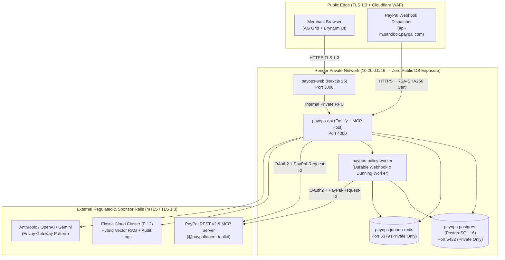

# Cloud Infrastructure, Network Topology & Data Residency (`INFRASTRUCTURE.md`)
> Project: PayOps AI (PayPal Sentinel) · Owner: Cloud Infrastructure & SRE Lead · Status: Approved v1.0 · Last updated: 2026-11-05
> Related: [Project Brief](../00-overview/PROJECT_BRIEF.md) · [PRD](../01-product/PRD.md) · [Architecture](../03-engineering/ARCHITECTURE.md) · [ADR-0004](../03-engineering/adr/ADR-0004-hosting-and-deployment.md) · [Deployment](./DEPLOYMENT.md) · [Cost](./COST.md)

## 1. Dual-Stage Hosting Strategy (`MVP (hackathon)` vs `v1 (production)`)

1. **`MVP (hackathon)` — Render Cloud Blueprint (`infra/render.yaml`)**:
   - Directly targets the **$2,250 Best Use of Render Sponsor Prize** (evaluated by **Shifra Williams**, Founding DevRel Engineer at Render).
   - Runs as a declarative 5-component Render Blueprint:
     1. `payops-web` (Next.js 15 App Router + AG Grid + Bryntum Executive Command Center)
     2. `payops-api` (Fastify + TypeScript + `@paypal/agent-toolkit` + PayPal MCP Server + `M-04` ONNX Graph Scorer)
     3. `payops-policy-worker` (Durable background worker for PayPal webhook ingestion, dunning schedules, and carrier tracking sync)
     4. `payops-postgres` (Managed PostgreSQL 16 with `pgvector` and append-only `ImmutableAuditLog` `E-10`)
     5. `payops-junodb-redis` (Managed Redis 7.4 implementing PayPal's `JunoDB` idempotent key-value state pattern `F-06`)
2. **`v1 (production)` — Multi-Region Google Cloud (GKE) + PayPal Enterprise Pattern**:
   - Mirrors PayPal's production hybrid cloud footprint (GCP `us-central1` + `asia-south1` Mumbai for RBI/DPDP India data residency + `europe-west1` Frankfurt for GDPR residency) with self-hosted **JunoDB (`paypal/junodb`)** storage/proxy clusters, **Apache Kafka** event streaming, and **Elasticsearch Cloud (`F-12`)**.

---

## 2. Network Topology & Private Service Mesh

---

## 3. Compute, Storage & Scaling Specifications

| Service Name | Runtime / Image | MVP Sizing (Render) | Production Sizing (GKE / Render Pro) | Auto-Scaling Rule |
|---|---|---|---|---|
| **`payops-web`** | Node.js 20.18 Alpine (`apps/web`) | `Starter` (0.5 vCPU, 512 MB RAM) | `Standard` (2 vCPU, 4 GB RAM, 2–8 replicas) | Scale out at `65% CPU` or `75% memory` over 60s. |
| **`payops-api`** | Node.js 20.18 + ONNX Runtime (`services/api`) | `Standard` (1 vCPU, 2 GB RAM) | `Pro` (4 vCPU, 8 GB RAM, 3–15 replicas) | Scale out at `60% CPU` or HTTP `p95 > 400ms`. |
| **`payops-policy-worker`** | Node.js 20.18 BullMQ / Render Worker | `Starter` (0.5 vCPU, 512 MB RAM) | `Standard` (2 vCPU, 4 GB RAM, 2–10 replicas) | Scale out when webhook/dunning queue depth `> 100 jobs`. |
| **`payops-postgres`** | Managed PostgreSQL 16 + `pgvector` | `Basic-1gb` (1 GB RAM, 15 GB NVMe SSD) | `Pro-16gb` HA Primary + Read Replica (500 GB SSD) | Automated storage expansion at `80%` disk utilization. |
| **`payops-junodb-redis`** | Managed Redis 7.4 (`allkeys-lru` / AOF) | `Starter` (256 MB RAM) | `Standard` HA Cluster (8 GB RAM) + `paypal/junodb` Go cluster | Alerts at `75%` memory; strict TTL on idempotency keys (`86,400s`). |

---

## 4. Regional Data Residency (`India RBI / DPDP` & `EU GDPR`)

In `v1 (production)`, workspace records (`E-01`..`E-10`) are partitioned by `MerchantWorkspace.jurisdiction_region`:
- **India Region (`IN` — GCP `asia-south1` Mumbai)**: Complies with the **RBI Storage of Payment System Data Directive (April 2018)**, **CERT-In 180-day Indian log retention**, and **DPDP Act 2023**. All Indian merchant invoices (`E-07`), orders (`E-06`), disputes (`E-08`), and audit logs (`E-10`) remain exclusively on Mumbai storage volumes.
- **US Region (`US` — Render Oregon `us-west` / GCP `us-central1`)**: Default region for the hackathon MVP and North American merchants.
- **EU Region (`EU` — Render Frankfurt `eu-central` / GCP `europe-west3`)**: Enforces GDPR data localization for EEA merchants.

---

## 5. Backups, Disaster Recovery & Sponsor Credit Optimization

1. **Automated Backups & Point-in-Time Recovery (PITR)**:
   - PostgreSQL continuous WAL archiving to encrypted object storage with **7-day PITR** in MVP and **35-day cross-region PITR** in production (`RPO < 5 minutes`, `RTO < 15 minutes`).
2. **Sponsor Credit Optimization**:
   - **Render Credits ($2,250 prize pool + free developer tier)**: Covers 100% of hackathon hosting and 12+ months of staging/pilot infrastructure.
   - **Elastic Cloud Trial**: Hosts the hybrid RAG index (`M-05`) and 180-day audit telemetry index (`F-12`) at zero MVP cost.
   - **APIMatic Free Hackathon Access**: Powers deterministic PayPal Server SDK generation and MCP Context Plugins (`F-09`).
