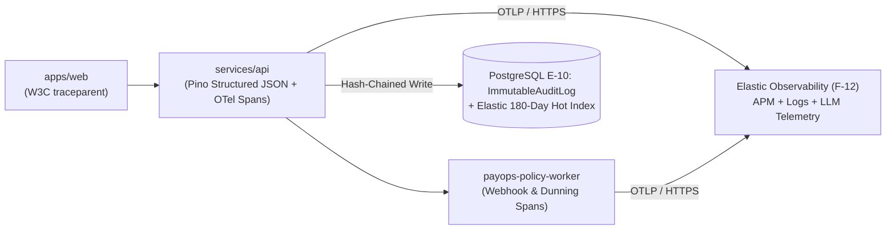

# Observability, Distributed Tracing & Audit Retention (`OBSERVABILITY.md`)
> Project: PayOps AI (PayPal Sentinel) · Owner: Observability & Telemetry Lead · Status: Approved v1.0 · Last updated: 2026-11-05
> Related: [Project Brief](../00-overview/PROJECT_BRIEF.md) · [PRD](../01-product/PRD.md) · [Architecture](../03-engineering/ARCHITECTURE.md) · [Models](../04-ai/MODELS.md) · [Runbook](./RUNBOOK.md) · [Compliance](../06-security-compliance/COMPLIANCE.md)

## 1. Unified Observability Stack (`Elastic` + `OpenTelemetry`)

**PayOps AI (`PayPal Sentinel`)** integrates **Elastic APM & Elasticsearch (`F-12`)** (aligned with judge **Carly Richmond**, Senior Manager of Developer Advocacy at Elastic) alongside the **OpenTelemetry (`@opentelemetry/sdk-node`)** standard to provide end-to-end correlation across:
1. **Frontend UI interactions** in the AG Grid Command Center (`F-07`) and Bryntum Scheduler (`F-08`)
2. **LLM Gateway & Agent Tool Spans** (`M-01`..`M-05`)
3. **Deterministic Policy Firewall Evaluations (`F-02`) & `JunoDB` Idempotency Locks (`F-06`)**
4. **Outbound PayPal REST v2 Calls (`PayPal-Debug-Id` capture)**



---

## 2. Structured PII-Redacted Logging (`Pino` + `Elastic ECS`)

All services emit structured JSON logs adhering to the **Elastic Common Schema (ECS)** with mandatory PII/secret redaction (`R-07`):
- **Redacted Paths**: `req.headers.authorization`, `*.client_secret`, `*.payer.email_address`, `*.shipping.address.address_line_1`, `*.card.number`.
- **Mandatory Correlation Keys in Every Log Line**:
  ```json
  {
    "@timestamp": "2026-11-05T08:15:22.419Z",
    "log.level": "info",
    "service.name": "payops-api",
    "trace.id": "4bf92f3577b34da6a3ce929d0e0e4736",
    "span.id": "00f067aa0ba902b7",
    "workspace_id": "ws_99102a",
    "agent_session_id": "ses_88210f",
    "execution_id": "exec_77412c",
    "paypal_request_id": "idem_ws99102a_inv_2026_8841_send",
    "paypal_debug_id": "f4183d92a110b",
    "mcp_tool": "send_invoice",
    "policy_verdict": "APPROVED_L3_AUTO",
    "gnn_risk_score": 0.08,
    "latency_ms": 342
  }
  ```

---

## 3. LLM & Agentic Commerce Telemetry (`M-01` to `M-05`)

Following **PayPal `Cosmos.AI` Envoy Gateway** telemetry standards, every model invocation records custom OpenTelemetry attributes:
- `gen_ai.system`: `"anthropic" | "openai" | "google" | "onnx-local"`
- `gen_ai.request.model`: `"claude-3-5-sonnet-20241022"`
- `gen_ai.usage.input_tokens`, `gen_ai.usage.output_tokens`, `gen_ai.usage.cached_input_tokens`
- `payops.ai.cost_usd`: `0.0068`, `payops.ai.cost_inr`: `0.5712`
- `payops.mcp.selected_tools_count`: `6`
- `payops.security.injection_risk_score`: `0.01`
- `payops.apimatic.schema_valid`: `true`

---

## 4. Alert Rules & Thresholds

| Alert ID | Metric / Condition | Window | Severity | Automated Action & Notification |
|---|---|---|---|---|
| **ALT-01** | `payops.security.prompt_injection_blocked_total >= 3` per workspace | `5 min` | **SEV-2** | Downgrade workspace Autonomy Slider to `L2` (human approval required); page on-call via PagerDuty/Slack. |
| **ALT-02** | `paypal.webhook.signature_verification_failed_total >= 5` | `1 min` | **SEV-1** | Block source IP at WAF (`R-04`); trigger security runbook `RB-04`. |
| **ALT-03** | `paypal.api.http_429_rate_limit_ratio > 0.05` or `5xx > 0.02` | `2 min` | **SEV-2** | Enable exponential backoff + activate `FF_DEMO_OFFLINE_REPLAY_FALLBACK` (`R-06`). |
| **ALT-04** | `payops.junodb.duplicate_idempotency_conflict_total > 20` | `5 min` | **SEV-3** | Inspect retry loop in `payops-policy-worker` (`R-02`). |
| **ALT-05** | `payops.ai.workspace_hourly_token_spend_usd > $10.00` (`₹840`) | `1 hour` | **SEV-2** | Trip workspace token circuit breaker (`R-10`); switch `M-01` to cached fallback mode. |
| **ALT-06** | `payops.gnn.score_distribution_psi > 0.25` (Population Stability Index drift) | `24 hours` | **SEV-3** | Flag `M-04` for retraining review (`FINE_TUNING.md`). |

---

## 5. CERT-In 180-Day & PCI-DSS v4.0 Immutable Audit Retention (`E-10`)

To comply with **Indian CERT-In Cyber Security Directions (April 2022)** (requiring 180-day log retention synced to NTP servers) and **PCI-DSS v4.0 Requirement 10**:
1. **NTP Clock Synchronization**: All Render/GKE nodes synchronize system clocks via `chronyd` against `time.cloudflare.com` and `time.google.com` (and `samay1.nic.in` for Indian `asia-south1` deployments).
2. **Cryptographic Hash Chaining (`E-10: ImmutableAuditLog`)**: Every record written to `immutable_audit_logs` calculates `record_hash = SHA256(prev_record_hash || timestamp_iso || actor_id || tool_name || payload_sha256 || policy_verdict)`. Any tampering breaks the cryptographic chain and triggers an immediate **SEV-1** integrity alert during the hourly verification cron.
3. **180-Day Hot Index + 7-Year Cold WORM Archive**:
   - **Days 0–180**: Immediately searchable in PostgreSQL (`E-10`) and Elasticsearch (`F-12`, `US-16`).
   - **Days 181–2,555 (7 Years)**: Nightly exported to immutable Object Lock (`WORM` — Write Once, Read Many) encrypted cloud storage (`AES-256-GCM`).
