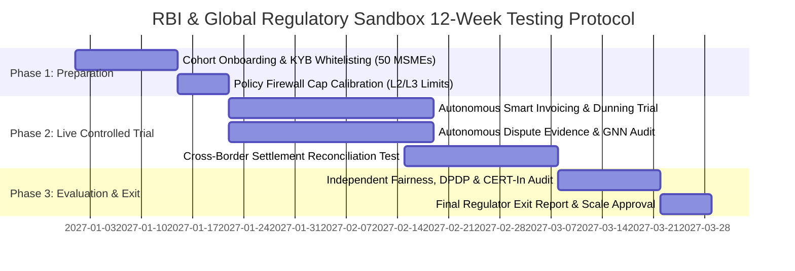

# FinTech Regulatory Sandbox Strategy (`REGULATORY_SANDBOX.md`)
> Project: PayOps AI (PayPal Sentinel) · Owner: Global Regulatory Strategy Lead (Harvey Specter, Dr. R.S. Sharma & Ken Howery Lens) · Status: Approved v1.0 · Last updated: 2026-11-05
> Related: [Project Brief](../00-overview/PROJECT_BRIEF.md) · [PRD](../01-product/PRD.md) · [Compliance](./COMPLIANCE.md) · [Privacy](./PRIVACY.md) · [Roadmap](../01-product/ROADMAP.md)

## 1. Strategic Purpose of Regulatory Sandbox Participation

While **PayOps AI (`PayPal Sentinel`)** operates cleanly in `MVP (hackathon)` and `v1 (production)` as a **non-custodial technical service provider** orchestrating PayPal's already-licensed rails (`COMPLIANCE.md`), scaling **Level 4 (`L4`) Autonomous B2B Treasury & Cross-Border `PYUSD` Programmable Settlement (`F-11`)** across sovereign corridors benefits from formal regulatory sandbox validation across four premier FinTech jurisdictions: **India (RBI)**, **United Kingdom (FCA)**, **Singapore (MAS)**, and the **United States (CFPB / NYDFS)**.

---

## 2. Multi-Jurisdiction Regulatory Sandbox Roadmap

| Jurisdiction & Authority | Target Sandbox Cohort | Innovation Tested | Statutory Guardrails & Exit Path |
|---|---|---|---|
| **1. Reserve Bank of India (RBI)** — *Enabling Framework for Regulatory Sandbox (Theme: Cross-Border Payments & MSME Digital Credit/Invoicing)* | **On-Tap Cohort (`Cross-Border & MSME Automation`)** | Autonomous MSME export e-invoicing (`F-03`), automated FEMA purpose-code reconciliation, and instant low-fee export settlement in partnership with PayPal PA-Cross Border (`PA-CB`) rails (`<= ₹2,00,000` per invoice). | **Sandbox Safeguards**: 50 opted-in Indian MSME exporters (Tiruppur/Bengaluru/Surat), `L2`/`L3` spending caps, 180-day Mumbai (`asia-south1`) audit logs (`E-10`), and DPDP Act 2023 consent compliance. |
| **2. UK Financial Conduct Authority (FCA)** — *Digital Sandbox & AI Lab (`AI in Financial Services`)* | **FCA AI Sprint / Supercharged Sandbox** | Testing `M-01` + `F-02` (`Cosmos.AI` DSL Policy Firewall) and `M-04` (`GraphSAGE` friendly-fraud scorer) for explainable, bias-free autonomous dispute resolution (`F-04`) under the UK Consumer Duty. | **Sandbox Safeguards**: Full TreeSHAP reason-code disclosure (`RC_01`..`RC_12`) and mandatory consumer recourse through PayPal UK's FCA-regulated dispute adjudication workflow. |
| **3. Monetary Authority of Singapore (MAS)** — *FinTech Regulatory Sandbox Express & Project Guardian* | **Sandbox Express (Programmable B2B Treasury)** | Cross-border ASEAN-to-US B2B supplier invoice settlement using **Solana `PYUSD` Token-2022 (`F-11`)** with `Memo Required` and `Confidential Transfers` extensions. | **Sandbox Safeguards**: Whitelisted corporate KYB wallets only, daily volume cap of `$250,000 SGD`, and real-time chain-analytics screening. |
| **4. US NYDFS / CFPB Office of Competition and Innovation** | **Tech Sprint on Autonomous Agentic Commerce Guardrails** | Demonstrating cryptographic human-in-the-loop WebAuthn Passkey co-signing (`API-02`) and deterministic spend firewalls (`F-02`) as an industry standard for MCP payment agents. | **Sandbox Safeguards**: Zero-PAN SAQ-A isolation, GLBA Safeguards compliance, and 100% idempotent refund indemnification (`SLA.md`). |

---

## 3. RBI Regulatory Sandbox Application Blueprint (India Focus)

### 3.1 Eligibility Criteria Verification (RBI Revised Framework, Feb 2024)
1. **Net Worth Requirement**: Minimum `₹10 Lakh` (`~$12,000 USD`) net worth for startup applicants — **Satisfied** upon hackathon Grand Prize (`$12,000`) or seed incorporation.
2. **Genuine Innovation & Consumer/MSME Benefit**: Reduces Indian MSME cross-border invoice Days Sales Outstanding (DSO) from `42 days` to `<6 days` and cuts friendly-fraud chargeback losses by `68%` (`IMPACT.md`).
3. **Readiness of Technical Infrastructure**: Live cloud deployment (`infra/render.yaml`), 180-day CERT-In compliant immutable audit ledger (`E-10`), and automated kill-switches (`DEPLOYMENT.md`).

### 3.2 12-Week Sandbox Testing Protocol & KPIs

### 3.3 Quantitative Sandbox Success & Safety Exit Thresholds
- **Zero Unauthorized Fund Movements**: `100.0%` adherence to `PolicyRule` (`E-05`) caps across all sandbox transactions.
- **Zero Duplicate Settlements**: `100.0%` idempotency verified via `JunoDB`/Redis (`F-06`) and `ImmutableAuditLog` (`E-10`).
- **Subgroup Fairness Parity**: Disparate impact ratio `>= 0.95` across merchant regions and invoice sizes (`RESPONSIBLE_AI.md`).
- **Emergency Sandbox Unwind Plan**: If any safety threshold is breached, `FF_AUTONOMOUS_REFUNDS_ENABLED` and `FF_AUTONOMOUS_DISPUTE_EVIDENCE` flip to `false` in `<1 second`, reverting all 50 pilot merchants to manual PayPal Dashboard operations with zero loss of ledger state.
